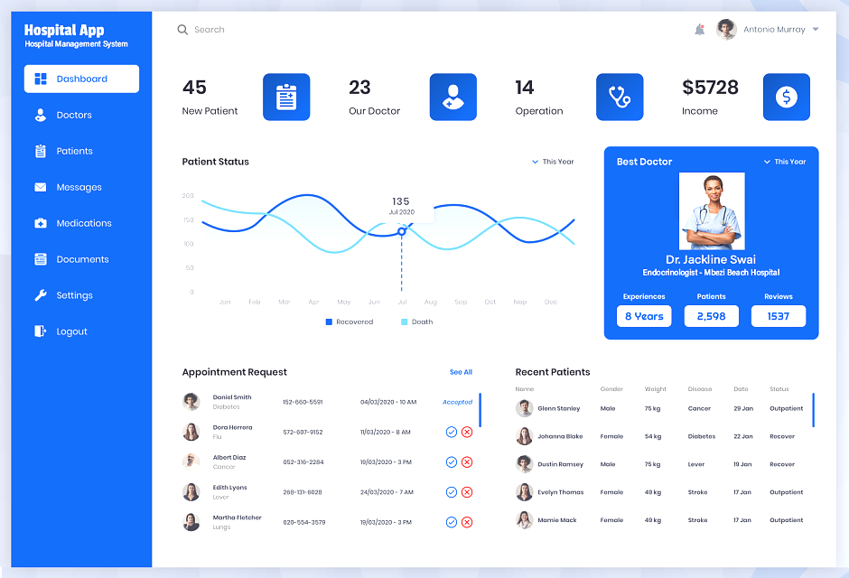
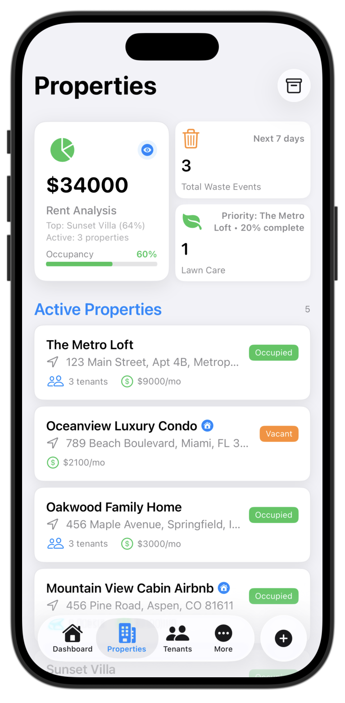

# Matiur Rahaman | Full-Stack Developer

<p align="center">
  <a href="https://github.com/matiur25580/Developer-Portfolio"></a>
  <a href="https://github.com/matiur25580"></a>
  <a href="mailto:rahamanmatiur397@gmail.com"></a>
</p>

<p align="center">
  <strong>Building useful web products, thoughtful user experiences, and full-stack solutions.</strong><br>
  React · TypeScript · Node.js · Express · MongoDB · AI Integrations
</p>

---

## About

I'm **Matiur Rahaman**, a full-stack developer based in West Bengal, India. I enjoy designing and building web applications that bring together clean interfaces, reliable APIs, data-driven workflows, and practical integrations.

This repository contains my personal portfolio website and a curated overview of **15 GitHub projects** across recruitment, AI tools, fintech, logistics, healthcare, e-commerce, collaboration, and business operations.

- **Portfolio source:** [Developer-Portfolio](https://github.com/matiur25580/Developer-Portfolio)
- **GitHub:** [github.com/matiur25580](https://github.com/matiur25580)
- **Email:** [rahamanmatiur397@gmail.com](mailto:rahamanmatiur397@gmail.com)
- **Location:** West Bengal, India

## Portfolio at a Glance

| | |
|---|---|
| **Projects showcased** | 15 public repositories |
| **Core focus** | Full-stack web development |
| **Frontend** | React, TypeScript, JavaScript, Preact, Vite |
| **Backend** | Node.js, Express.js, REST APIs, PHP |
| **Data** | MongoDB, Mongoose, MySQL |
| **Interests** | AI-assisted products, secure workflows, dashboards, real-time apps |

## Featured Work

A selection of projects from the full catalogue. Open a repository to explore its source code, setup instructions, screenshots, and implementation notes.

| Project | Area | Technology / focus |
|---|---|---|
| [HireFlow — ATS Recruitment System](https://github.com/matiur25580/ats-recruitment-system) | Recruitment · AI | React, TypeScript, Node.js, Express, MongoDB, Gemini |
| [TrustShield — Banking Fraud Detection](https://github.com/matiur25580/Enterprise-AI-Powered-Digital-Banking-Fraud-Detection-DevOps-Command-Center) | FinTech · Security | MERN, JWT, OTP, real-time workflows |
| [FleetCommand — Logistics & Supply Chain](https://github.com/matiur25580/Enterprise-AI-Powered-Logistics-Fleet-Supply-Chain-Command-Center) | Enterprise · Logistics | React, Node.js, Express, MongoDB, Socket.IO |
| [CityCare Hospital Management](https://github.com/matiur25580/hospital-management-system) | Healthcare | MERN, JWT, OTP, hospital workflows |
| [Smart HR & Payroll](https://github.com/matiur25580/enterprise-hr-payroll-system) | HR · Enterprise | TypeScript, Preact, Express, MongoDB |
| [Multi-Vendor Marketplace](https://github.com/matiur25580/Enterprise-AI-Powered-Multi-Vendor-Marketplace-Seller-Ecosystem-Command-Center) | E-commerce | MERN, MongoDB, Brevo OTP |
| [SmartGadget Lifestyle MegaStore](https://github.com/matiur25580/Enterprise-AI-Powered-SmartGadget-Lifestyle-MegaStore-Command-Center) | E-commerce | MERN, JWT, OTP |
| [Draftline AI Writing Studio](https://github.com/matiur25580/ai-saas-generator) | AI · SaaS | React, Vite, Express, MongoDB, Gemini |
| [FinTech Smart Invoice & Expense](https://github.com/matiur25580/FinTech-Smart-Invoice-Expense-Supplier-Payment-System) | FinTech | React, TypeScript, Node.js, Express, MongoDB |
| [Cyber Security Operations Command Center](https://github.com/matiur25580/Enterprise-AI-Powered-Cyber-Security-Operations-Command-Center) | Cybersecurity | React, Vite, TypeScript, Node.js, Express, MongoDB |

## All 15 Repositories

Every project below is included in the portfolio's searchable Projects page.

### Enterprise platforms

| # | Project | Overview | Repository |
|---:|---|---|---|
| 01 | **TrustShield — Digital Banking & Fraud Detection** | Banking-style user workflows, role-based dashboards, OTP authentication, KYC and fraud-monitoring concepts. | [Source](https://github.com/matiur25580/Enterprise-AI-Powered-Digital-Banking-Fraud-Detection-DevOps-Command-Center) |
| 02 | **FleetCommand — Logistics & Supply Chain** | Fleet, trips, warehouse and supply-chain operations with real-time and forecasting-oriented workflows. | [Source](https://github.com/matiur25580/Enterprise-AI-Powered-Logistics-Fleet-Supply-Chain-Command-Center) |
| 03 | **Smart HR & Payroll Management** | Employee self-service, attendance, leave and payroll workflows. | [Source](https://github.com/matiur25580/enterprise-hr-payroll-system) |
| 04 | **Real Estate Management System** | Property, rental and real-estate management workflows. | [Source](https://github.com/matiur25580/realestate-management-system) |
| 05 | **CityCare Hospital Management** | Patient registration, appointments, clinical and hospital operations. | [Source](https://github.com/matiur25580/hospital-management-system) |

### AI, finance & commerce

| # | Project | Overview | Repository |
|---:|---|---|---|
| 06 | **HireFlow — ATS Recruitment System** | Candidate and recruiter workflows, resume handling and Gemini-assisted resume-to-job analysis. | [Source](https://github.com/matiur25580/ats-recruitment-system) |
| 07 | **Draftline AI Writing Studio** | AI-assisted content generation, verified accounts, generation history and credit-related workflows. | [Source](https://github.com/matiur25580/ai-saas-generator) |
| 08 | **SmartGadget Lifestyle MegaStore** | Smart-gadget e-commerce catalogue, seller product workflows and cash-on-delivery ordering. | [Source](https://github.com/matiur25580/Enterprise-AI-Powered-SmartGadget-Lifestyle-MegaStore-Command-Center) |
| 09 | **Multi-Vendor Marketplace Seller Ecosystem** | Buyer, seller, logistics and finance-oriented marketplace workflows. | [Source](https://github.com/matiur25580/Enterprise-AI-Powered-Multi-Vendor-Marketplace-Seller-Ecosystem-Command-Center) |
| 10 | **FinTech Smart Invoice & Expense System** | Invoice, expense and supplier-payment management workflows. | [Source](https://github.com/matiur25580/FinTech-Smart-Invoice-Expense-Supplier-Payment-System) |
| 11 | **Cyber Security Operations Command Center** | Security operations command-center foundation and monitoring-oriented interface. | [Source](https://github.com/matiur25580/Enterprise-AI-Powered-Cyber-Security-Operations-Command-Center) |

### Collaboration & web applications

| # | Project | Overview | Repository |
|---:|---|---|---|
| 12 | **Real-Time Chat & Collaboration Hub** | Authenticated chat, online-user presence and real-time messaging. | [Source](https://github.com/matiur25580/Enterprise-Real-Time-Chat-Collaboration-Hub) |
| 13 | **Trello Clone** | Kanban-inspired boards and task organization. | [Source](https://github.com/matiur25580/Trello-Clone) |
| 14 | **Online Food Ordering System** | Restaurant/menu and food-ordering website built as an academic team project. | [Source](https://github.com/matiur25580/Online-Food-Ordering-System-main) |
| 15 | **Developer Portfolio** | This personal portfolio website and searchable project showcase. | [Source](https://github.com/matiur25580/Developer-Portfolio) |

> **Transparency note:** These repositories represent projects at different stages of implementation. The descriptions above summarize their focus; they do not imply that every planned feature or integration is complete or production-deployed. Please refer to each repository's README and source code for its current status. The Online Food Ordering System was an academic team project; my documented contribution was frontend UI work. The Cyber Security Command Center is an evolving project, so its broader SOC/SIEM/SOAR/GRC direction should not be mistaken for a fully implemented feature set.

## Complete Project Visual Gallery

All **15 projects** are listed in one vertical column. Where a project has a real screenshot or image asset in its own repository (or an existing project preview), that exact image is used here and in the portfolio Projects page. No new decorative mockup covers are used. For projects without a committed screenshot, the gallery says so rather than showing an unrelated or invented image.

<table>
<tr>
<td align="center" width="100%">
<h3>01 · HireFlow — ATS Recruitment System</h3>
<a href="https://github.com/matiur25580/ats-recruitment-system"></a><br>
<a href="https://github.com/matiur25580/ats-recruitment-system"><strong>View repository ↗</strong></a>
</td>
</tr>
<tr>
<td align="center" width="100%">
<h3>02 · Developer Portfolio</h3>
<p><em>No dedicated portfolio screenshot is currently committed.</em></p><br>
<a href="https://github.com/matiur25580/Developer-Portfolio"><strong>View repository ↗</strong></a>
</td>
</tr>
<tr>
<td align="center" width="100%">
<h3>03 · TrustShield — Banking Fraud Detection</h3>
<a href="https://github.com/matiur25580/Enterprise-AI-Powered-Digital-Banking-Fraud-Detection-DevOps-Command-Center"></a><br>
<a href="https://github.com/matiur25580/Enterprise-AI-Powered-Digital-Banking-Fraud-Detection-DevOps-Command-Center"><strong>View repository ↗</strong></a>
</td>
</tr>
<tr>
<td align="center" width="100%">
<h3>04 · FleetCommand — Logistics & Supply Chain</h3>
<a href="https://github.com/matiur25580/Enterprise-AI-Powered-Logistics-Fleet-Supply-Chain-Command-Center"></a><br>
<a href="https://github.com/matiur25580/Enterprise-AI-Powered-Logistics-Fleet-Supply-Chain-Command-Center"><strong>View repository ↗</strong></a>
</td>
</tr>
<tr>
<td align="center" width="100%">
<h3>05 · SmartGadget Lifestyle MegaStore</h3>
<a href="https://github.com/matiur25580/Enterprise-AI-Powered-SmartGadget-Lifestyle-MegaStore-Command-Center"></a><br>
<a href="https://github.com/matiur25580/Enterprise-AI-Powered-SmartGadget-Lifestyle-MegaStore-Command-Center"><strong>View repository ↗</strong></a>
</td>
</tr>
<tr>
<td align="center" width="100%">
<h3>06 · CityCare Hospital Management</h3>
<a href="https://github.com/matiur25580/hospital-management-system"></a><br>
<a href="https://github.com/matiur25580/hospital-management-system"><strong>View repository ↗</strong></a>
</td>
</tr>
<tr>
<td align="center" width="100%">
<h3>07 · Draftline AI Writing Studio</h3>
<p><em>No screenshot is currently committed in this project's repository.</em></p><br>
<a href="https://github.com/matiur25580/ai-saas-generator"><strong>View repository ↗</strong></a>
</td>
</tr>
<tr>
<td align="center" width="100%">
<h3>08 · Real Estate Management System</h3>
<a href="https://github.com/matiur25580/realestate-management-system"></a><br>
<a href="https://github.com/matiur25580/realestate-management-system"><strong>View repository ↗</strong></a>
</td>
</tr>
<tr>
<td align="center" width="100%">
<h3>09 · Real-Time Chat & Collaboration Hub</h3>
<p><em>No screenshot is currently committed in this project's repository.</em></p><br>
<a href="https://github.com/matiur25580/Enterprise-Real-Time-Chat-Collaboration-Hub"><strong>View repository ↗</strong></a>
</td>
</tr>
<tr>
<td align="center" width="100%">
<h3>10 · Trello Clone</h3>
<a href="https://github.com/matiur25580/Trello-Clone"></a><br>
<a href="https://github.com/matiur25580/Trello-Clone"><strong>View repository ↗</strong></a>
</td>
</tr>
<tr>
<td align="center" width="100%">
<h3>11 · Online Food Ordering System</h3>
<a href="https://github.com/matiur25580/Online-Food-Ordering-System-main"></a><br>
<a href="https://github.com/matiur25580/Online-Food-Ordering-System-main"><strong>View repository ↗</strong></a>
</td>
</tr>
<tr>
<td align="center" width="100%">
<h3>12 · Smart HR & Payroll Management</h3>
<a href="https://github.com/matiur25580/enterprise-hr-payroll-system"></a><br>
<a href="https://github.com/matiur25580/enterprise-hr-payroll-system"><strong>View repository ↗</strong></a>
</td>
</tr>
<tr>
<td align="center" width="100%">
<h3>13 · Multi-Vendor Marketplace Seller Ecosystem</h3>
<a href="https://github.com/matiur25580/Enterprise-AI-Powered-Multi-Vendor-Marketplace-Seller-Ecosystem-Command-Center"></a><br>
<a href="https://github.com/matiur25580/Enterprise-AI-Powered-Multi-Vendor-Marketplace-Seller-Ecosystem-Command-Center"><strong>View repository ↗</strong></a>
</td>
</tr>
<tr>
<td align="center" width="100%">
<h3>14 · FinTech Smart Invoice & Expense System</h3>
<a href="https://github.com/matiur25580/FinTech-Smart-Invoice-Expense-Supplier-Payment-System"></a><br>
<a href="https://github.com/matiur25580/FinTech-Smart-Invoice-Expense-Supplier-Payment-System"><strong>View repository ↗</strong></a>
</td>
</tr>
<tr>
<td align="center" width="100%">
<h3>15 · Cyber Security Operations Command Center</h3>
<p><em>No project screenshot is currently committed in this project's repository.</em></p><br>
<a href="https://github.com/matiur25580/Enterprise-AI-Powered-Cyber-Security-Operations-Command-Center"><strong>View repository ↗</strong></a>
</td>
</tr>
</table>

> **Image accuracy:** HireFlow and FinTech include concept/interface artwork documented in their own READMEs; SmartGadget uses an actual catalogue product image; Trello uses its application hero asset; Food Ordering uses the homepage screenshot already embedded in its README. The other available previews are existing project images. Four repositories currently have no dedicated screenshot: Developer Portfolio, Draftline AI, Real-Time Chat, and Cyber Security Command Center. Add genuine app screenshots to those repositories to complete their visual previews.

## Technology Stack

| Category | Technologies |
|---|---|
| **Frontend** | React, TypeScript, JavaScript, Preact, Vite, Tailwind CSS, HTML, CSS, Bootstrap |
| **Backend** | Node.js, Express.js, REST APIs, PHP |
| **Database** | MongoDB, Mongoose, MySQL |
| **Authentication** | JWT, bcrypt, OTP workflows, role-based access control |
| **Real-time & AI** | Socket.IO, Gemini API, AI-assisted workflows |
| **Tools & delivery** | Git, GitHub, GitHub Actions, Postman, Vercel, Render |

## Education

**B.Tech — Computer Science & Engineering**  
Bengal Institute of Technology, Kolkata · MAKAUT  
2019–2023

## Run This Portfolio Locally

The application source is organized in the `client` directory. To run the frontend locally:

```bash
cd client
npm install
npm run dev
```

To create a production build:

```bash
npm run build
```

Check the `client/package.json` and project configuration for the exact scripts and any environment variables required by your checkout.

## Connect

- **Email:** [rahamanmatiur397@gmail.com](mailto:rahamanmatiur397@gmail.com)
- **GitHub:** [matiur25580](https://github.com/matiur25580)
- **Portfolio source:** [Developer-Portfolio](https://github.com/matiur25580/Developer-Portfolio)

---

<p align="center">
  <strong>Designed and maintained by Matiur Rahaman</strong><br>
  <sub>Learning, building, improving — one project at a time.</sub>
</p>
