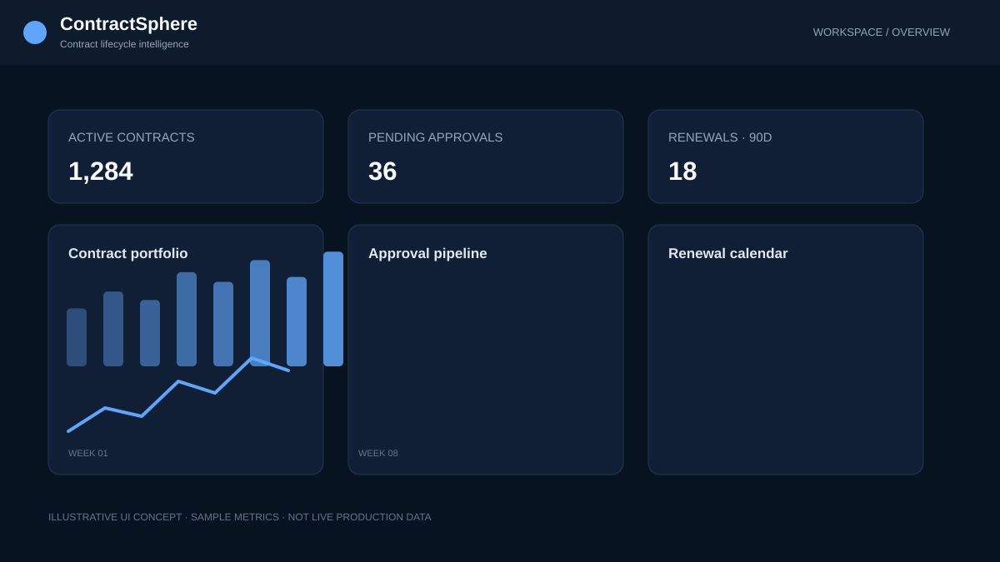
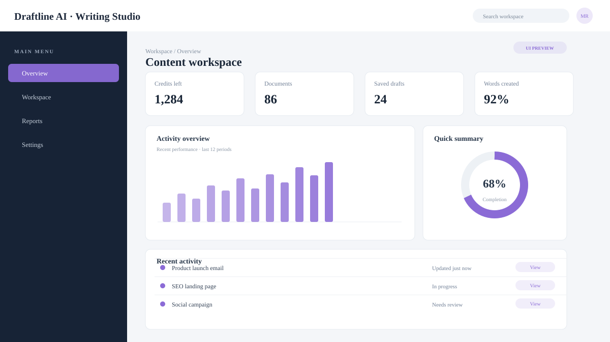
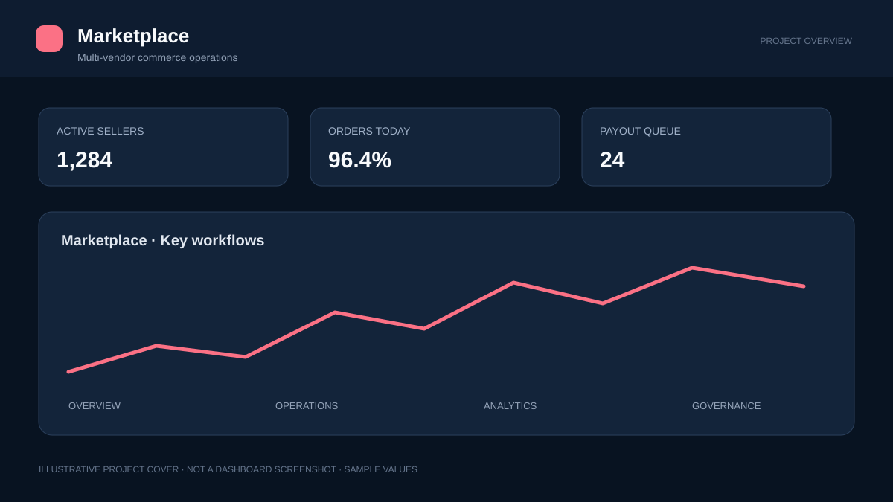
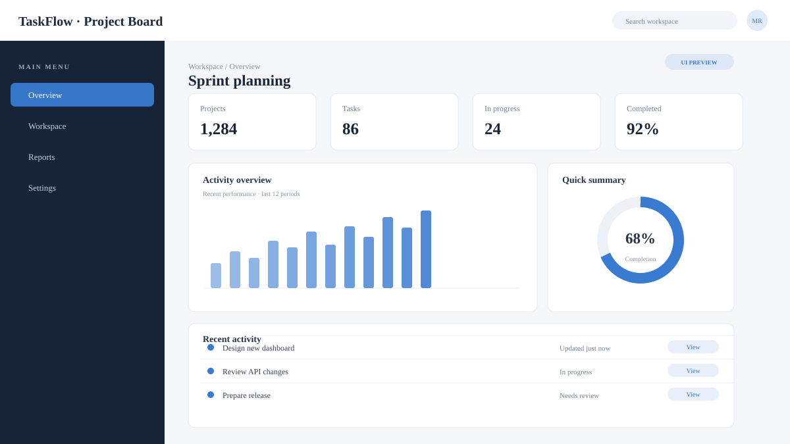

# Matiur Rahaman | Full-Stack Developer

<p align="center">
  <a href="https://github.com/matiur25580/Developer-Portfolio"></a>
  <a href="https://github.com/matiur25580"></a>
  <a href="mailto:rahamanmatiur397@gmail.com"></a>
</p>

<p align="center">
  <strong>Building useful web products, thoughtful user experiences, and full-stack solutions.</strong><br>
  React · TypeScript · Node.js · Express · MongoDB · AI Integrations
</p>

---

## Screenshots

No dashboard screenshots of the Developer Portfolio are included in this README. The project gallery below uses illustrative, project-specific cover artwork rather than captured portfolio dashboard screens.

## About

I'm **Matiur Rahaman**, a full-stack developer based in West Bengal, India. I enjoy designing and building web applications that bring together clean interfaces, reliable APIs, data-driven workflows, and practical integrations.

This repository contains my personal portfolio website and a curated overview of **24 GitHub projects** across recruitment, AI tools, fintech, logistics, healthcare, e-commerce, collaboration, and business operations.

- **Portfolio source:** [Developer-Portfolio](https://github.com/matiur25580/Developer-Portfolio)
- **GitHub:** [github.com/matiur25580](https://github.com/matiur25580)
- **Email:** [rahamanmatiur397@gmail.com](mailto:rahamanmatiur397@gmail.com)
- **Location:** West Bengal, India

## Portfolio at a Glance

| | |
|---|---|
| **Projects showcased** | 24 public repositories (excluding this portfolio) |
| **Core focus** | Full-stack web development |
| **Frontend** | React, TypeScript, JavaScript, Preact, Vite |
| **Backend** | Node.js, Express.js, REST APIs, PHP |
| **Data** | MongoDB, Mongoose, MySQL |
| **Interests** | AI-assisted products, secure workflows, dashboards, real-time apps |

## Featured Work

A selection of projects from the full catalogue. Open a repository to explore its source code, setup instructions, screenshots, and implementation notes.

| Project | Area | Technology / focus |
|---|---|---|
| [HireFlow — ATS Recruitment System](https://github.com/matiur25580/ats-recruitment-system) | Recruitment · AI | React, TypeScript, Node.js, Express, MongoDB, Gemini |
| [TrustShield — Banking Fraud Detection](https://github.com/matiur25580/Enterprise-AI-Powered-Digital-Banking-Fraud-Detection-DevOps-Command-Center) | FinTech · Security | MERN, JWT, OTP, real-time workflows |
| [FleetCommand — Logistics & Supply Chain](https://github.com/matiur25580/Enterprise-AI-Powered-Logistics-Fleet-Supply-Chain-Command-Center) | Enterprise · Logistics | React, Node.js, Express, MongoDB, Socket.IO |
| [CityCare Hospital Management](https://github.com/matiur25580/hospital-management-system) | Healthcare | MERN, JWT, OTP, hospital workflows |
| [Smart HR & Payroll](https://github.com/matiur25580/enterprise-hr-payroll-system) | HR · Enterprise | TypeScript, Preact, Express, MongoDB |
| [Multi-Vendor Marketplace](https://github.com/matiur25580/Enterprise-AI-Powered-Multi-Vendor-Marketplace-Seller-Ecosystem-Command-Center) | E-commerce | MERN, MongoDB, Brevo OTP |
| [SmartGadget Lifestyle MegaStore](https://github.com/matiur25580/Enterprise-AI-Powered-SmartGadget-Lifestyle-MegaStore-Command-Center) | E-commerce | MERN, JWT, OTP |
| [Draftline AI Writing Studio](https://github.com/matiur25580/ai-saas-generator) | AI · SaaS | React, Vite, Express, MongoDB, Gemini |
| [FinTech Smart Invoice & Expense](https://github.com/matiur25580/FinTech-Smart-Invoice-Expense-Supplier-Payment-System) | FinTech | React, TypeScript, Node.js, Express, MongoDB |
| [Cyber Security Operations Command Center](https://github.com/matiur25580/Enterprise-AI-Powered-Cyber-Security-Operations-Command-Center) | Cybersecurity | React, Vite, TypeScript, Node.js, Express, MongoDB |
| [PulseOps — Enterprise Developer Platform](https://github.com/matiur25580/PulseOps-Enterprise-Developer-Platform) | DevOps · SRE · FinOps | Next.js, React, TypeScript, NestJS, PostgreSQL, Prisma, Docker |

## Projects

The complete catalogue below lists **all 24 public GitHub projects** in this account, excluding this Developer Portfolio repository itself. Project descriptions summarize repository focus; check each README for implementation status.

| # | Project | Overview | Repository |
|---:|---|---|---|
| 01 | **ContractSphere — Contract Lifecycle Intelligence** | Multi-tenant contract repository, governed approvals, obligations, renewals and evidence-led review. | [Source](https://github.com/matiur25580/ContractSphere-Enterprise-Contract-Lifecycle-Intelligence-Platform) |
| 02 | **FinSight — Cloud FinOps Intelligence** | Cloud cost analytics, budget governance, showback and optimization workflows. | [Source](https://github.com/matiur25580/enterprise-cloud-finsight-platform) |
| 03 | **Cyber Security Operations Command Center** | Tenant-aware security event workflows, detection foundations, incident response and auditability. | [Source](https://github.com/matiur25580/Enterprise-AI-Powered-Cyber-Security-Operations-Command-Center) |
| 04 | **FinTech Smart Invoice & Expense System** | Invoice, expense, supplier-bill and payment operations with transactional financial controls. | [Source](https://github.com/matiur25580/FinTech-Smart-Invoice-Expense-Supplier-Payment-System) |
| 05 | **Smart HR & Payroll Management** | Role-based workforce administration, attendance, leave, payroll and employee self-service. | [Source](https://github.com/matiur25580/enterprise-hr-payroll-system) |
| 06 | **HireFlow — ATS Recruitment System** | Applicant tracking, recruiter workflows, resume handling and AI-assisted candidate analysis. | [Source](https://github.com/matiur25580/ats-recruitment-system) |
| 07 | **GridPulse — Energy Intelligence & Grid Flexibility** | Energy telemetry, grid demand intelligence, renewable mix and flexibility operations. | [Source](https://github.com/matiur25580/GridPulse-Enterprise-Energy-Intelligence-Grid-Flexibility-Platform) |
| 08 | **PrivaOps — Privacy & Data Lifecycle Operations** | Privacy request coordination, data inventory, processing records and audit evidence. | [Source](https://github.com/matiur25580/PrivaOps-Enterprise-Privacy-Data-Lifecycle-Platform) |
| 09 | **Real Estate Management System** | Property listings, rental operations, tenant workflows and owner/agent management. | [Source](https://github.com/matiur25580/realestate-management-system) |
| 10 | **ForgeOps — Asset Lifecycle & Predictive Maintenance** | Asset registry, maintenance operations, telemetry health, inspections and MRO workflows. | [Source](https://github.com/matiur25580/ForgeOps-Enterprise-Asset-Lifecycle-Predictive-Maintenance-Platform) |
| 11 | **FleetCommand — Logistics & Supply Chain** | Fleet, trips, warehouses, dispatch, supply-chain coordination and operational analytics. | [Source](https://github.com/matiur25580/Enterprise-AI-Powered-Logistics-Fleet-Supply-Chain-Command-Center) |
| 12 | **Online Food Ordering System** | Restaurant discovery, menu browsing, customer accounts and food-order management. | [Source](https://github.com/matiur25580/Online-Food-Ordering-System-main) |
| 13 | **SignalForge — Product Intelligence & Experimentation** | Product analytics, event intelligence, funnels, cohorts, experimentation and governance. | [Source](https://github.com/matiur25580/SignalForge-Enterprise-Product-Intelligence-Experimentation-Platform) |
| 14 | **Draftline — AI Writing Studio** | AI-assisted content generation, account verification, writing history and credit workflows. | [Source](https://github.com/matiur25580/ai-saas-generator) |
| 15 | **Multi-Vendor Marketplace & Seller Ecosystem** | Buyer, seller, logistics, platform administration and finance-oriented marketplace workflows. | [Source](https://github.com/matiur25580/Enterprise-AI-Powered-Multi-Vendor-Marketplace-Seller-Ecosystem-Command-Center) |
| 16 | **PulseOps — Enterprise Developer Platform** | Service ownership, observability, incident response, SLO reliability and FinOps visibility. | [Source](https://github.com/matiur25580/PulseOps-Enterprise-Developer-Platform) |
| 17 | **CarbonLedger — ESG & Carbon Accounting** | Organization-scoped emissions accounting, sustainability metrics, evidence and reduction initiatives. | [Source](https://github.com/matiur25580/CarbonLedger-Enterprise-ESG-Carbon-Accounting-Platform) |
| 18 | **Trello Clone — Kanban Workspace** | Collaborative boards, lists, tasks and membership-aware project organization. | [Source](https://github.com/matiur25580/Trello-Clone) |
| 19 | **NexusID — Identity Security & Governance** | Identity lifecycle, access grants, risk intelligence, certification and audit governance. | [Source](https://github.com/matiur25580/NexusID-Enterprise-Identity-Security-Governance-Platform) |
| 20 | **SmartGadget Lifestyle MegaStore** | Smart-gadget commerce catalogue, seller product workflows and customer ordering. | [Source](https://github.com/matiur25580/Enterprise-AI-Powered-SmartGadget-Lifestyle-MegaStore-Command-Center) |
| 21 | **SentinelAI — AI Governance & Risk Intelligence** | AI system inventory, governance controls, risk reviews and compliance-oriented oversight. | [Source](https://github.com/matiur25580/SentinelAI-Enterprise-AI-Governance-Risk-Intelligence-Platform) |
| 22 | **TrustShield — Digital Banking & Fraud Detection** | Banking-style user workflows, role-based access, OTP authentication, KYC and fraud-monitoring concepts. | [Source](https://github.com/matiur25580/Enterprise-AI-Powered-Digital-Banking-Fraud-Detection-DevOps-Command-Center) |
| 23 | **Real-Time Chat & Collaboration Hub** | Authenticated messaging, online presence and real-time collaboration workflows. | [Source](https://github.com/matiur25580/Enterprise-Real-Time-Chat-Collaboration-Hub) |
| 24 | **CityCare Hospital Management** | Patient registration, appointments, clinical access and hospital administration workflows. | [Source](https://github.com/matiur25580/hospital-management-system) |

> **Transparency note:** These repositories represent projects at different stages of implementation. The descriptions summarize their focus; they do not imply that every planned feature or integration is complete or production-deployed. Please refer to each repository's README and source code for current status. The Online Food Ordering System was an academic team project; my documented contribution was frontend UI work. The Cyber Security Command Center and other evolving platforms should not be mistaken for fully implemented versions of every planned capability.

## Complete Project Visual Gallery

**24 projects · one representative visual per project.** Each entry is arranged in a single column and links to its source repository. Visuals are illustrative project cover artwork, not dashboard screenshots or live production captures. No dashboard screenshot of the Developer Portfolio is included.

<h3>01 · ContractSphere — Contract Lifecycle Intelligence</h3>

<a href="https://github.com/matiur25580/ContractSphere-Enterprise-Contract-Lifecycle-Intelligence-Platform"><strong>View repository</strong></a>

<a href="https://raw.githubusercontent.com/matiur25580/Developer-Portfolio/main/client/public/projects/preview-contractsphere.svg"></a>

---

<h3>02 · FinSight — Cloud FinOps Intelligence</h3>

<a href="https://github.com/matiur25580/enterprise-cloud-finsight-platform"><strong>View repository</strong></a>

<a href="https://raw.githubusercontent.com/matiur25580/Developer-Portfolio/main/client/public/projects/preview-finsight.svg"></a>

---

<h3>03 · Cyber Security Operations Command Center</h3>

<a href="https://github.com/matiur25580/Enterprise-AI-Powered-Cyber-Security-Operations-Command-Center"><strong>View repository</strong></a>

<a href="https://raw.githubusercontent.com/matiur25580/Developer-Portfolio/main/client/public/projects/preview-cyber.svg"></a>

---

<h3>04 · FinTech Smart Invoice & Expense System</h3>

<a href="https://github.com/matiur25580/FinTech-Smart-Invoice-Expense-Supplier-Payment-System"><strong>View repository</strong></a>

<a href="https://raw.githubusercontent.com/matiur25580/Developer-Portfolio/main/client/public/projects/preview-fintech.svg"></a>

---

<h3>05 · Smart HR & Payroll Management</h3>

<a href="https://github.com/matiur25580/enterprise-hr-payroll-system"><strong>View repository</strong></a>

<a href="https://raw.githubusercontent.com/matiur25580/Developer-Portfolio/main/client/public/projects/preview-hrpayroll.svg"></a>

---

<h3>06 · HireFlow — ATS Recruitment System</h3>

<a href="https://github.com/matiur25580/ats-recruitment-system"><strong>View repository</strong></a>

<a href="https://raw.githubusercontent.com/matiur25580/Developer-Portfolio/main/client/public/projects/preview-hireflow.svg"></a>

---

<h3>07 · GridPulse — Energy Intelligence & Grid Flexibility</h3>

<a href="https://github.com/matiur25580/GridPulse-Enterprise-Energy-Intelligence-Grid-Flexibility-Platform"><strong>View repository</strong></a>

<a href="https://raw.githubusercontent.com/matiur25580/Developer-Portfolio/main/client/public/projects/preview-gridpulse.svg"></a>

---

<h3>08 · PrivaOps — Privacy & Data Lifecycle Operations</h3>

<a href="https://github.com/matiur25580/PrivaOps-Enterprise-Privacy-Data-Lifecycle-Platform"><strong>View repository</strong></a>

<a href="https://raw.githubusercontent.com/matiur25580/Developer-Portfolio/main/client/public/projects/preview-privaoops.svg"></a>

---

<h3>09 · Real Estate Management System</h3>

<a href="https://github.com/matiur25580/realestate-management-system"><strong>View repository</strong></a>

<a href="https://raw.githubusercontent.com/matiur25580/Developer-Portfolio/main/client/public/projects/preview-realestate.svg"></a>

---

<h3>10 · ForgeOps — Asset Lifecycle & Predictive Maintenance</h3>

<a href="https://github.com/matiur25580/ForgeOps-Enterprise-Asset-Lifecycle-Predictive-Maintenance-Platform"><strong>View repository</strong></a>

<a href="https://raw.githubusercontent.com/matiur25580/Developer-Portfolio/main/client/public/projects/preview-forgeops.svg"></a>

---

<h3>11 · FleetCommand — Logistics & Supply Chain</h3>

<a href="https://github.com/matiur25580/Enterprise-AI-Powered-Logistics-Fleet-Supply-Chain-Command-Center"><strong>View repository</strong></a>

<a href="https://raw.githubusercontent.com/matiur25580/Developer-Portfolio/main/client/public/projects/preview-fleetcommand.svg"></a>

---

<h3>12 · Online Food Ordering System</h3>

<a href="https://github.com/matiur25580/Online-Food-Ordering-System-main"><strong>View repository</strong></a>

<a href="https://raw.githubusercontent.com/matiur25580/Developer-Portfolio/main/client/public/projects/preview-food-order.svg"></a>

---

<h3>13 · SignalForge — Product Intelligence & Experimentation</h3>

<a href="https://github.com/matiur25580/SignalForge-Enterprise-Product-Intelligence-Experimentation-Platform"><strong>View repository</strong></a>

<a href="https://raw.githubusercontent.com/matiur25580/Developer-Portfolio/main/client/public/projects/preview-signalforge.svg"></a>

---

<h3>14 · Draftline — AI Writing Studio</h3>

<a href="https://github.com/matiur25580/ai-saas-generator"><strong>View repository</strong></a>

<a href="https://raw.githubusercontent.com/matiur25580/Developer-Portfolio/main/client/public/projects/preview-draftline.svg"></a>

---

<h3>15 · Multi-Vendor Marketplace & Seller Ecosystem</h3>

<a href="https://github.com/matiur25580/Enterprise-AI-Powered-Multi-Vendor-Marketplace-Seller-Ecosystem-Command-Center"><strong>View repository</strong></a>

<a href="https://raw.githubusercontent.com/matiur25580/Developer-Portfolio/main/client/public/projects/preview-marketplace.svg"></a>

---

<h3>16 · PulseOps — Enterprise Developer Platform</h3>

<a href="https://github.com/matiur25580/PulseOps-Enterprise-Developer-Platform"><strong>View repository</strong></a>

<a href="https://raw.githubusercontent.com/matiur25580/Developer-Portfolio/main/client/public/projects/pulseops-overview.svg"></a>

---

<h3>17 · CarbonLedger — ESG & Carbon Accounting</h3>

<a href="https://github.com/matiur25580/CarbonLedger-Enterprise-ESG-Carbon-Accounting-Platform"><strong>View repository</strong></a>

<a href="https://raw.githubusercontent.com/matiur25580/Developer-Portfolio/main/client/public/projects/preview-carbonledger.svg"></a>

---

<h3>18 · Trello Clone — Kanban Workspace</h3>

<a href="https://github.com/matiur25580/Trello-Clone"><strong>View repository</strong></a>

<a href="https://raw.githubusercontent.com/matiur25580/Developer-Portfolio/main/client/public/projects/preview-trello.svg"></a>

---

<h3>19 · NexusID — Identity Security & Governance</h3>

<a href="https://github.com/matiur25580/NexusID-Enterprise-Identity-Security-Governance-Platform"><strong>View repository</strong></a>

<a href="https://raw.githubusercontent.com/matiur25580/Developer-Portfolio/main/client/public/projects/preview-nexusid.svg"></a>

---

<h3>20 · SmartGadget Lifestyle MegaStore</h3>

<a href="https://github.com/matiur25580/Enterprise-AI-Powered-SmartGadget-Lifestyle-MegaStore-Command-Center"><strong>View repository</strong></a>

<a href="https://raw.githubusercontent.com/matiur25580/Developer-Portfolio/main/client/public/projects/preview-smartgadget.svg"></a>

---

<h3>21 · SentinelAI — AI Governance & Risk Intelligence</h3>

<a href="https://github.com/matiur25580/SentinelAI-Enterprise-AI-Governance-Risk-Intelligence-Platform"><strong>View repository</strong></a>

<a href="https://raw.githubusercontent.com/matiur25580/Developer-Portfolio/main/client/public/projects/preview-sentinelai.svg"></a>

---

<h3>22 · TrustShield — Digital Banking & Fraud Detection</h3>

<a href="https://github.com/matiur25580/Enterprise-AI-Powered-Digital-Banking-Fraud-Detection-DevOps-Command-Center"><strong>View repository</strong></a>

<a href="https://raw.githubusercontent.com/matiur25580/Developer-Portfolio/main/client/public/projects/preview-trustshield.svg"></a>

---

<h3>23 · Real-Time Chat & Collaboration Hub</h3>

<a href="https://github.com/matiur25580/Enterprise-Real-Time-Chat-Collaboration-Hub"><strong>View repository</strong></a>

<a href="https://raw.githubusercontent.com/matiur25580/Developer-Portfolio/main/client/public/projects/preview-chat.svg"></a>

---

<h3>24 · CityCare Hospital Management</h3>

<a href="https://github.com/matiur25580/hospital-management-system"><strong>View repository</strong></a>

<a href="https://raw.githubusercontent.com/matiur25580/Developer-Portfolio/main/client/public/projects/preview-citycare.svg"></a>

---

## Technology Stack

| Category | Technologies |
|---|---|
| **Frontend** | React, TypeScript, JavaScript, Preact, Vite, Tailwind CSS, HTML, CSS, Bootstrap |
| **Backend** | Node.js, Express.js, REST APIs, PHP |
| **Database** | MongoDB, Mongoose, MySQL |
| **Authentication** | JWT, bcrypt, OTP workflows, role-based access control |
| **Real-time & AI** | Socket.IO, Gemini API, AI-assisted workflows |
| **Tools & delivery** | Git, GitHub, GitHub Actions, Postman, Vercel, Render |

## Education

**B.Tech — Computer Science & Engineering**  
Bengal Institute of Technology, Kolkata · MAKAUT  
2019–2023

## Run This Portfolio Locally

The application source is organized in the `client` directory. To run the frontend locally:

```bash
cd client
npm install
npm run dev
```

To create a production build:

```bash
npm run build
```

Check the `client/package.json` and project configuration for the exact scripts and any environment variables required by your checkout.

## Connect

- **Email:** [rahamanmatiur397@gmail.com](mailto:rahamanmatiur397@gmail.com)
- **GitHub:** [matiur25580](https://github.com/matiur25580)
- **Portfolio source:** [Developer-Portfolio](https://github.com/matiur25580/Developer-Portfolio)

---

<p align="center">
  <strong>Designed and maintained by Matiur Rahaman</strong><br>
  <sub>Learning, building, improving — one project at a time.</sub>
</p>
