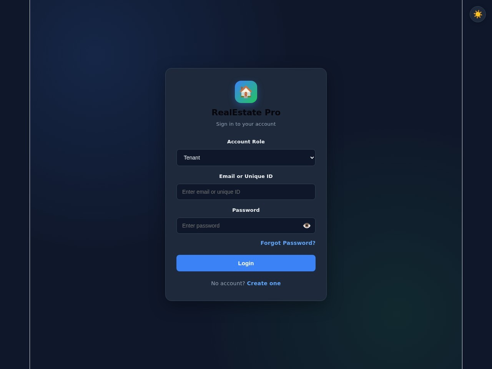
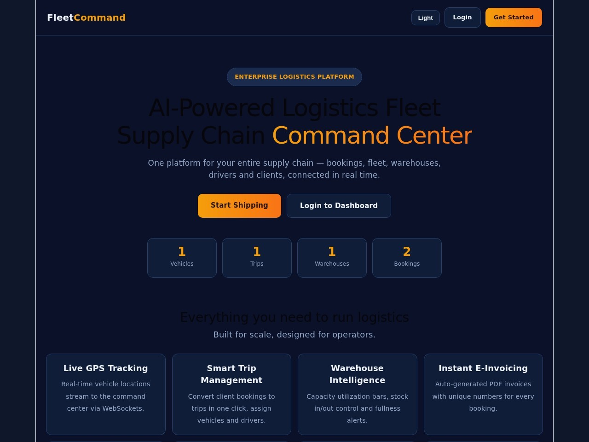

# Matiur Rahaman | Full-Stack Developer

<p align="center">
  <a href="https://developer-portfolio-client.vercel.app"></a>
  <a href="https://github.com/matiur25580"></a>
  <a href="mailto:rahamanmatiur397@gmail.com"></a>
</p>

<p align="center">
  <strong>Building useful web products, thoughtful user experiences, and full-stack solutions.</strong><br>
  React · TypeScript · Node.js · Express · MongoDB · AI Integrations
</p>

---

## About

I'm **Matiur Rahaman**, a full-stack developer based in West Bengal, India. I enjoy designing and building web applications that bring together clean interfaces, reliable APIs, data-driven workflows, and practical integrations.

This repository contains my personal portfolio website and a curated overview of **15 GitHub projects** across recruitment, AI tools, fintech, logistics, healthcare, e-commerce, collaboration, and business operations.

- **Portfolio:** [developer-portfolio-client.vercel.app](https://developer-portfolio-client.vercel.app)
- **GitHub:** [github.com/matiur25580](https://github.com/matiur25580)
- **Email:** [rahamanmatiur397@gmail.com](mailto:rahamanmatiur397@gmail.com)
- **Location:** West Bengal, India

## Portfolio at a Glance

| | |
|---|---|
| **Projects showcased** | 15 public repositories |
| **Core focus** | Full-stack web development |
| **Frontend** | React, TypeScript, JavaScript, Preact, Vite |
| **Backend** | Node.js, Express.js, REST APIs, PHP |
| **Data** | MongoDB, Mongoose, MySQL |
| **Interests** | AI-assisted products, secure workflows, dashboards, real-time apps |

## Featured Work

A selection of projects from the full catalogue. Open a repository to explore its source code, setup instructions, screenshots, and implementation notes.

| Project | Area | Technology / focus |
|---|---|---|
| [HireFlow — ATS Recruitment System](https://github.com/matiur25580/ats-recruitment-system) | Recruitment · AI | React, TypeScript, Node.js, Express, MongoDB, Gemini |
| [TrustShield — Banking Fraud Detection](https://github.com/matiur25580/Enterprise-AI-Powered-Digital-Banking-Fraud-Detection-DevOps-Command-Center) | FinTech · Security | MERN, JWT, OTP, real-time workflows |
| [FleetCommand — Logistics & Supply Chain](https://github.com/matiur25580/Enterprise-AI-Powered-Logistics-Fleet-Supply-Chain-Command-Center) | Enterprise · Logistics | React, Node.js, Express, MongoDB, Socket.IO |
| [CityCare Hospital Management](https://github.com/matiur25580/hospital-management-system) | Healthcare | MERN, JWT, OTP, hospital workflows |
| [Smart HR & Payroll](https://github.com/matiur25580/enterprise-hr-payroll-system) | HR · Enterprise | TypeScript, Preact, Express, MongoDB |
| [Multi-Vendor Marketplace](https://github.com/matiur25580/Enterprise-AI-Powered-Multi-Vendor-Marketplace-Seller-Ecosystem-Command-Center) | E-commerce | MERN, MongoDB, Brevo OTP |
| [SmartGadget Lifestyle MegaStore](https://github.com/matiur25580/Enterprise-AI-Powered-SmartGadget-Lifestyle-MegaStore-Command-Center) | E-commerce | MERN, JWT, OTP |
| [Draftline AI Writing Studio](https://github.com/matiur25580/ai-saas-generator) | AI · SaaS | React, Vite, Express, MongoDB, Gemini |
| [FinTech Smart Invoice & Expense](https://github.com/matiur25580/FinTech-Smart-Invoice-Expense-Supplier-Payment-System) | FinTech | React, TypeScript, Node.js, Express, MongoDB |
| [Cyber Security Operations Command Center](https://github.com/matiur25580/Enterprise-AI-Powered-Cyber-Security-Operations-Command-Center) | Cybersecurity | React, Vite, TypeScript, Node.js, Express, MongoDB |

## All 15 Repositories

Every project below is included in the portfolio's searchable Projects page.

### Enterprise platforms

| # | Project | Overview | Repository |
|---:|---|---|---|
| 01 | **TrustShield — Digital Banking & Fraud Detection** | Banking-style user workflows, role-based dashboards, OTP authentication, KYC and fraud-monitoring concepts. | [Source](https://github.com/matiur25580/Enterprise-AI-Powered-Digital-Banking-Fraud-Detection-DevOps-Command-Center) |
| 02 | **FleetCommand — Logistics & Supply Chain** | Fleet, trips, warehouse and supply-chain operations with real-time and forecasting-oriented workflows. | [Source](https://github.com/matiur25580/Enterprise-AI-Powered-Logistics-Fleet-Supply-Chain-Command-Center) |
| 03 | **Smart HR & Payroll Management** | Employee self-service, attendance, leave and payroll workflows. | [Source](https://github.com/matiur25580/enterprise-hr-payroll-system) |
| 04 | **Real Estate Management System** | Property, rental and real-estate management workflows. | [Source](https://github.com/matiur25580/realestate-management-system) |
| 05 | **CityCare Hospital Management** | Patient registration, appointments, clinical and hospital operations. | [Source](https://github.com/matiur25580/hospital-management-system) |

### AI, finance & commerce

| # | Project | Overview | Repository |
|---:|---|---|---|
| 06 | **HireFlow — ATS Recruitment System** | Candidate and recruiter workflows, resume handling and Gemini-assisted resume-to-job analysis. | [Source](https://github.com/matiur25580/ats-recruitment-system) |
| 07 | **Draftline AI Writing Studio** | AI-assisted content generation, verified accounts, generation history and credit-related workflows. | [Source](https://github.com/matiur25580/ai-saas-generator) |
| 08 | **SmartGadget Lifestyle MegaStore** | Smart-gadget e-commerce catalogue, seller product workflows and cash-on-delivery ordering. | [Source](https://github.com/matiur25580/Enterprise-AI-Powered-SmartGadget-Lifestyle-MegaStore-Command-Center) |
| 09 | **Multi-Vendor Marketplace Seller Ecosystem** | Buyer, seller, logistics and finance-oriented marketplace workflows. | [Source](https://github.com/matiur25580/Enterprise-AI-Powered-Multi-Vendor-Marketplace-Seller-Ecosystem-Command-Center) |
| 10 | **FinTech Smart Invoice & Expense System** | Invoice, expense and supplier-payment management workflows. | [Source](https://github.com/matiur25580/FinTech-Smart-Invoice-Expense-Supplier-Payment-System) |
| 11 | **Cyber Security Operations Command Center** | Security operations command-center foundation and monitoring-oriented interface. | [Source](https://github.com/matiur25580/Enterprise-AI-Powered-Cyber-Security-Operations-Command-Center) |

### Collaboration & web applications

| # | Project | Overview | Repository |
|---:|---|---|---|
| 12 | **Real-Time Chat & Collaboration Hub** | Authenticated chat, online-user presence and real-time messaging. | [Source](https://github.com/matiur25580/Enterprise-Real-Time-Chat-Collaboration-Hub) |
| 13 | **Trello Clone** | Kanban-inspired boards and task organization. | [Source](https://github.com/matiur25580/Trello-Clone) |
| 14 | **Online Food Ordering System** | Restaurant/menu and food-ordering website built as an academic team project. | [Source](https://github.com/matiur25580/Online-Food-Ordering-System-main) |
| 15 | **Developer Portfolio** | This personal portfolio website and searchable project showcase. | [Source](https://github.com/matiur25580/Developer-Portfolio) |

> **Transparency note:** These repositories represent projects at different stages of implementation. The descriptions above summarize their focus; they do not imply that every planned feature or integration is complete or production-deployed. Please refer to each repository's README and source code for its current status. The Online Food Ordering System was an academic team project; my documented contribution was frontend UI work. The Cyber Security Command Center is an evolving project, so its broader SOC/SIEM/SOAR/GRC direction should not be mistaken for a fully implemented feature set.

## Project Interface Gallery

Selected interface previews already included in this repository.

### 01 · Smart HR & Payroll

<p align="center">
  
  
</p>

### 02 · CityCare Hospital

<p align="center">
  
  
</p>

### 03 · Real Estate Management

<p align="center">
  
  
</p>

### 04 · FleetCommand Logistics

<p align="center">
  
  
</p>

### 05 · TrustShield Banking

<p align="center">
  
  
</p>

### 06 · Multi-Vendor Marketplace

<p align="center">
  
  
</p>

## Technology Stack

| Category | Technologies |
|---|---|
| **Frontend** | React, TypeScript, JavaScript, Preact, Vite, Tailwind CSS, HTML, CSS, Bootstrap |
| **Backend** | Node.js, Express.js, REST APIs, PHP |
| **Database** | MongoDB, Mongoose, MySQL |
| **Authentication** | JWT, bcrypt, OTP workflows, role-based access control |
| **Real-time & AI** | Socket.IO, Gemini API, AI-assisted workflows |
| **Tools & delivery** | Git, GitHub, GitHub Actions, Postman, Vercel, Render |

## Education

**B.Tech — Computer Science & Engineering**  
Bengal Institute of Technology, Kolkata · MAKAUT  
2019–2023

## Run This Portfolio Locally

The application source is organized in the `client` directory. To run the frontend locally:

```bash
cd client
npm install
npm run dev
```

To create a production build:

```bash
npm run build
```

Check the `client/package.json` and project configuration for the exact scripts and any environment variables required by your checkout.

## Connect

- **Email:** [rahamanmatiur397@gmail.com](mailto:rahamanmatiur397@gmail.com)
- **GitHub:** [matiur25580](https://github.com/matiur25580)
- **Portfolio:** [developer-portfolio-client.vercel.app](https://developer-portfolio-client.vercel.app)

---

<p align="center">
  <strong>Designed and maintained by Matiur Rahaman</strong><br>
  <sub>Learning, building, improving — one project at a time.</sub>
</p>
