# Matiur Rahaman | Full-Stack Developer

<p align="center">
  <a href="https://github.com/matiur25580/Developer-Portfolio"></a>
  <a href="https://github.com/matiur25580"></a>
  <a href="mailto:rahamanmatiur397@gmail.com"></a>
</p>

<p align="center">
  <strong>Building useful web products, thoughtful user experiences, and full-stack solutions.</strong><br>
  React · TypeScript · Node.js · Express · MongoDB · AI Integrations
</p>

---

## Screenshots

Capture the actual deployed portfolio after the latest production deployment. The [screenshot capture guide](docs/screenshots/README.md) lists the exact sections to capture. Only screenshots of this portfolio belong in this gallery; do not reuse images from the other projects.

## About

I'm **Matiur Rahaman**, a full-stack developer based in West Bengal, India. I enjoy designing and building web applications that bring together clean interfaces, reliable APIs, data-driven workflows, and practical integrations.

This repository contains my personal portfolio website and a curated overview of **15 GitHub projects** across recruitment, AI tools, fintech, logistics, healthcare, e-commerce, collaboration, and business operations.

- **Portfolio source:** [Developer-Portfolio](https://github.com/matiur25580/Developer-Portfolio)
- **GitHub:** [github.com/matiur25580](https://github.com/matiur25580)
- **Email:** [rahamanmatiur397@gmail.com](mailto:rahamanmatiur397@gmail.com)
- **Location:** West Bengal, India

## Portfolio at a Glance

| | |
|---|---|
| **Projects showcased** | 15 public repositories |
| **Core focus** | Full-stack web development |
| **Frontend** | React, TypeScript, JavaScript, Preact, Vite |
| **Backend** | Node.js, Express.js, REST APIs, PHP |
| **Data** | MongoDB, Mongoose, MySQL |
| **Interests** | AI-assisted products, secure workflows, dashboards, real-time apps |

## Featured Work

A selection of projects from the full catalogue. Open a repository to explore its source code, setup instructions, screenshots, and implementation notes.

| Project | Area | Technology / focus |
|---|---|---|
| [HireFlow — ATS Recruitment System](https://github.com/matiur25580/ats-recruitment-system) | Recruitment · AI | React, TypeScript, Node.js, Express, MongoDB, Gemini |
| [TrustShield — Banking Fraud Detection](https://github.com/matiur25580/Enterprise-AI-Powered-Digital-Banking-Fraud-Detection-DevOps-Command-Center) | FinTech · Security | MERN, JWT, OTP, real-time workflows |
| [FleetCommand — Logistics & Supply Chain](https://github.com/matiur25580/Enterprise-AI-Powered-Logistics-Fleet-Supply-Chain-Command-Center) | Enterprise · Logistics | React, Node.js, Express, MongoDB, Socket.IO |
| [CityCare Hospital Management](https://github.com/matiur25580/hospital-management-system) | Healthcare | MERN, JWT, OTP, hospital workflows |
| [Smart HR & Payroll](https://github.com/matiur25580/enterprise-hr-payroll-system) | HR · Enterprise | TypeScript, Preact, Express, MongoDB |
| [Multi-Vendor Marketplace](https://github.com/matiur25580/Enterprise-AI-Powered-Multi-Vendor-Marketplace-Seller-Ecosystem-Command-Center) | E-commerce | MERN, MongoDB, Brevo OTP |
| [SmartGadget Lifestyle MegaStore](https://github.com/matiur25580/Enterprise-AI-Powered-SmartGadget-Lifestyle-MegaStore-Command-Center) | E-commerce | MERN, JWT, OTP |
| [Draftline AI Writing Studio](https://github.com/matiur25580/ai-saas-generator) | AI · SaaS | React, Vite, Express, MongoDB, Gemini |
| [FinTech Smart Invoice & Expense](https://github.com/matiur25580/FinTech-Smart-Invoice-Expense-Supplier-Payment-System) | FinTech | React, TypeScript, Node.js, Express, MongoDB |
| [Cyber Security Operations Command Center](https://github.com/matiur25580/Enterprise-AI-Powered-Cyber-Security-Operations-Command-Center) | Cybersecurity | React, Vite, TypeScript, Node.js, Express, MongoDB |

## All 15 Repositories

Every project below is included in the portfolio's searchable Projects page.

### Enterprise platforms

| # | Project | Overview | Repository |
|---:|---|---|---|
| 01 | **TrustShield — Digital Banking & Fraud Detection** | Banking-style user workflows, role-based dashboards, OTP authentication, KYC and fraud-monitoring concepts. | [Source](https://github.com/matiur25580/Enterprise-AI-Powered-Digital-Banking-Fraud-Detection-DevOps-Command-Center) |
| 02 | **FleetCommand — Logistics & Supply Chain** | Fleet, trips, warehouse and supply-chain operations with real-time and forecasting-oriented workflows. | [Source](https://github.com/matiur25580/Enterprise-AI-Powered-Logistics-Fleet-Supply-Chain-Command-Center) |
| 03 | **Smart HR & Payroll Management** | Employee self-service, attendance, leave and payroll workflows. | [Source](https://github.com/matiur25580/enterprise-hr-payroll-system) |
| 04 | **Real Estate Management System** | Property, rental and real-estate management workflows. | [Source](https://github.com/matiur25580/realestate-management-system) |
| 05 | **CityCare Hospital Management** | Patient registration, appointments, clinical and hospital operations. | [Source](https://github.com/matiur25580/hospital-management-system) |

### AI, finance & commerce

| # | Project | Overview | Repository |
|---:|---|---|---|
| 06 | **HireFlow — ATS Recruitment System** | Candidate and recruiter workflows, resume handling and Gemini-assisted resume-to-job analysis. | [Source](https://github.com/matiur25580/ats-recruitment-system) |
| 07 | **Draftline AI Writing Studio** | AI-assisted content generation, verified accounts, generation history and credit-related workflows. | [Source](https://github.com/matiur25580/ai-saas-generator) |
| 08 | **SmartGadget Lifestyle MegaStore** | Smart-gadget e-commerce catalogue, seller product workflows and cash-on-delivery ordering. | [Source](https://github.com/matiur25580/Enterprise-AI-Powered-SmartGadget-Lifestyle-MegaStore-Command-Center) |
| 09 | **Multi-Vendor Marketplace Seller Ecosystem** | Buyer, seller, logistics and finance-oriented marketplace workflows. | [Source](https://github.com/matiur25580/Enterprise-AI-Powered-Multi-Vendor-Marketplace-Seller-Ecosystem-Command-Center) |
| 10 | **FinTech Smart Invoice & Expense System** | Invoice, expense and supplier-payment management workflows. | [Source](https://github.com/matiur25580/FinTech-Smart-Invoice-Expense-Supplier-Payment-System) |
| 11 | **Cyber Security Operations Command Center** | Security operations command-center foundation and monitoring-oriented interface. | [Source](https://github.com/matiur25580/Enterprise-AI-Powered-Cyber-Security-Operations-Command-Center) |

### Collaboration & web applications

| # | Project | Overview | Repository |
|---:|---|---|---|
| 12 | **Real-Time Chat & Collaboration Hub** | Authenticated chat, online-user presence and real-time messaging. | [Source](https://github.com/matiur25580/Enterprise-Real-Time-Chat-Collaboration-Hub) |
| 13 | **Trello Clone** | Kanban-inspired boards and task organization. | [Source](https://github.com/matiur25580/Trello-Clone) |
| 14 | **Online Food Ordering System** | Restaurant/menu and food-ordering website built as an academic team project. | [Source](https://github.com/matiur25580/Online-Food-Ordering-System-main) |
| 15 | **Developer Portfolio** | This personal portfolio website and searchable project showcase. | [Source](https://github.com/matiur25580/Developer-Portfolio) |

> **Transparency note:** These repositories represent projects at different stages of implementation. The descriptions above summarize their focus; they do not imply that every planned feature or integration is complete or production-deployed. Please refer to each repository's README and source code for its current status. The Online Food Ordering System was an academic team project; my documented contribution was frontend UI work. The Cyber Security Command Center is an evolving project, so its broader SOC/SIEM/SOAR/GRC direction should not be mistaken for a fully implemented feature set.

## Complete Project Visual Gallery

Each project is shown once in this vertical list. Every gallery is a wide six-image horizontal strip: the first large image is visible initially, and the remaining images sit off-screen until you scroll sideways. On a phone, swipe left or right; on desktop, use the horizontal scrollbar. The images are deliberately kept large rather than shrunk into six small thumbnails.

**Gallery size: 15 projects × 6 images = 90 images.** The six original captures are retained. The additional screen designs are clearly labelled UI concept previews and are not presented as screenshots from live applications.

<table width="5400">
<tr><td colspan="6"><h3>01 · HireFlow — ATS Recruitment System</h3><a href="https://github.com/matiur25580/ats-recruitment-system"><strong>View repository ↗</strong></a></td></tr>
<tr>
<td width="900" align="center" valign="top"><a href="https://raw.githubusercontent.com/matiur25580/Developer-Portfolio/main/client/public/projects/preview-hireflow.svg"></a><br><sub>Overview</sub></td>
<td width="900" align="center" valign="top"><a href="https://raw.githubusercontent.com/matiur25580/Developer-Portfolio/main/client/public/projects/hireflow-02.svg">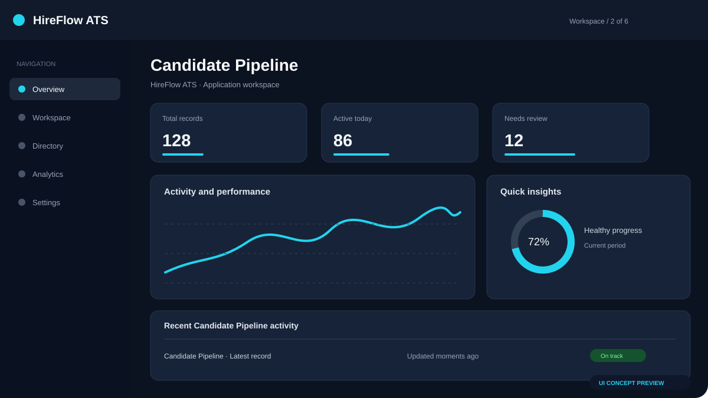</a><br><sub>Candidate Pipeline</sub></td>
<td width="900" align="center" valign="top"><a href="https://raw.githubusercontent.com/matiur25580/Developer-Portfolio/main/client/public/projects/hireflow-03.svg">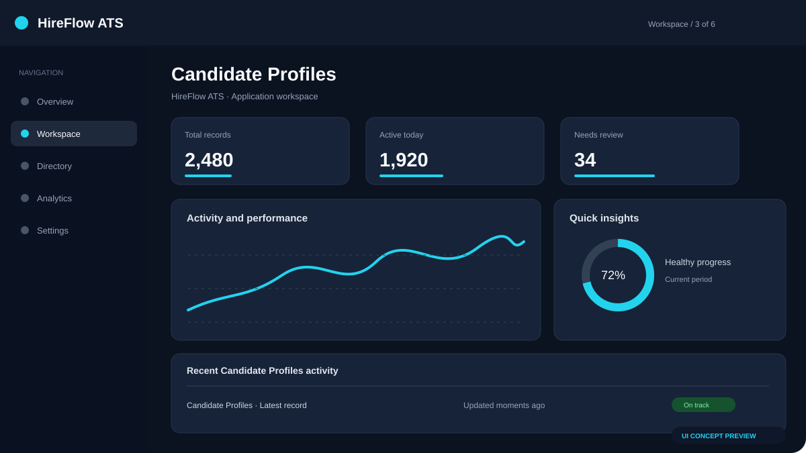</a><br><sub>Candidate Profiles</sub></td>
<td width="900" align="center" valign="top"><a href="https://raw.githubusercontent.com/matiur25580/Developer-Portfolio/main/client/public/projects/hireflow-04.svg">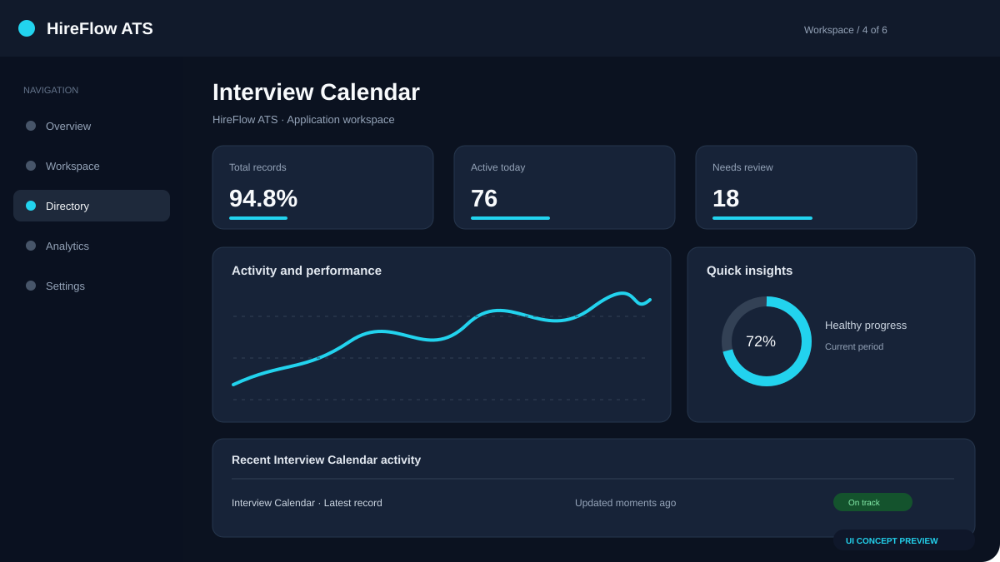</a><br><sub>Interview Calendar</sub></td>
<td width="900" align="center" valign="top"><a href="https://raw.githubusercontent.com/matiur25580/Developer-Portfolio/main/client/public/projects/hireflow-05.svg">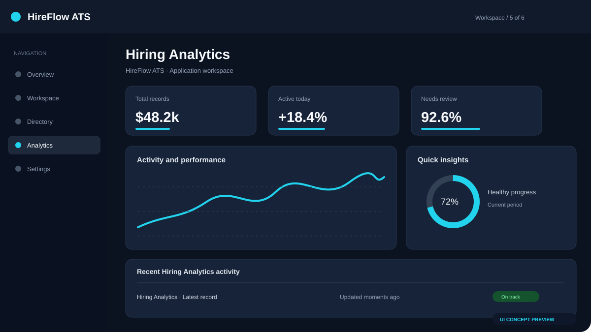</a><br><sub>Hiring Analytics</sub></td>
<td width="900" align="center" valign="top"><a href="https://raw.githubusercontent.com/matiur25580/Developer-Portfolio/main/client/public/projects/hireflow-06.svg"></a><br><sub>Recruiter Settings</sub></td>
</tr>
</table>

<table width="5400">
<tr><td colspan="6"><h3>02 · Developer Portfolio</h3><a href="https://github.com/matiur25580/Developer-Portfolio"><strong>View repository ↗</strong></a></td></tr>
<tr>
<td width="900" align="center" valign="top"><a href="https://raw.githubusercontent.com/matiur25580/Developer-Portfolio/main/client/public/projects/preview-portfolio.svg">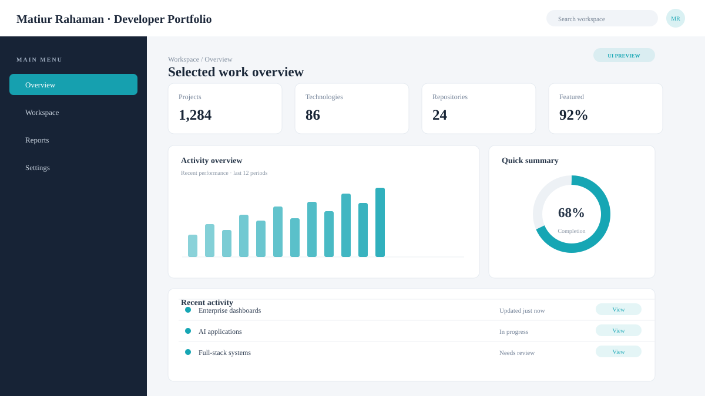</a><br><sub>Overview</sub></td>
<td width="900" align="center" valign="top"><a href="https://raw.githubusercontent.com/matiur25580/Developer-Portfolio/main/client/public/projects/portfolio-02.svg">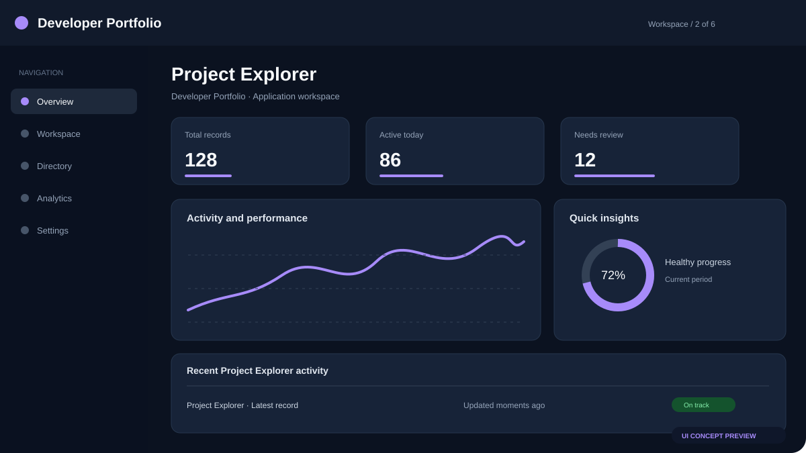</a><br><sub>Project Explorer</sub></td>
<td width="900" align="center" valign="top"><a href="https://raw.githubusercontent.com/matiur25580/Developer-Portfolio/main/client/public/projects/portfolio-03.svg">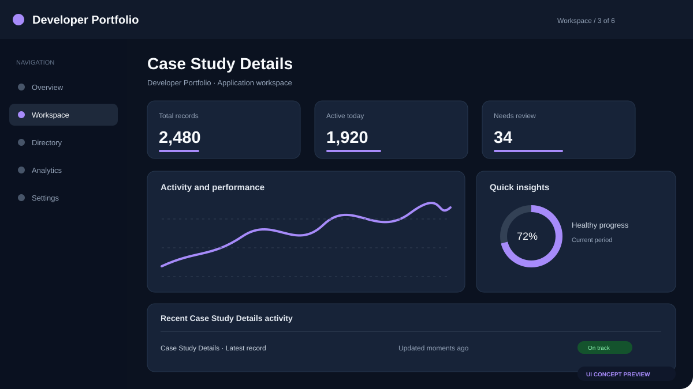</a><br><sub>Case Study Details</sub></td>
<td width="900" align="center" valign="top"><a href="https://raw.githubusercontent.com/matiur25580/Developer-Portfolio/main/client/public/projects/portfolio-04.svg">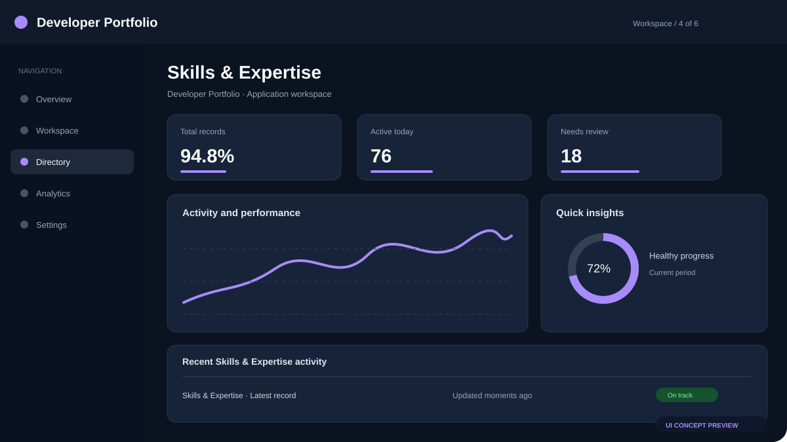</a><br><sub>Skills & Expertise</sub></td>
<td width="900" align="center" valign="top"><a href="https://raw.githubusercontent.com/matiur25580/Developer-Portfolio/main/client/public/projects/portfolio-05.svg">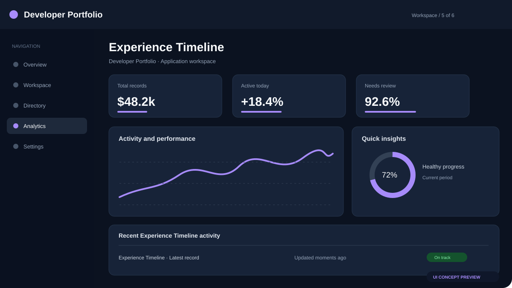</a><br><sub>Experience Timeline</sub></td>
<td width="900" align="center" valign="top"><a href="https://raw.githubusercontent.com/matiur25580/Developer-Portfolio/main/client/public/projects/portfolio-06.svg">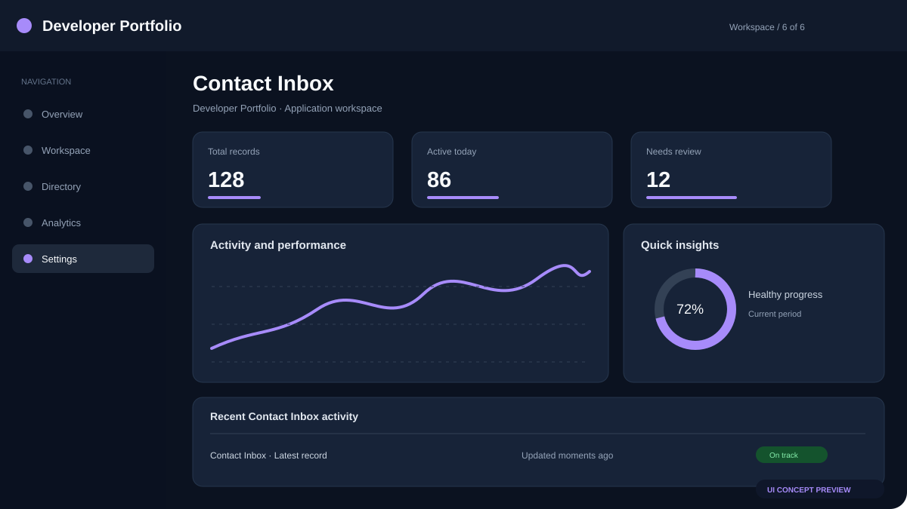</a><br><sub>Contact Inbox</sub></td>
</tr>
</table>

<table width="5400">
<tr><td colspan="6"><h3>03 · TrustShield — Banking Fraud Detection</h3><a href="https://github.com/matiur25580/Enterprise-AI-Powered-Digital-Banking-Fraud-Detection-DevOps-Command-Center"><strong>View repository ↗</strong></a></td></tr>
<tr>
<td width="900" align="center" valign="top"><a href="https://raw.githubusercontent.com/matiur25580/Developer-Portfolio/main/client/public/projects/p5.png">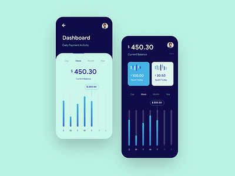</a><br><sub>Application Screenshot</sub></td>
<td width="900" align="center" valign="top"><a href="https://raw.githubusercontent.com/matiur25580/Developer-Portfolio/main/client/public/projects/trustshield-02.svg"></a><br><sub>Fraud Monitoring</sub></td>
<td width="900" align="center" valign="top"><a href="https://raw.githubusercontent.com/matiur25580/Developer-Portfolio/main/client/public/projects/trustshield-03.svg"></a><br><sub>Customer KYC</sub></td>
<td width="900" align="center" valign="top"><a href="https://raw.githubusercontent.com/matiur25580/Developer-Portfolio/main/client/public/projects/trustshield-04.svg">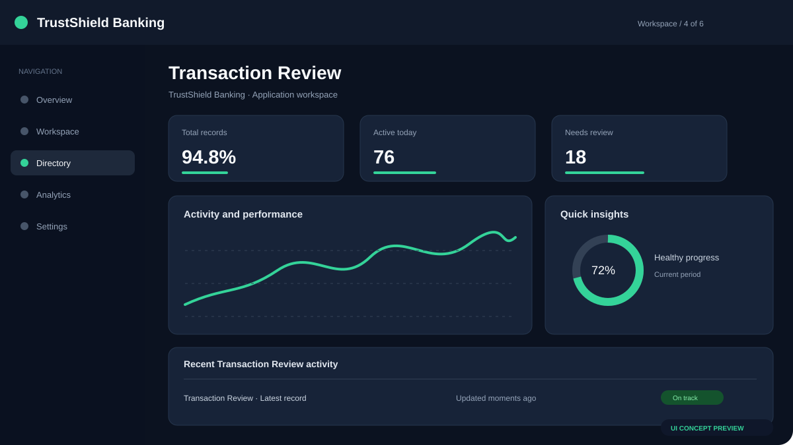</a><br><sub>Transaction Review</sub></td>
<td width="900" align="center" valign="top"><a href="https://raw.githubusercontent.com/matiur25580/Developer-Portfolio/main/client/public/projects/trustshield-05.svg">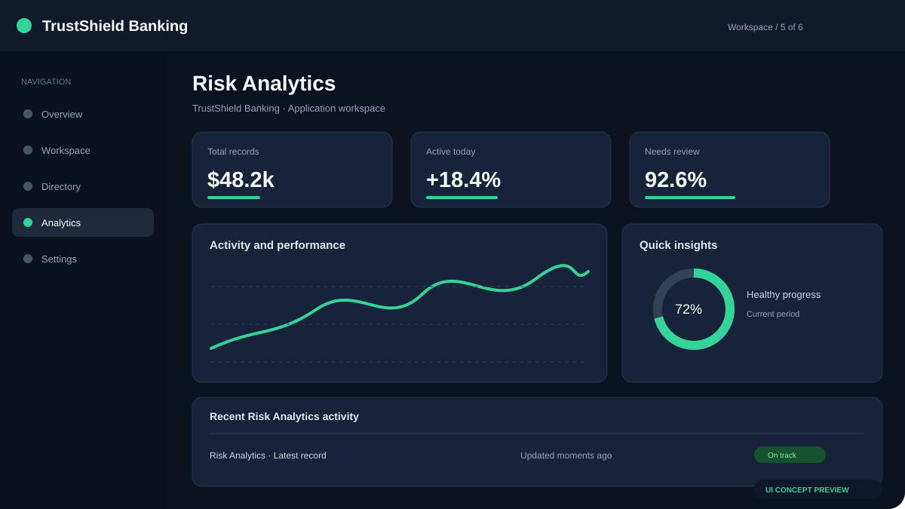</a><br><sub>Risk Analytics</sub></td>
<td width="900" align="center" valign="top"><a href="https://raw.githubusercontent.com/matiur25580/Developer-Portfolio/main/client/public/projects/trustshield-06.svg">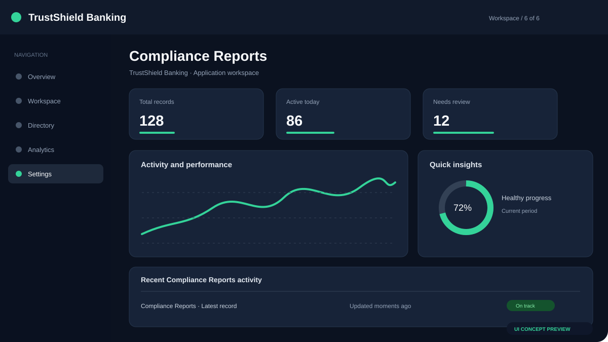</a><br><sub>Compliance Reports</sub></td>
</tr>
</table>

<table width="5400">
<tr><td colspan="6"><h3>04 · FleetCommand — Logistics & Supply Chain</h3><a href="https://github.com/matiur25580/Enterprise-AI-Powered-Logistics-Fleet-Supply-Chain-Command-Center"><strong>View repository ↗</strong></a></td></tr>
<tr>
<td width="900" align="center" valign="top"><a href="https://raw.githubusercontent.com/matiur25580/Developer-Portfolio/main/client/public/projects/p4.png">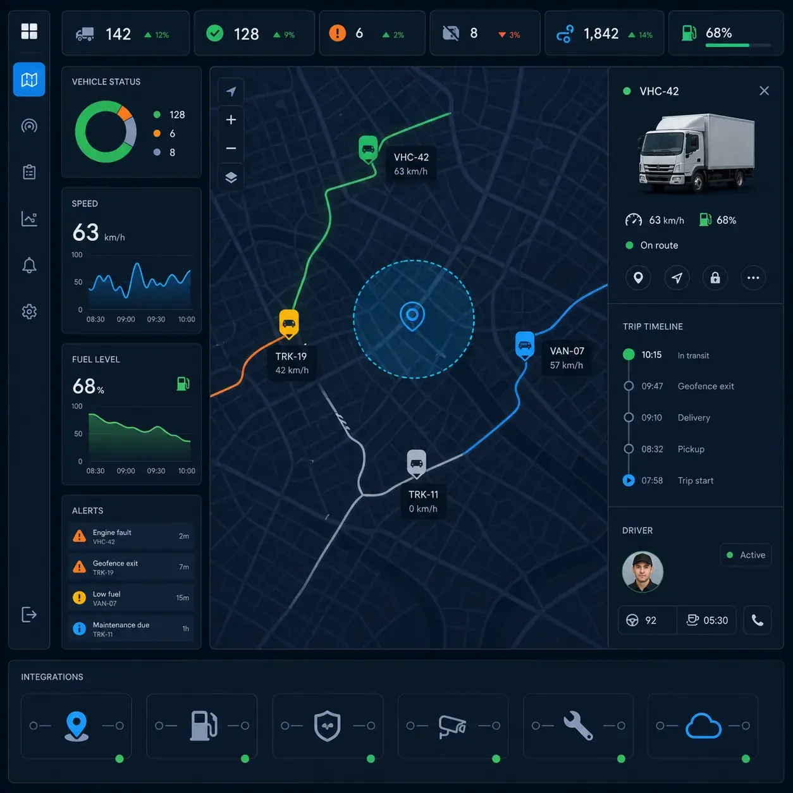</a><br><sub>Application Screenshot</sub></td>
<td width="900" align="center" valign="top"><a href="https://raw.githubusercontent.com/matiur25580/Developer-Portfolio/main/client/public/projects/fleetcommand-02.svg">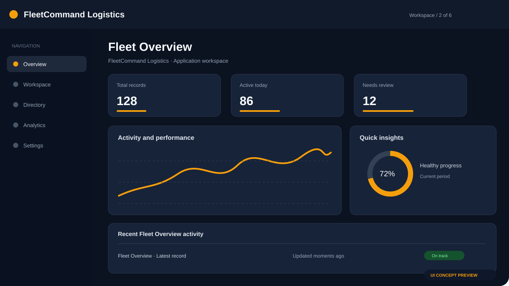</a><br><sub>Fleet Overview</sub></td>
<td width="900" align="center" valign="top"><a href="https://raw.githubusercontent.com/matiur25580/Developer-Portfolio/main/client/public/projects/fleetcommand-03.svg">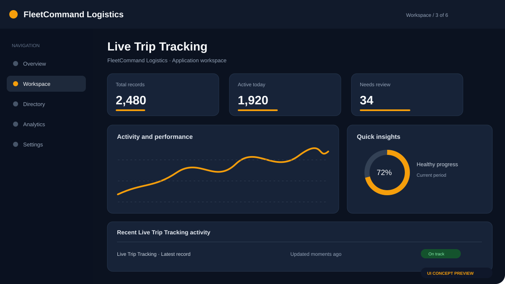</a><br><sub>Live Trip Tracking</sub></td>
<td width="900" align="center" valign="top"><a href="https://raw.githubusercontent.com/matiur25580/Developer-Portfolio/main/client/public/projects/fleetcommand-04.svg">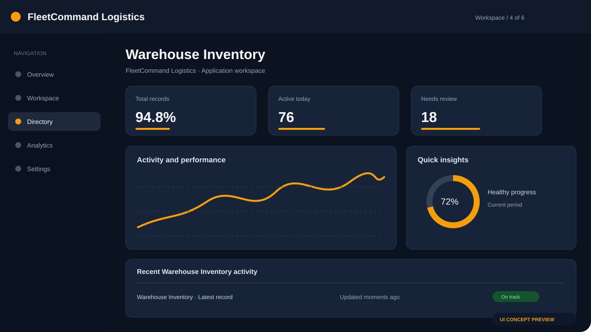</a><br><sub>Warehouse Inventory</sub></td>
<td width="900" align="center" valign="top"><a href="https://raw.githubusercontent.com/matiur25580/Developer-Portfolio/main/client/public/projects/fleetcommand-05.svg">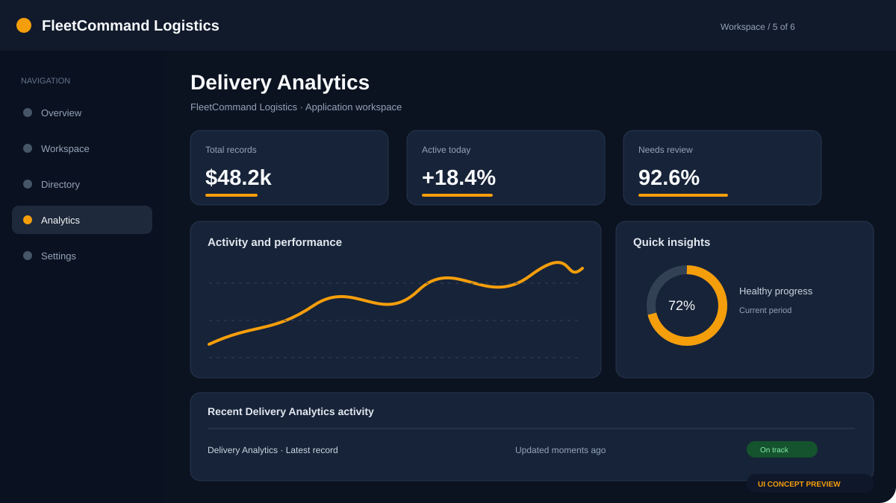</a><br><sub>Delivery Analytics</sub></td>
<td width="900" align="center" valign="top"><a href="https://raw.githubusercontent.com/matiur25580/Developer-Portfolio/main/client/public/projects/fleetcommand-06.svg">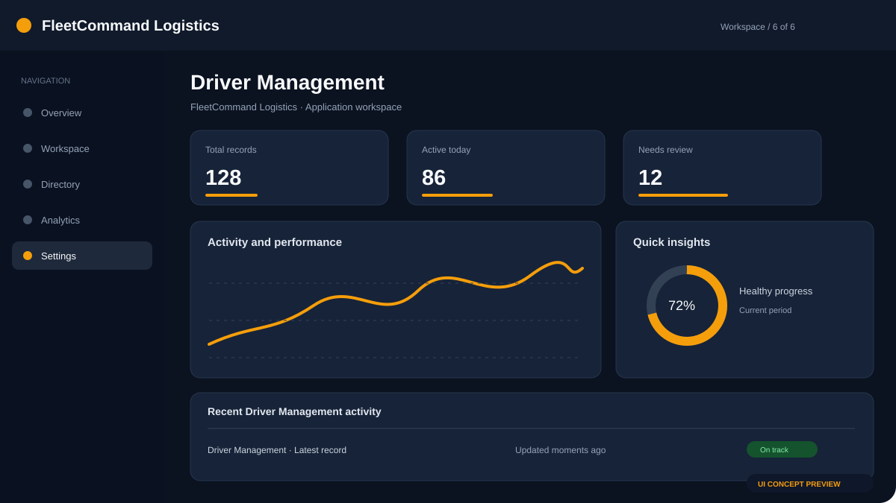</a><br><sub>Driver Management</sub></td>
</tr>
</table>

<table width="5400">
<tr><td colspan="6"><h3>05 · SmartGadget Lifestyle MegaStore</h3><a href="https://github.com/matiur25580/Enterprise-AI-Powered-SmartGadget-Lifestyle-MegaStore-Command-Center"><strong>View repository ↗</strong></a></td></tr>
<tr>
<td width="900" align="center" valign="top"><a href="https://raw.githubusercontent.com/matiur25580/Developer-Portfolio/main/client/public/projects/preview-smartgadget.svg"></a><br><sub>Overview</sub></td>
<td width="900" align="center" valign="top"><a href="https://raw.githubusercontent.com/matiur25580/Developer-Portfolio/main/client/public/projects/smartgadget-02.svg">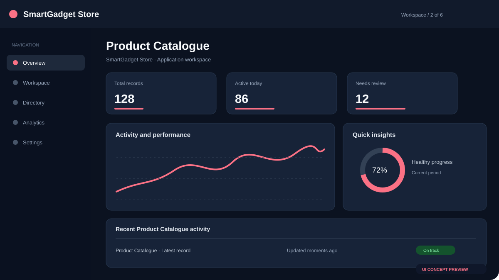</a><br><sub>Product Catalogue</sub></td>
<td width="900" align="center" valign="top"><a href="https://raw.githubusercontent.com/matiur25580/Developer-Portfolio/main/client/public/projects/smartgadget-03.svg"></a><br><sub>Order Management</sub></td>
<td width="900" align="center" valign="top"><a href="https://raw.githubusercontent.com/matiur25580/Developer-Portfolio/main/client/public/projects/smartgadget-04.svg">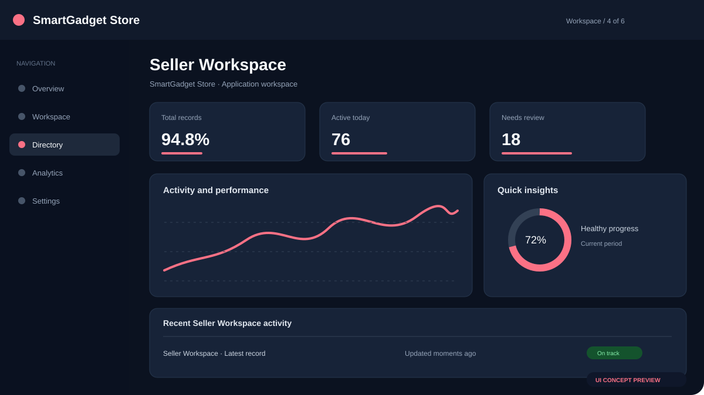</a><br><sub>Seller Workspace</sub></td>
<td width="900" align="center" valign="top"><a href="https://raw.githubusercontent.com/matiur25580/Developer-Portfolio/main/client/public/projects/smartgadget-05.svg">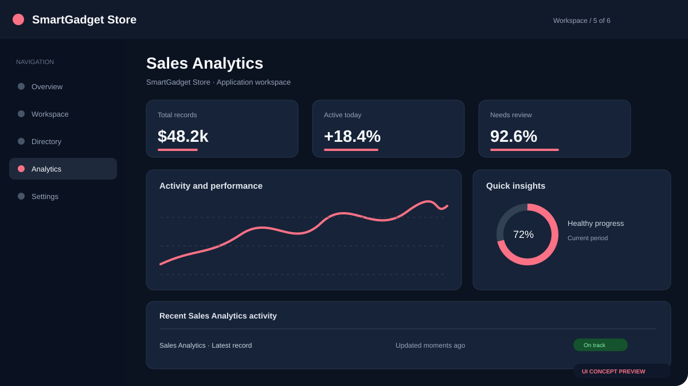</a><br><sub>Sales Analytics</sub></td>
<td width="900" align="center" valign="top"><a href="https://raw.githubusercontent.com/matiur25580/Developer-Portfolio/main/client/public/projects/smartgadget-06.svg">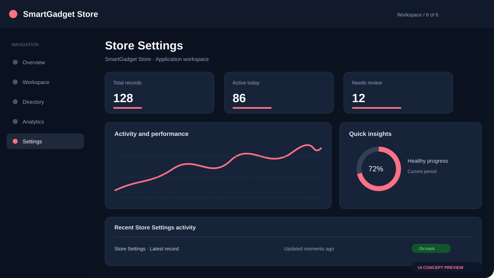</a><br><sub>Store Settings</sub></td>
</tr>
</table>

<table width="5400">
<tr><td colspan="6"><h3>06 · CityCare Hospital Management</h3><a href="https://github.com/matiur25580/hospital-management-system"><strong>View repository ↗</strong></a></td></tr>
<tr>
<td width="900" align="center" valign="top"><a href="https://raw.githubusercontent.com/matiur25580/Developer-Portfolio/main/client/public/projects/p2.png"></a><br><sub>Application Screenshot</sub></td>
<td width="900" align="center" valign="top"><a href="https://raw.githubusercontent.com/matiur25580/Developer-Portfolio/main/client/public/projects/citycare-02.svg">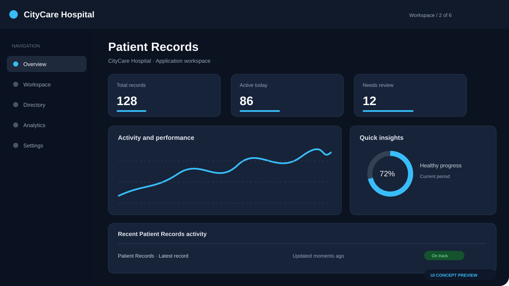</a><br><sub>Patient Records</sub></td>
<td width="900" align="center" valign="top"><a href="https://raw.githubusercontent.com/matiur25580/Developer-Portfolio/main/client/public/projects/citycare-03.svg">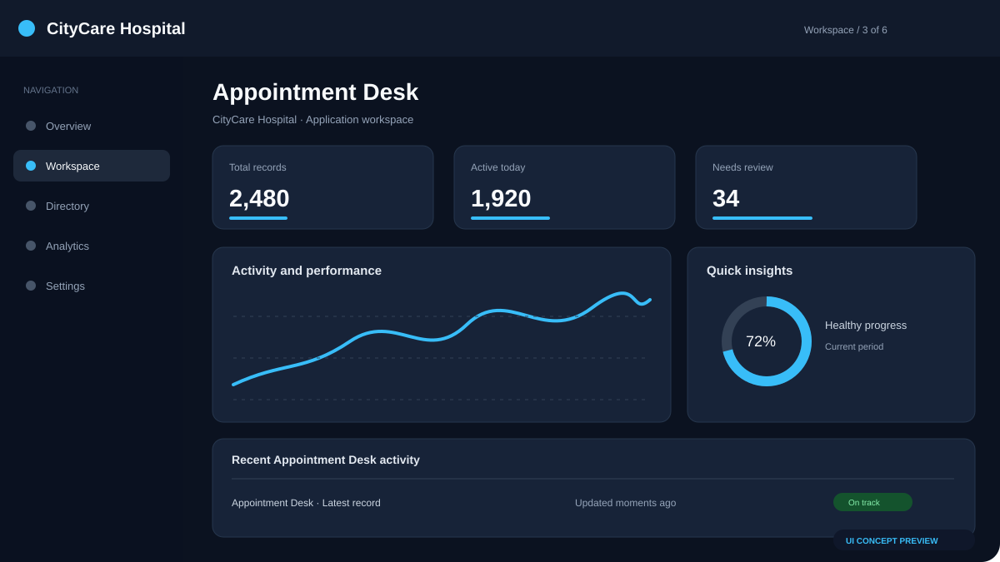</a><br><sub>Appointment Desk</sub></td>
<td width="900" align="center" valign="top"><a href="https://raw.githubusercontent.com/matiur25580/Developer-Portfolio/main/client/public/projects/citycare-04.svg"></a><br><sub>Doctor Workspace</sub></td>
<td width="900" align="center" valign="top"><a href="https://raw.githubusercontent.com/matiur25580/Developer-Portfolio/main/client/public/projects/citycare-05.svg">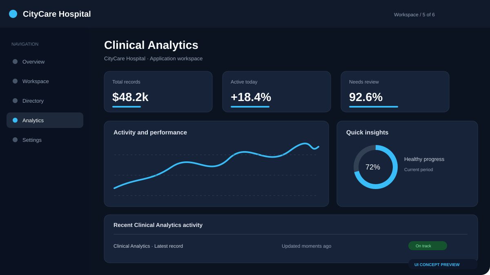</a><br><sub>Clinical Analytics</sub></td>
<td width="900" align="center" valign="top"><a href="https://raw.githubusercontent.com/matiur25580/Developer-Portfolio/main/client/public/projects/citycare-06.svg">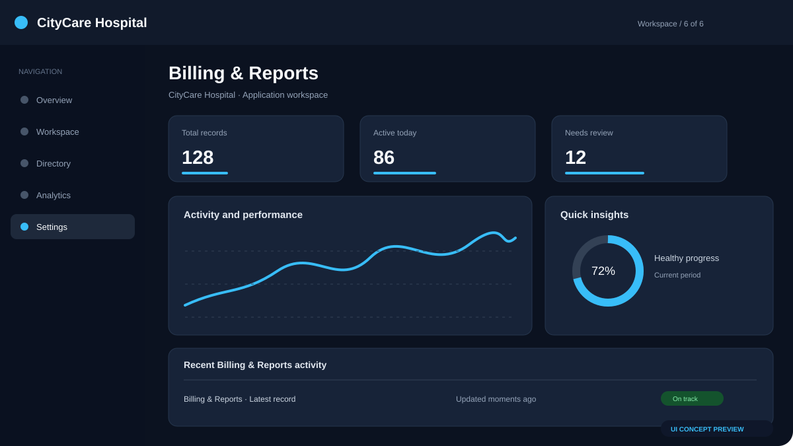</a><br><sub>Billing & Reports</sub></td>
</tr>
</table>

<table width="5400">
<tr><td colspan="6"><h3>07 · Draftline AI Writing Studio</h3><a href="https://github.com/matiur25580/ai-saas-generator"><strong>View repository ↗</strong></a></td></tr>
<tr>
<td width="900" align="center" valign="top"><a href="https://raw.githubusercontent.com/matiur25580/Developer-Portfolio/main/client/public/projects/preview-draftline.svg"></a><br><sub>Overview</sub></td>
<td width="900" align="center" valign="top"><a href="https://raw.githubusercontent.com/matiur25580/Developer-Portfolio/main/client/public/projects/draftline-02.svg">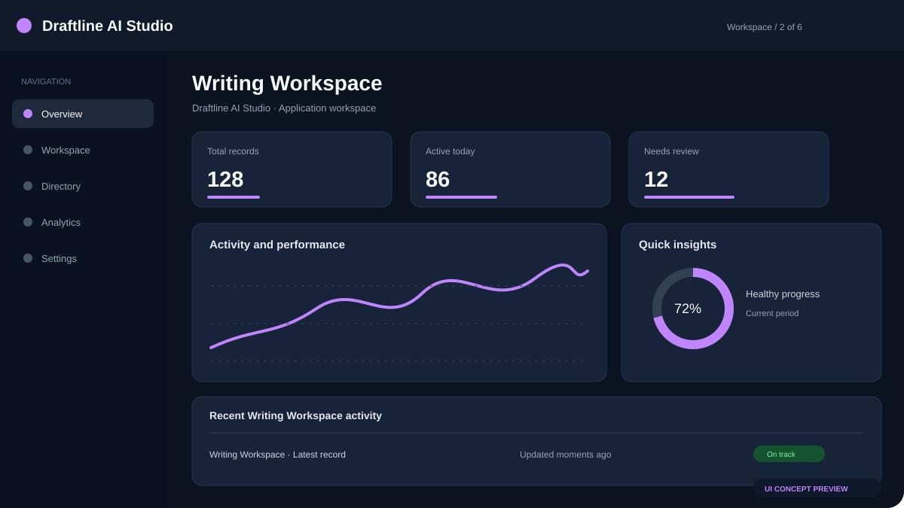</a><br><sub>Writing Workspace</sub></td>
<td width="900" align="center" valign="top"><a href="https://raw.githubusercontent.com/matiur25580/Developer-Portfolio/main/client/public/projects/draftline-03.svg">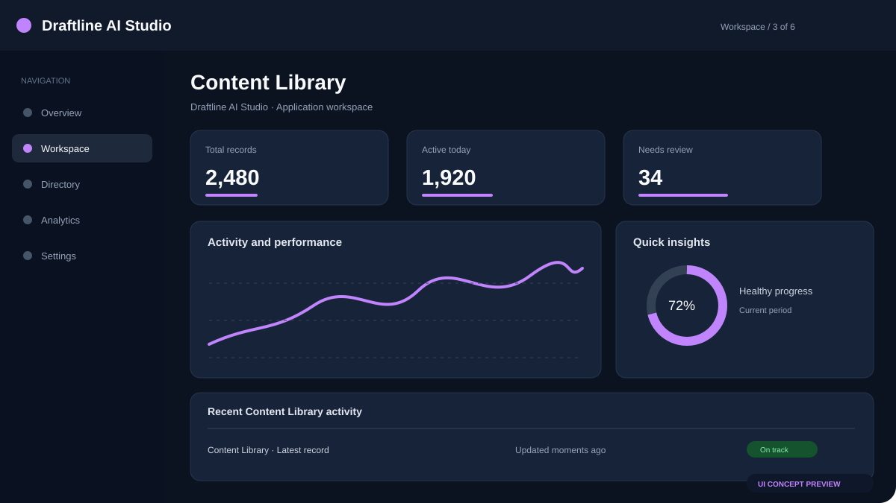</a><br><sub>Content Library</sub></td>
<td width="900" align="center" valign="top"><a href="https://raw.githubusercontent.com/matiur25580/Developer-Portfolio/main/client/public/projects/draftline-04.svg">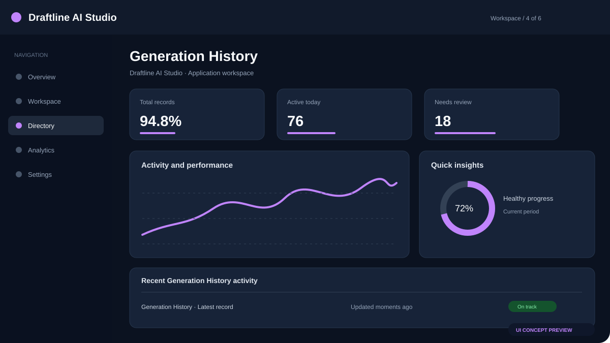</a><br><sub>Generation History</sub></td>
<td width="900" align="center" valign="top"><a href="https://raw.githubusercontent.com/matiur25580/Developer-Portfolio/main/client/public/projects/draftline-05.svg">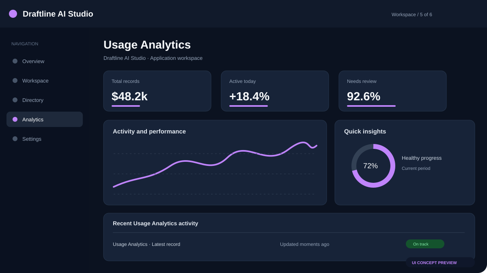</a><br><sub>Usage Analytics</sub></td>
<td width="900" align="center" valign="top"><a href="https://raw.githubusercontent.com/matiur25580/Developer-Portfolio/main/client/public/projects/draftline-06.svg">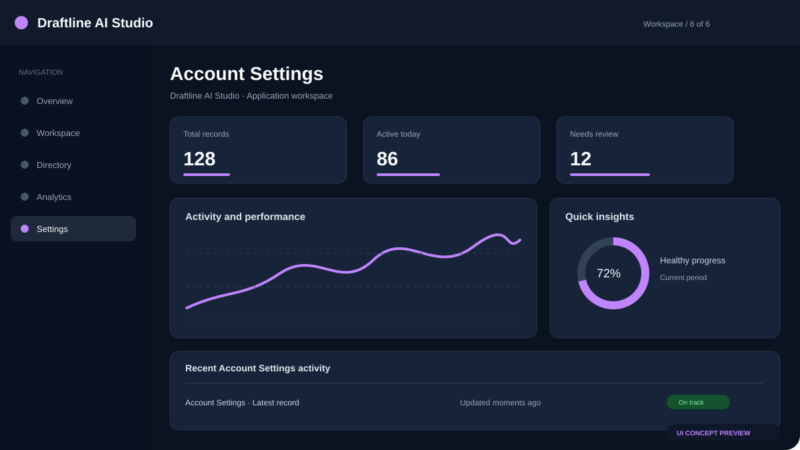</a><br><sub>Account Settings</sub></td>
</tr>
</table>

<table width="5400">
<tr><td colspan="6"><h3>08 · Real Estate Management System</h3><a href="https://github.com/matiur25580/realestate-management-system"><strong>View repository ↗</strong></a></td></tr>
<tr>
<td width="900" align="center" valign="top"><a href="https://raw.githubusercontent.com/matiur25580/Developer-Portfolio/main/client/public/projects/p3.png"></a><br><sub>Application Screenshot</sub></td>
<td width="900" align="center" valign="top"><a href="https://raw.githubusercontent.com/matiur25580/Developer-Portfolio/main/client/public/projects/realestate-02.svg"></a><br><sub>Property Listings</sub></td>
<td width="900" align="center" valign="top"><a href="https://raw.githubusercontent.com/matiur25580/Developer-Portfolio/main/client/public/projects/realestate-03.svg">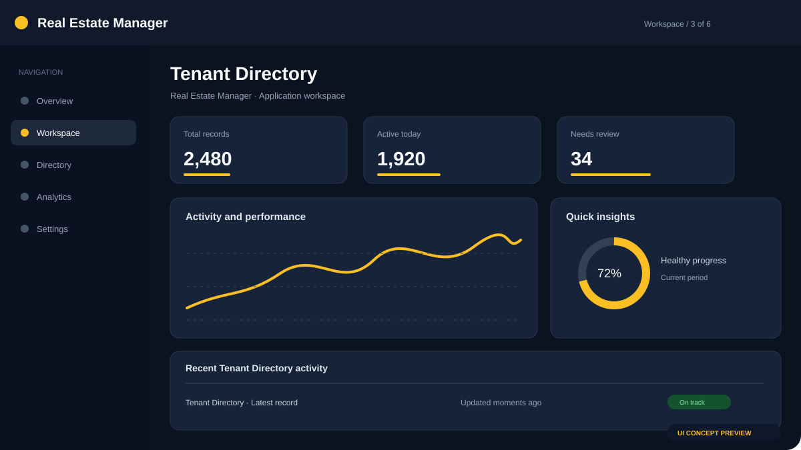</a><br><sub>Tenant Directory</sub></td>
<td width="900" align="center" valign="top"><a href="https://raw.githubusercontent.com/matiur25580/Developer-Portfolio/main/client/public/projects/realestate-04.svg">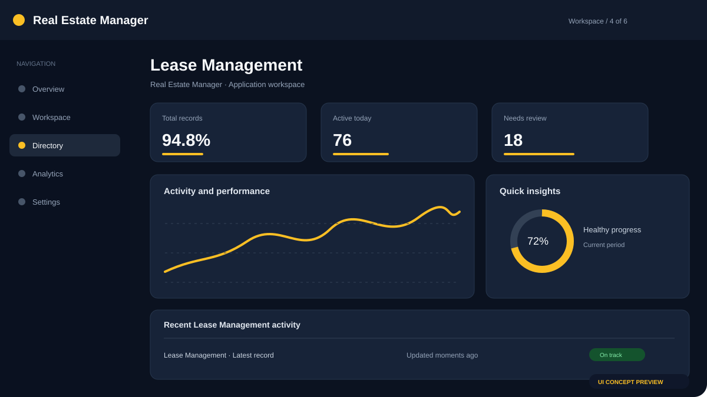</a><br><sub>Lease Management</sub></td>
<td width="900" align="center" valign="top"><a href="https://raw.githubusercontent.com/matiur25580/Developer-Portfolio/main/client/public/projects/realestate-05.svg">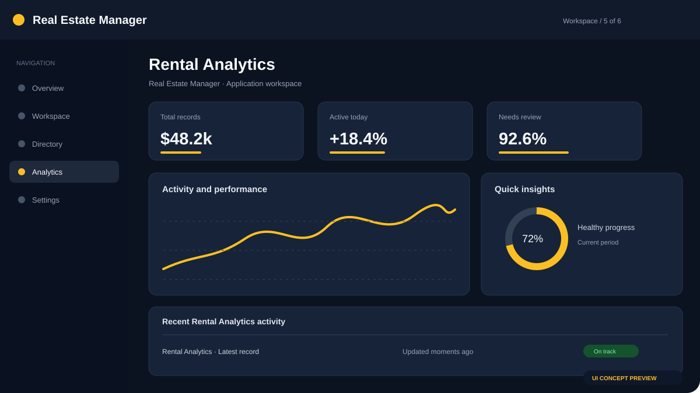</a><br><sub>Rental Analytics</sub></td>
<td width="900" align="center" valign="top"><a href="https://raw.githubusercontent.com/matiur25580/Developer-Portfolio/main/client/public/projects/realestate-06.svg">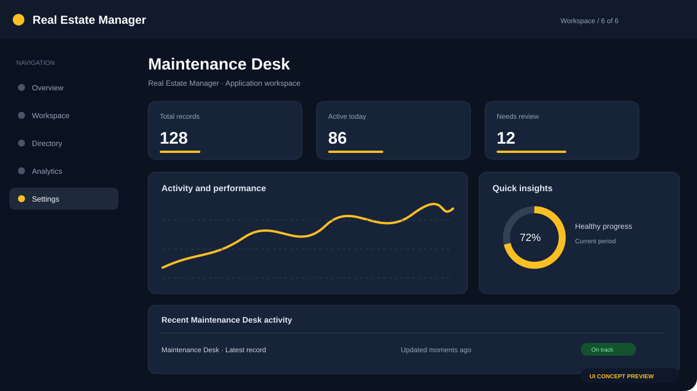</a><br><sub>Maintenance Desk</sub></td>
</tr>
</table>

<table width="5400">
<tr><td colspan="6"><h3>09 · Real-Time Chat & Collaboration Hub</h3><a href="https://github.com/matiur25580/Enterprise-Real-Time-Chat-Collaboration-Hub"><strong>View repository ↗</strong></a></td></tr>
<tr>
<td width="900" align="center" valign="top"><a href="https://raw.githubusercontent.com/matiur25580/Developer-Portfolio/main/client/public/projects/preview-chat.svg"></a><br><sub>Overview</sub></td>
<td width="900" align="center" valign="top"><a href="https://raw.githubusercontent.com/matiur25580/Developer-Portfolio/main/client/public/projects/chat-02.svg">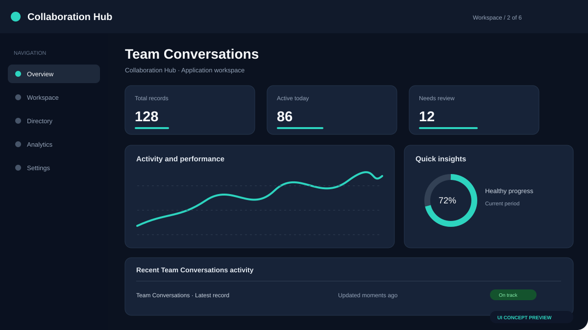</a><br><sub>Team Conversations</sub></td>
<td width="900" align="center" valign="top"><a href="https://raw.githubusercontent.com/matiur25580/Developer-Portfolio/main/client/public/projects/chat-03.svg">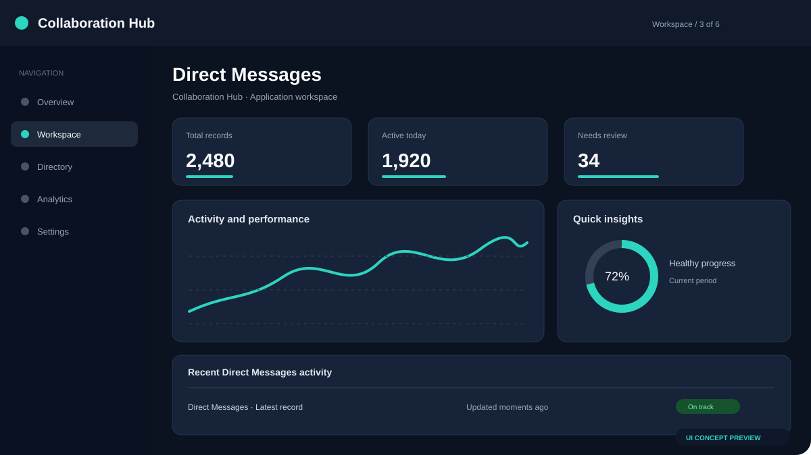</a><br><sub>Direct Messages</sub></td>
<td width="900" align="center" valign="top"><a href="https://raw.githubusercontent.com/matiur25580/Developer-Portfolio/main/client/public/projects/chat-04.svg"></a><br><sub>Shared Channels</sub></td>
<td width="900" align="center" valign="top"><a href="https://raw.githubusercontent.com/matiur25580/Developer-Portfolio/main/client/public/projects/chat-05.svg">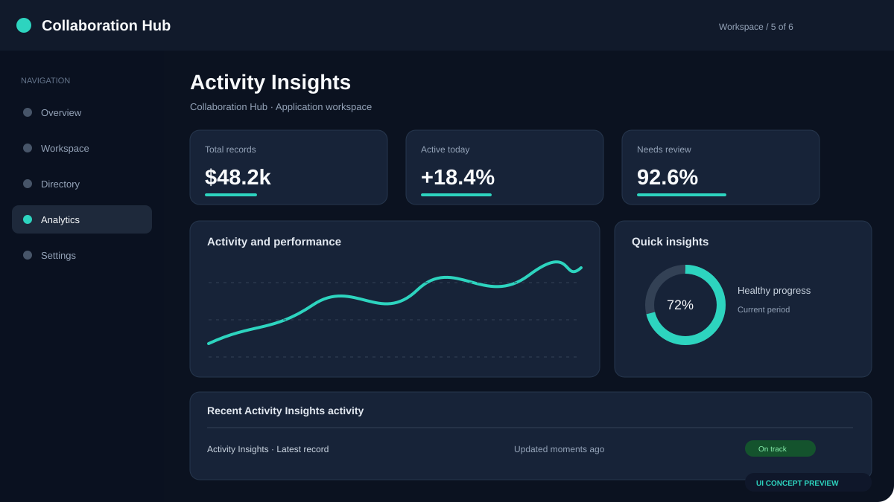</a><br><sub>Activity Insights</sub></td>
<td width="900" align="center" valign="top"><a href="https://raw.githubusercontent.com/matiur25580/Developer-Portfolio/main/client/public/projects/chat-06.svg"></a><br><sub>Workspace Settings</sub></td>
</tr>
</table>

<table width="5400">
<tr><td colspan="6"><h3>10 · Trello Clone</h3><a href="https://github.com/matiur25580/Trello-Clone"><strong>View repository ↗</strong></a></td></tr>
<tr>
<td width="900" align="center" valign="top"><a href="https://raw.githubusercontent.com/matiur25580/Developer-Portfolio/main/client/public/projects/preview-trello.svg"></a><br><sub>Overview</sub></td>
<td width="900" align="center" valign="top"><a href="https://raw.githubusercontent.com/matiur25580/Developer-Portfolio/main/client/public/projects/trello-02.svg">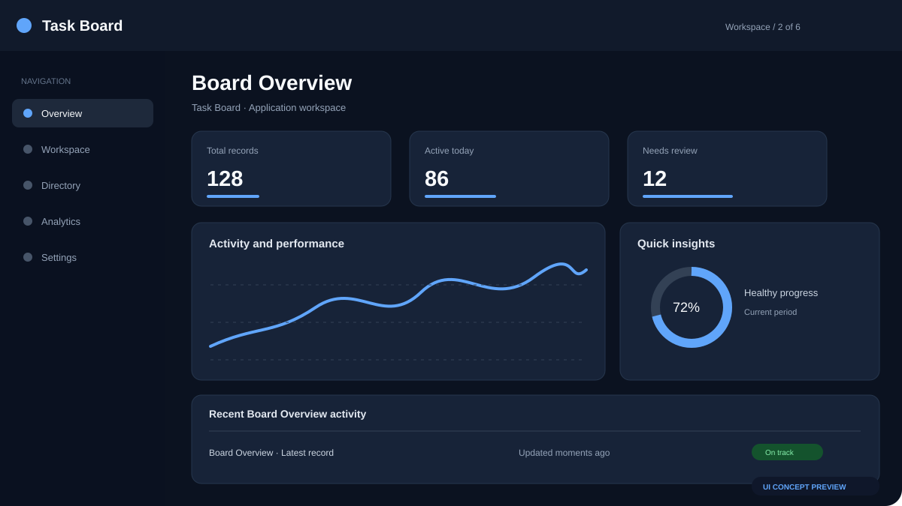</a><br><sub>Board Overview</sub></td>
<td width="900" align="center" valign="top"><a href="https://raw.githubusercontent.com/matiur25580/Developer-Portfolio/main/client/public/projects/trello-03.svg">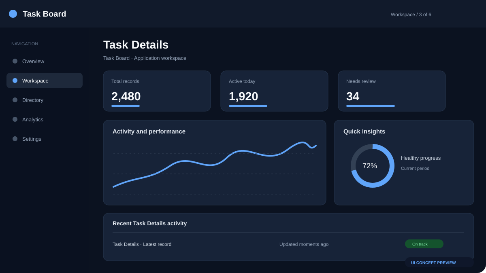</a><br><sub>Task Details</sub></td>
<td width="900" align="center" valign="top"><a href="https://raw.githubusercontent.com/matiur25580/Developer-Portfolio/main/client/public/projects/trello-04.svg">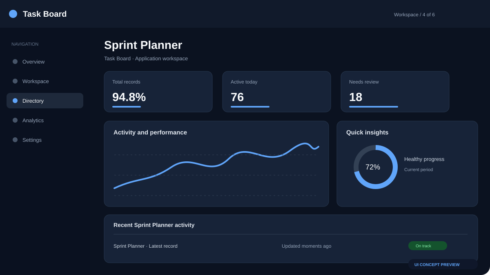</a><br><sub>Sprint Planner</sub></td>
<td width="900" align="center" valign="top"><a href="https://raw.githubusercontent.com/matiur25580/Developer-Portfolio/main/client/public/projects/trello-05.svg">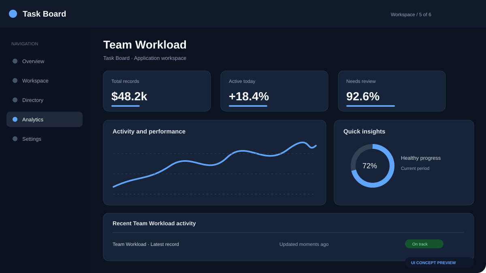</a><br><sub>Team Workload</sub></td>
<td width="900" align="center" valign="top"><a href="https://raw.githubusercontent.com/matiur25580/Developer-Portfolio/main/client/public/projects/trello-06.svg">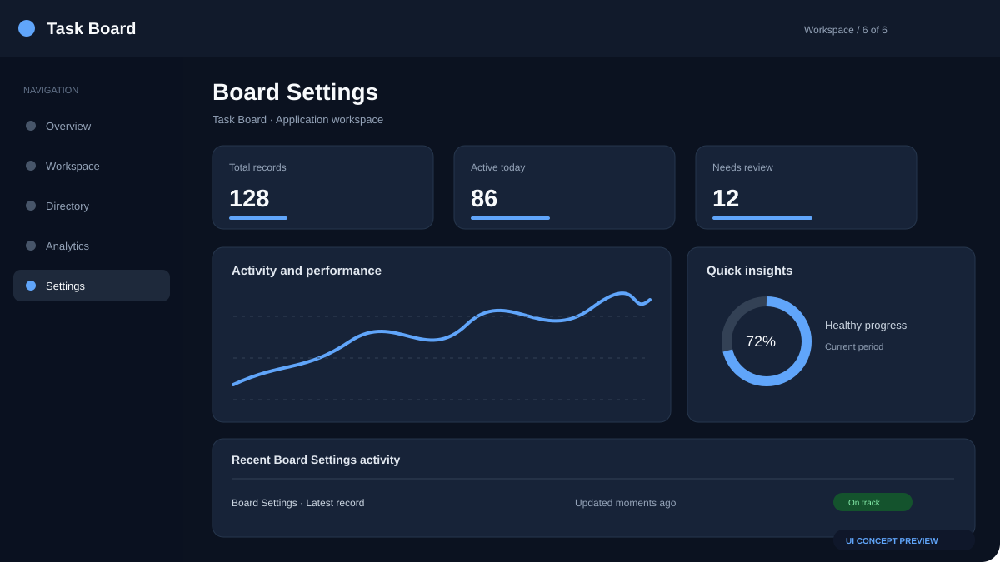</a><br><sub>Board Settings</sub></td>
</tr>
</table>

<table width="5400">
<tr><td colspan="6"><h3>11 · Online Food Ordering System</h3><a href="https://github.com/matiur25580/Online-Food-Ordering-System-main"><strong>View repository ↗</strong></a></td></tr>
<tr>
<td width="900" align="center" valign="top"><a href="https://raw.githubusercontent.com/matiur25580/Developer-Portfolio/main/client/public/projects/preview-food-order.svg"></a><br><sub>Overview</sub></td>
<td width="900" align="center" valign="top"><a href="https://raw.githubusercontent.com/matiur25580/Developer-Portfolio/main/client/public/projects/foodorder-02.svg">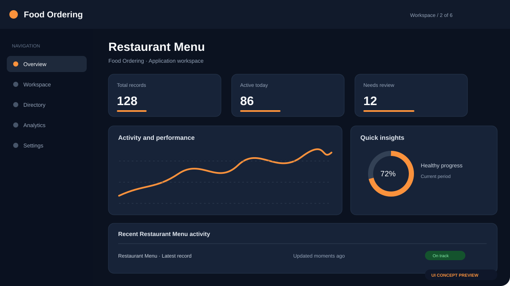</a><br><sub>Restaurant Menu</sub></td>
<td width="900" align="center" valign="top"><a href="https://raw.githubusercontent.com/matiur25580/Developer-Portfolio/main/client/public/projects/foodorder-03.svg">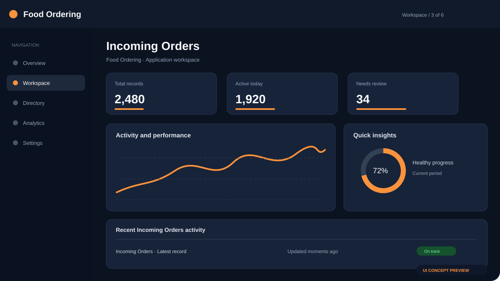</a><br><sub>Incoming Orders</sub></td>
<td width="900" align="center" valign="top"><a href="https://raw.githubusercontent.com/matiur25580/Developer-Portfolio/main/client/public/projects/foodorder-04.svg">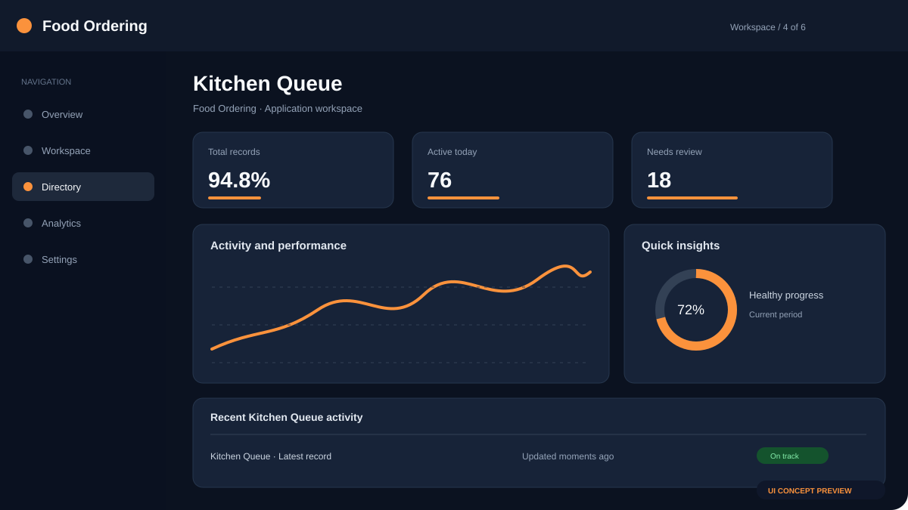</a><br><sub>Kitchen Queue</sub></td>
<td width="900" align="center" valign="top"><a href="https://raw.githubusercontent.com/matiur25580/Developer-Portfolio/main/client/public/projects/foodorder-05.svg">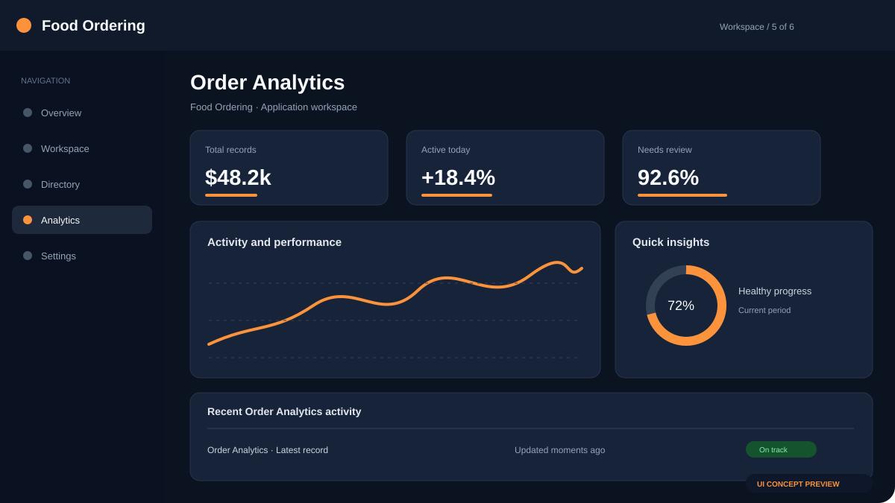</a><br><sub>Order Analytics</sub></td>
<td width="900" align="center" valign="top"><a href="https://raw.githubusercontent.com/matiur25580/Developer-Portfolio/main/client/public/projects/foodorder-06.svg">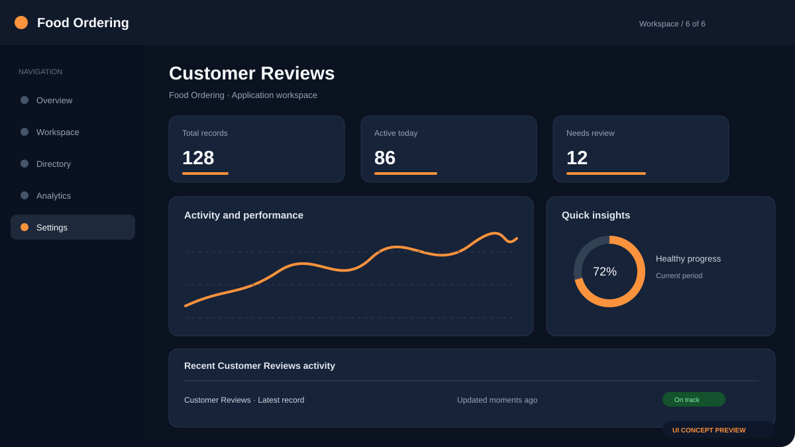</a><br><sub>Customer Reviews</sub></td>
</tr>
</table>

<table width="5400">
<tr><td colspan="6"><h3>12 · Smart HR & Payroll Management</h3><a href="https://github.com/matiur25580/enterprise-hr-payroll-system"><strong>View repository ↗</strong></a></td></tr>
<tr>
<td width="900" align="center" valign="top"><a href="https://raw.githubusercontent.com/matiur25580/Developer-Portfolio/main/client/public/projects/p1.webp"></a><br><sub>Application Screenshot</sub></td>
<td width="900" align="center" valign="top"><a href="https://raw.githubusercontent.com/matiur25580/Developer-Portfolio/main/client/public/projects/hrpayroll-02.svg"></a><br><sub>Employee Directory</sub></td>
<td width="900" align="center" valign="top"><a href="https://raw.githubusercontent.com/matiur25580/Developer-Portfolio/main/client/public/projects/hrpayroll-03.svg"></a><br><sub>Attendance Register</sub></td>
<td width="900" align="center" valign="top"><a href="https://raw.githubusercontent.com/matiur25580/Developer-Portfolio/main/client/public/projects/hrpayroll-04.svg"></a><br><sub>Leave Requests</sub></td>
<td width="900" align="center" valign="top"><a href="https://raw.githubusercontent.com/matiur25580/Developer-Portfolio/main/client/public/projects/hrpayroll-05.svg"></a><br><sub>Payroll Overview</sub></td>
<td width="900" align="center" valign="top"><a href="https://raw.githubusercontent.com/matiur25580/Developer-Portfolio/main/client/public/projects/hrpayroll-06.svg"></a><br><sub>HR Reports</sub></td>
</tr>
</table>

<table width="5400">
<tr><td colspan="6"><h3>13 · Multi-Vendor Marketplace Seller Ecosystem</h3><a href="https://github.com/matiur25580/Enterprise-AI-Powered-Multi-Vendor-Marketplace-Seller-Ecosystem-Command-Center"><strong>View repository ↗</strong></a></td></tr>
<tr>
<td width="900" align="center" valign="top"><a href="https://raw.githubusercontent.com/matiur25580/Developer-Portfolio/main/client/public/projects/p6.png"></a><br><sub>Application Screenshot</sub></td>
<td width="900" align="center" valign="top"><a href="https://raw.githubusercontent.com/matiur25580/Developer-Portfolio/main/client/public/projects/marketplace-02.svg"></a><br><sub>Marketplace Overview</sub></td>
<td width="900" align="center" valign="top"><a href="https://raw.githubusercontent.com/matiur25580/Developer-Portfolio/main/client/public/projects/marketplace-03.svg"></a><br><sub>Seller Directory</sub></td>
<td width="900" align="center" valign="top"><a href="https://raw.githubusercontent.com/matiur25580/Developer-Portfolio/main/client/public/projects/marketplace-04.svg"></a><br><sub>Product Approvals</sub></td>
<td width="900" align="center" valign="top"><a href="https://raw.githubusercontent.com/matiur25580/Developer-Portfolio/main/client/public/projects/marketplace-05.svg"></a><br><sub>Commission Analytics</sub></td>
<td width="900" align="center" valign="top"><a href="https://raw.githubusercontent.com/matiur25580/Developer-Portfolio/main/client/public/projects/marketplace-06.svg"></a><br><sub>Payout Center</sub></td>
</tr>
</table>

<table width="5400">
<tr><td colspan="6"><h3>14 · FinTech Smart Invoice & Expense System</h3><a href="https://github.com/matiur25580/FinTech-Smart-Invoice-Expense-Supplier-Payment-System"><strong>View repository ↗</strong></a></td></tr>
<tr>
<td width="900" align="center" valign="top"><a href="https://raw.githubusercontent.com/matiur25580/Developer-Portfolio/main/client/public/projects/preview-fintech.svg"></a><br><sub>Overview</sub></td>
<td width="900" align="center" valign="top"><a href="https://raw.githubusercontent.com/matiur25580/Developer-Portfolio/main/client/public/projects/fintech-02.svg"></a><br><sub>Invoice Register</sub></td>
<td width="900" align="center" valign="top"><a href="https://raw.githubusercontent.com/matiur25580/Developer-Portfolio/main/client/public/projects/fintech-03.svg"></a><br><sub>Expense Tracking</sub></td>
<td width="900" align="center" valign="top"><a href="https://raw.githubusercontent.com/matiur25580/Developer-Portfolio/main/client/public/projects/fintech-04.svg"></a><br><sub>Supplier Directory</sub></td>
<td width="900" align="center" valign="top"><a href="https://raw.githubusercontent.com/matiur25580/Developer-Portfolio/main/client/public/projects/fintech-05.svg"></a><br><sub>Cashflow Analytics</sub></td>
<td width="900" align="center" valign="top"><a href="https://raw.githubusercontent.com/matiur25580/Developer-Portfolio/main/client/public/projects/fintech-06.svg"></a><br><sub>Payment Schedule</sub></td>
</tr>
</table>

<table width="5400">
<tr><td colspan="6"><h3>15 · Cyber Security Operations Command Center</h3><a href="https://github.com/matiur25580/Enterprise-AI-Powered-Cyber-Security-Operations-Command-Center"><strong>View repository ↗</strong></a></td></tr>
<tr>
<td width="900" align="center" valign="top"><a href="https://raw.githubusercontent.com/matiur25580/Developer-Portfolio/main/client/public/projects/preview-cyber.svg"></a><br><sub>Overview</sub></td>
<td width="900" align="center" valign="top"><a href="https://raw.githubusercontent.com/matiur25580/Developer-Portfolio/main/client/public/projects/cyber-02.svg"></a><br><sub>Security Overview</sub></td>
<td width="900" align="center" valign="top"><a href="https://raw.githubusercontent.com/matiur25580/Developer-Portfolio/main/client/public/projects/cyber-03.svg"></a><br><sub>Threat Investigation</sub></td>
<td width="900" align="center" valign="top"><a href="https://raw.githubusercontent.com/matiur25580/Developer-Portfolio/main/client/public/projects/cyber-04.svg"></a><br><sub>Incident Queue</sub></td>
<td width="900" align="center" valign="top"><a href="https://raw.githubusercontent.com/matiur25580/Developer-Portfolio/main/client/public/projects/cyber-05.svg"></a><br><sub>SOC Analytics</sub></td>
<td width="900" align="center" valign="top"><a href="https://raw.githubusercontent.com/matiur25580/Developer-Portfolio/main/client/public/projects/cyber-06.svg"></a><br><sub>Audit & Compliance</sub></td>
</tr>
</table>

## Technology Stack

| Category | Technologies |
|---|---|
| **Frontend** | React, TypeScript, JavaScript, Preact, Vite, Tailwind CSS, HTML, CSS, Bootstrap |
| **Backend** | Node.js, Express.js, REST APIs, PHP |
| **Database** | MongoDB, Mongoose, MySQL |
| **Authentication** | JWT, bcrypt, OTP workflows, role-based access control |
| **Real-time & AI** | Socket.IO, Gemini API, AI-assisted workflows |
| **Tools & delivery** | Git, GitHub, GitHub Actions, Postman, Vercel, Render |

## Education

**B.Tech — Computer Science & Engineering**  
Bengal Institute of Technology, Kolkata · MAKAUT  
2019–2023

## Run This Portfolio Locally

The application source is organized in the `client` directory. To run the frontend locally:

```bash
cd client
npm install
npm run dev
```

To create a production build:

```bash
npm run build
```

Check the `client/package.json` and project configuration for the exact scripts and any environment variables required by your checkout.

## Connect

- **Email:** [rahamanmatiur397@gmail.com](mailto:rahamanmatiur397@gmail.com)
- **GitHub:** [matiur25580](https://github.com/matiur25580)
- **Portfolio source:** [Developer-Portfolio](https://github.com/matiur25580/Developer-Portfolio)

---

<p align="center">
  <strong>Designed and maintained by Matiur Rahaman</strong><br>
  <sub>Learning, building, improving — one project at a time.</sub>
</p>
