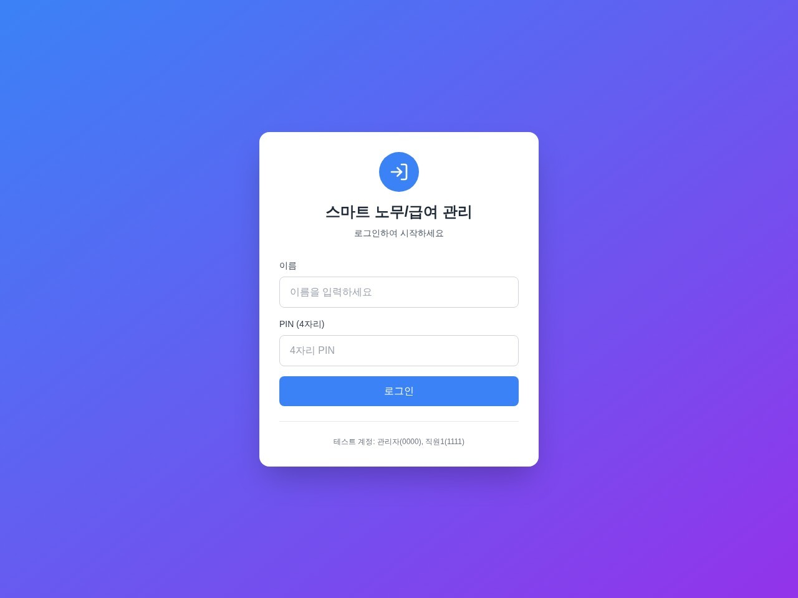
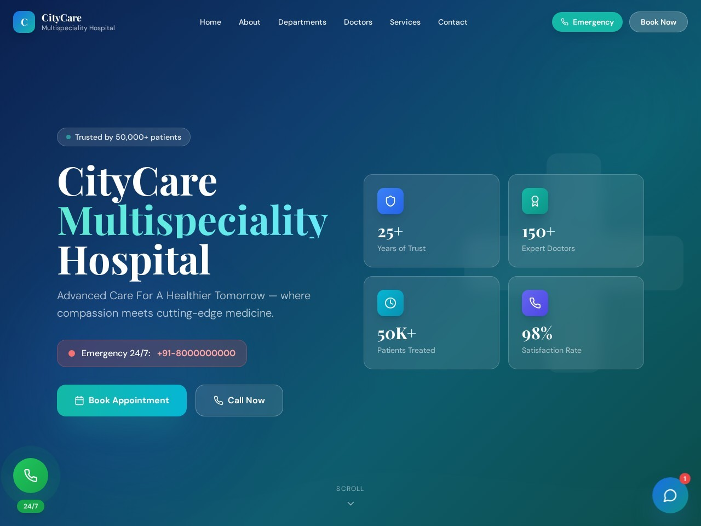
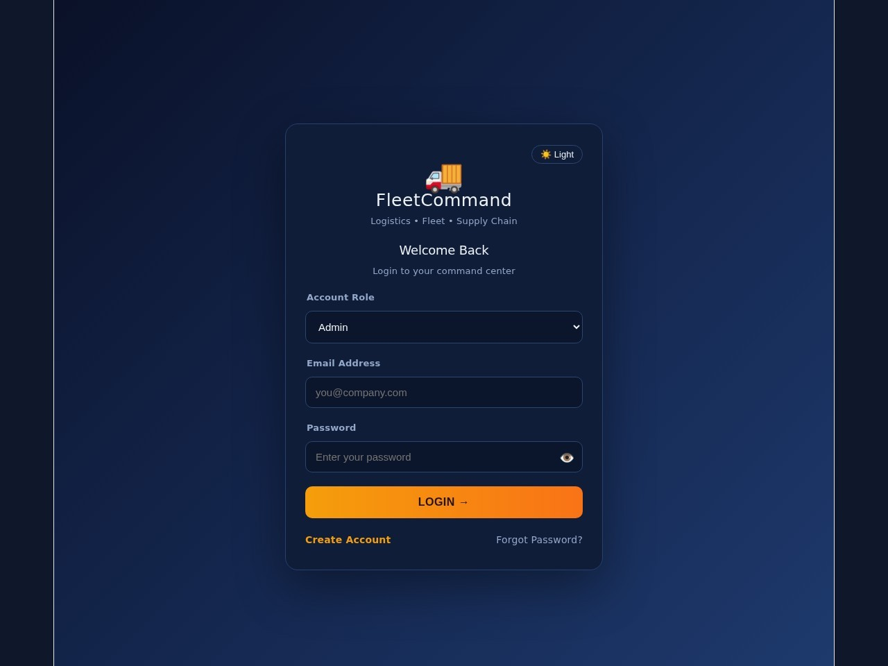
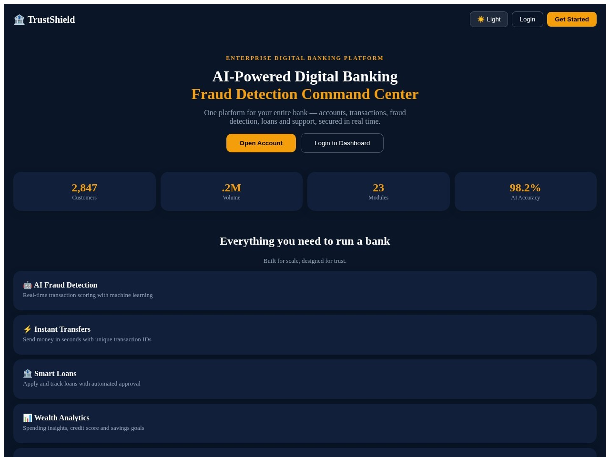
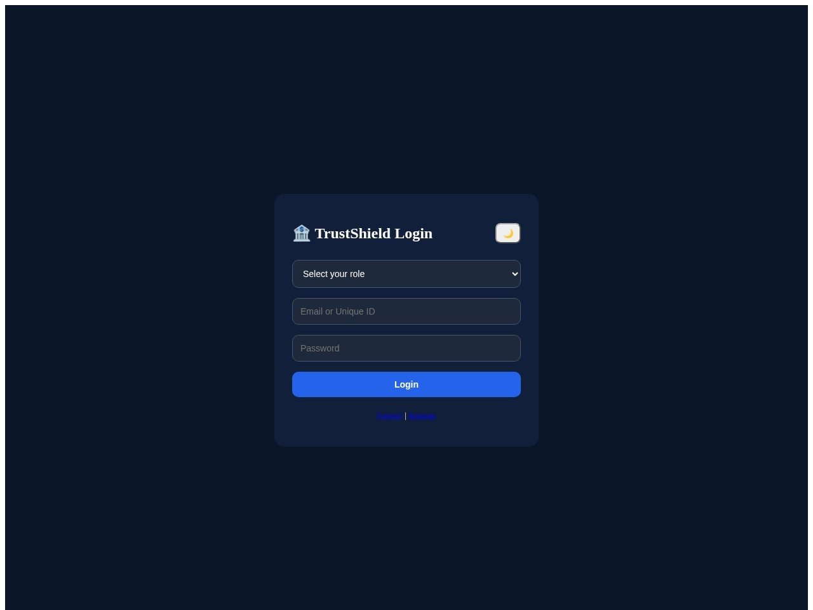
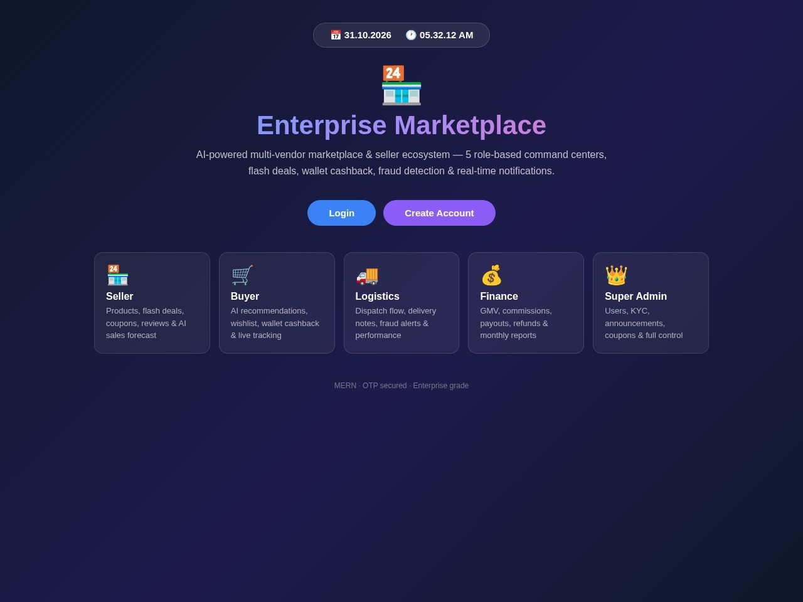

# Matiur Rahaman — Full-Stack Developer

A collection of full-stack applications, enterprise-style workflow platforms, AI-assisted tools, and developer experiments. I focus on building practical products with clear user roles, secure APIs, responsive interfaces, and maintainable architecture.

**Portfolio:** https://developer-portfolio-client.vercel.app  
**GitHub:** https://github.com/matiur25580  
**Email:** rahamanmatiur397@gmail.com  
**Location:** Raiganj, West Bengal, India

---

## Featured Projects

| Project | What it demonstrates | Technology / focus |
|---|---|---|
| [HireFlow — ATS Recruitment System](https://github.com/matiur25580/ats-recruitment-system) | Candidate and recruiter workflows, resume handling, AI-assisted resume matching | React, TypeScript, Node.js, Express, MongoDB, Gemini |
| [TrustShield — Banking Fraud Detection](https://github.com/matiur25580/Enterprise-AI-Powered-Digital-Banking-Fraud-Detection-DevOps-Command-Center) | Banking-style dashboards, role-based workflows, fraud-monitoring concepts | MERN, JWT, OTP, real-time updates |
| [FleetCommand — Logistics & Supply Chain](https://github.com/matiur25580/Enterprise-AI-Powered-Logistics-Fleet-Supply-Chain-Command-Center) | Fleet, trips, warehouse, bookings, forecasting and operational reporting | React, Node.js, Express, MongoDB, Socket.IO |
| [SmartGadget MegaStore](https://github.com/matiur25580/Enterprise-AI-Powered-SmartGadget-Lifestyle-MegaStore-Command-Center) | E-commerce catalog, seller workflows, authentication and COD order flow | MERN, JWT, OTP |
| [Multi-Vendor Marketplace](https://github.com/matiur25580/Enterprise-AI-Powered-Multi-Vendor-Marketplace-Seller-Ecosystem-Command-Center) | Buyer, seller, logistics and finance workflows | MERN, MongoDB, Brevo OTP |
| [CityCare Hospital Management](https://github.com/matiur25580/hospital-management-system) | Patient care, appointments, pharmacy, billing and staff workflows | MERN, JWT, OTP |
| [Smart HR & Payroll](https://github.com/matiur25580/enterprise-hr-payroll-system) | Employee self-service, attendance, leave and payroll operations | TypeScript, Preact, Express, MongoDB |
| [AI SaaS Generator](https://github.com/matiur25580/ai-saas-generator) | AI-assisted SaaS generation and account/credit workflows | AI integration, full-stack application |
| [Real Estate Management](https://github.com/matiur25580/realestate-management-system) | Property and real-estate management workflows | Full-stack web application |
| [Real-Time Chat Collaboration Hub](https://github.com/matiur25580/Enterprise-Real-Time-Chat-Collaboration-Hub) | Real-time messaging and authenticated collaboration | React, Node.js, Express, Socket.IO |
| [Trello Clone](https://github.com/matiur25580/Trello-Clone) | Kanban-style task and board management | Web application |
| [Online Food Ordering System](https://github.com/matiur25580/Online-Food-Ordering-System-main) | Responsive restaurant and menu interface | HTML, CSS, JavaScript, Bootstrap, PHP, MySQL |
| [FinTech Smart Invoice & Expense System](https://github.com/matiur25580/FinTech-Smart-Invoice-Expense-Supplier-Payment-System) | Invoice, expense and supplier-payment workflows | FinTech application |\n| [Cyber Security Operations Command Center](https://github.com/matiur25580/Enterprise-AI-Powered-Cyber-Security-Operations-Command-Center) | Security operations monitoring and command-center workflows | AI / Cybersecurity |\n| [Developer Portfolio](https://github.com/matiur25580/Developer-Portfolio) | Personal profile and project presentation | React, Vite, Tailwind CSS |

> **Project transparency:** The repositories represent work at different stages. Feature descriptions should be read alongside each project's implementation notes; prototype UI, demo data, and planned integrations are not presented as production capabilities. The Online Food Ordering System was a team academic project; my documented contribution was frontend UI work.

---

## Project UI Gallery

A single-column gallery of the six featured applications. Each project includes two existing interface previews from the portfolio's screenshot assets.

### 01 · Smart HR & Payroll Management System

*Workforce administration and role-based HR operations.*

*An additional view of the HR and employee workflow.*

---

### 02 · CityCare Hospital Management System

*Hospital operations and patient-care workflows.*

*An additional view of the hospital management experience.*

---

### 03 · RealEstate Management System

*Property and rental-management workflows.*

*An additional view of the property operations interface.*

---

### 04 · FleetCommand Logistics System

*Fleet, trip and supply-chain operations.*

*An additional view of the logistics command center.*

---

### 05 · TrustShield Bank

*Digital banking and fraud-monitoring concepts.*

*An additional view of the banking experience.*

---

### 06 · Multi-Vendor Marketplace

*Buyer and seller marketplace workflows.*

*An additional view of the seller ecosystem.*

> These are portfolio project previews. Feature availability and implementation status are documented in each linked repository.

## Technical Skills

- **Frontend:** React, TypeScript, JavaScript, Preact, Vite, Tailwind CSS, HTML, CSS, Bootstrap
- **Backend:** Node.js, Express.js, REST APIs, PHP
- **Database:** MongoDB, Mongoose, MySQL
- **Authentication & security:** JWT, bcrypt, OTP workflows, role-based access control
- **Integrations:** Socket.IO, Gemini API, Cloudinary, email APIs
- **Tools & deployment:** Git, GitHub, GitHub Actions, Vercel, Render

## Education

**B.Tech in Computer Science & Engineering**  
Bengal Institute of Technology, Kolkata — MAKAUT  
2019–2023

## Contact

- **Email:** rahamanmatiur397@gmail.com
- **GitHub:** [github.com/matiur25580](https://github.com/matiur25580)
- **Portfolio:** [developer-portfolio-client.vercel.app](https://developer-portfolio-client.vercel.app)

---

*Built and maintained by Matiur Rahaman.*
