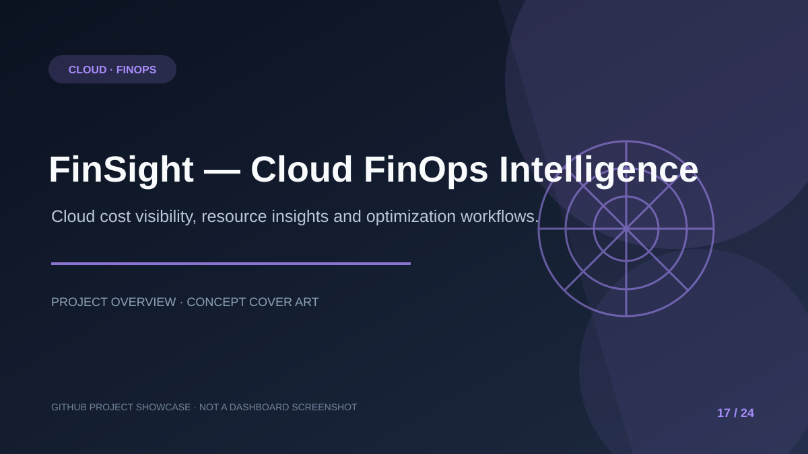
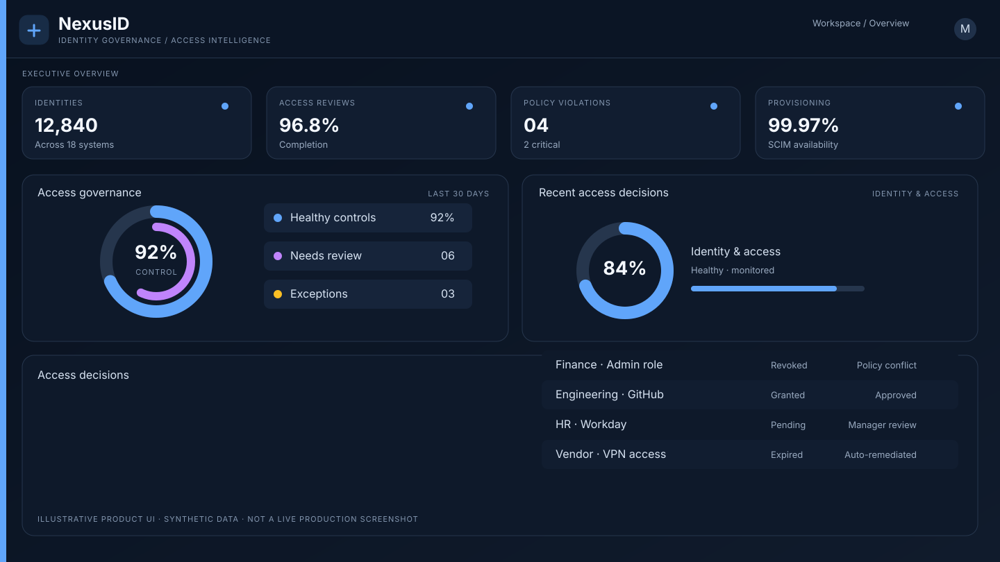
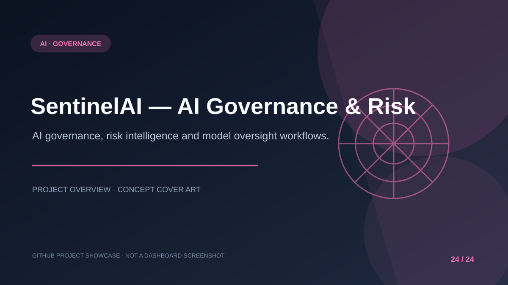
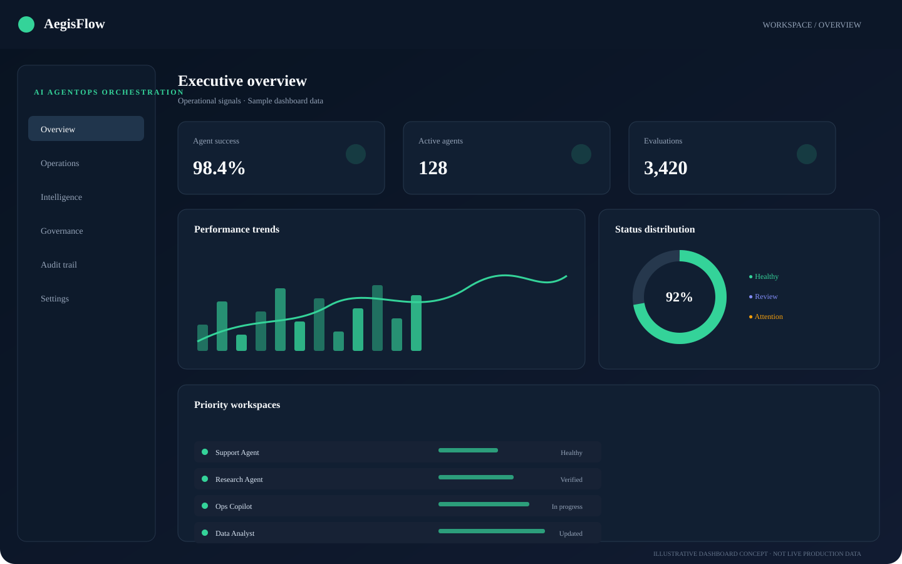
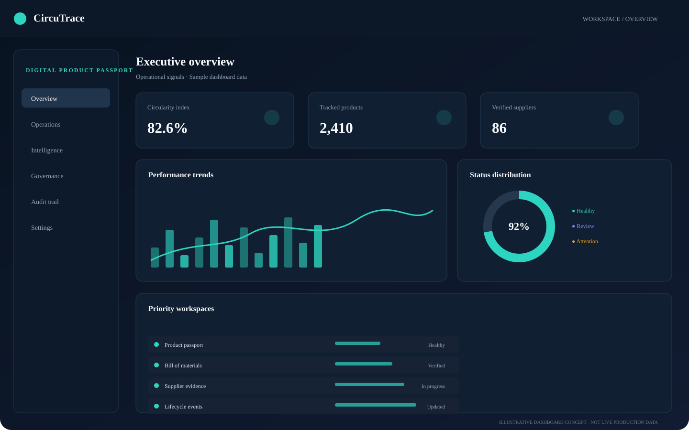
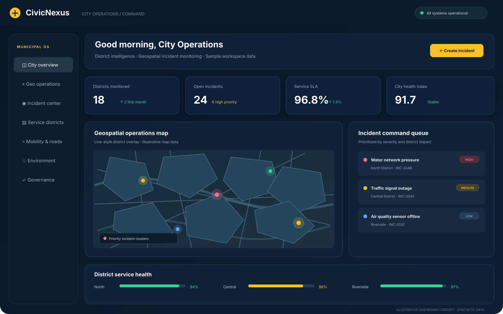
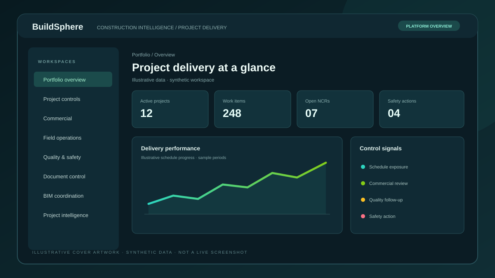

# Matiur Rahaman | Full-Stack Developer

<p align="center">
  <a href="https://github.com/matiur25580/Developer-Portfolio"></a>
  <a href="https://github.com/matiur25580"></a>
  <a href="mailto:rahamanmatiur397@gmail.com"></a>
</p>

<p align="center">
  <strong>Building useful web products, thoughtful user experiences, and full-stack solutions.</strong><br>
  React · TypeScript · Node.js · Express · MongoDB · AI Integrations
</p>

---

## Quick Navigation

- [About](#about)
- [Portfolio at a Glance](#portfolio-at-a-glance)
- [Featured Project Snapshot](#featured-project-snapshot)
- [Interview-ready project order](#interview-ready-project-order)
- [Complete List — All 32 Projects](#all-32-projects)
- [Complete Project Visual Gallery](#complete-project-visual-gallery)
- [Technology Stack](#technology-stack)
- [Education](#education)
- [Run Locally](#run-this-portfolio-locally)
- [Connect](#connect)

> **Portfolio focus:** full-stack engineering, secure application workflows, responsive product interfaces, API development and AI-assisted features. The project directory intentionally preserves all **32 project repositories**; each repository remains the source of truth for its implementation status.

## Screenshots

Capture the actual deployed portfolio after the latest production deployment. The [screenshot capture guide](docs/screenshots/README.md) lists the exact sections to capture. Only screenshots of this portfolio belong in this gallery; do not reuse images from the other projects.

## About

I'm **Matiur Rahaman**, a full-stack developer based in West Bengal, India. I enjoy designing and building web applications that bring together clean interfaces, reliable APIs, data-driven workflows, and practical integrations.

This repository contains my personal portfolio website and a curated overview of **32 GitHub project repositories** across recruitment, AI tools, fintech, logistics, healthcare, e-commerce, collaboration, and business operations.

- **Portfolio source:** [Developer-Portfolio](https://github.com/matiur25580/Developer-Portfolio)
- **GitHub:** [github.com/matiur25580](https://github.com/matiur25580)
- **Email:** [rahamanmatiur397@gmail.com](mailto:rahamanmatiur397@gmail.com)
- **Location:** West Bengal, India

## Portfolio at a Glance

| | |
|---|---|
| **Projects showcased** | 32 public repositories (excluding this portfolio) |
| **Core focus** | Full-stack web development |
| **Frontend** | React, TypeScript, JavaScript, Preact, Vite |
| **Backend** | Node.js, Express.js, REST APIs, PHP |
| **Data** | MongoDB, Mongoose, MySQL |
| **Interests** | AI-assisted products, secure workflows, dashboards, real-time apps |

## Interview-ready project order

The portfolio website is the front door to this collection and is featured first in the visual showcase. The **32-project count covers the 32 project repositories**; this portfolio repository is the presentation site itself and is not double-counted.

| Priority | Project | Why it is useful in an interview | Repository |
|---:|---|---|---|
| 01 | **Developer Portfolio — this website** | Demonstrates React UI composition, responsive design, searchable project discovery, category filters, project detail views and clear navigation to engineering work. | [Portfolio source](https://github.com/matiur25580/Developer-Portfolio) |
| 02 | **FleetCommand — Logistics & Supply Chain** | Strong MERN case study: role-based workflows, fleet/trip/warehouse domains, API design, real-time updates and operational data. | [Source](https://github.com/matiur25580/Enterprise-AI-Powered-Logistics-Fleet-Supply-Chain-Command-Center) |
| 03 | **CityCare — Hospital Management** | Another substantial MERN case study: multiple user roles, patient and appointment workflows, domain modelling and secure access. | [Source](https://github.com/matiur25580/hospital-management-system) |
| 04 | **HireFlow — ATS Recruitment System** | AI-assisted resume-to-job analysis alongside candidate, recruiter and hiring-pipeline workflows. | [Source](https://github.com/matiur25580/ats-recruitment-system) |
| 05 | **Draftline — AI Writing Studio** | Gemini-powered content generation with verified accounts, generation history and credit-ledger concepts. | [Source](https://github.com/matiur25580/ai-saas-generator) |
| 06 | **BuildSphere — Construction Intelligence** | Enterprise architecture across tenant isolation, project controls, document security, BIM coordination, testing and explainable decision support. | [Source](https://github.com/matiur25580/BuildSphere-Enterprise-Construction-Intelligence-Platform) |

For interviews, lead with the first three and be ready to explain one complete user journey, the data model, API authorization, error handling, testing strategy and one engineering trade-off in each repository. Describe AI and enterprise capabilities according to the implementation boundaries documented in each project's README.

## Featured Project Snapshot

A quick look at selected projects across the portfolio. The complete, numbered directory of all 32 project repositories follows below, and every project remains represented in the visual gallery.

| Project | Area | Technology / focus |
|---|---|---|
| [HireFlow — ATS Recruitment System](https://github.com/matiur25580/ats-recruitment-system) | Recruitment · AI | React, TypeScript, Node.js, Express, MongoDB, Gemini |
| [TrustShield — Banking Fraud Detection](https://github.com/matiur25580/Enterprise-AI-Powered-Digital-Banking-Fraud-Detection-DevOps-Command-Center) | FinTech · Security | MERN, JWT, OTP, real-time workflows |
| [FleetCommand — Logistics & Supply Chain](https://github.com/matiur25580/Enterprise-AI-Powered-Logistics-Fleet-Supply-Chain-Command-Center) | Enterprise · Logistics | React, Node.js, Express, MongoDB, Socket.IO |
| [CityCare Hospital Management](https://github.com/matiur25580/hospital-management-system) | Healthcare | MERN, JWT, OTP, hospital workflows |
| [Smart HR & Payroll](https://github.com/matiur25580/enterprise-hr-payroll-system) | HR · Enterprise | TypeScript, Preact, Express, MongoDB |
| [Multi-Vendor Marketplace](https://github.com/matiur25580/Enterprise-AI-Powered-Multi-Vendor-Marketplace-Seller-Ecosystem-Command-Center) | E-commerce | MERN, MongoDB, Brevo OTP |
| [SmartGadget Lifestyle MegaStore](https://github.com/matiur25580/Enterprise-AI-Powered-SmartGadget-Lifestyle-MegaStore-Command-Center) | E-commerce | MERN, JWT, OTP |
| [Draftline AI Writing Studio](https://github.com/matiur25580/ai-saas-generator) | AI · SaaS | React, Vite, Express, MongoDB, Gemini |
| [FinTech Smart Invoice & Expense](https://github.com/matiur25580/FinTech-Smart-Invoice-Expense-Supplier-Payment-System) | FinTech | React, TypeScript, Node.js, Express, MongoDB |
| [Cyber Security Operations Command Center](https://github.com/matiur25580/Enterprise-AI-Powered-Cyber-Security-Operations-Command-Center) | Cybersecurity | React, Vite, TypeScript, Node.js, Express, MongoDB |
| [PulseOps — Enterprise Developer Platform](https://github.com/matiur25580/PulseOps-Enterprise-Developer-Platform) | DevOps · SRE · FinOps | Next.js, React, TypeScript, NestJS, PostgreSQL, Prisma, Docker |

## All 32 Projects

All public projects in this GitHub account are listed below. This personal portfolio repository is intentionally excluded.

### Enterprise platforms & operations

| # | Project | Overview | Repository |
|---:|---|---|---|
| 01 | **ContractSphere — Contract Lifecycle Intelligence** | Contract lifecycle, approvals, obligations and legal operations. | [Source](https://github.com/matiur25580/ContractSphere-Enterprise-Contract-Lifecycle-Intelligence-Platform) |
| 02 | **FinSight — Cloud FinOps Intelligence** | Cloud cost visibility, resource insights and optimization workflows. | [Source](https://github.com/matiur25580/enterprise-cloud-finsight-platform) |
| 03 | **PrivaOps — Privacy & Data Lifecycle** | Privacy request operations, verification and data lifecycle controls. | [Source](https://github.com/matiur25580/PrivaOps-Enterprise-Privacy-Data-Lifecycle-Platform) |
| 04 | **GridPulse — Energy Intelligence** | Energy telemetry, grid flexibility and operational intelligence. | [Source](https://github.com/matiur25580/GridPulse-Enterprise-Energy-Intelligence-Grid-Flexibility-Platform) |
| 05 | **ForgeOps — Asset Lifecycle & Maintenance** | Asset lifecycle, maintenance planning and procurement workflows. | [Source](https://github.com/matiur25580/ForgeOps-Enterprise-Asset-Lifecycle-Predictive-Maintenance-Platform) |
| 06 | **FleetCommand — Logistics & Supply Chain** | Fleet, trips, warehouse and supply-chain operations. | [Source](https://github.com/matiur25580/Enterprise-AI-Powered-Logistics-Fleet-Supply-Chain-Command-Center) |
| 07 | **PulseOps — Enterprise Developer Platform** | Service ownership, observability, incident response, SRE and FinOps. | [Source](https://github.com/matiur25580/PulseOps-Enterprise-Developer-Platform) |
| 08 | **CarbonLedger — ESG & Carbon Accounting** | Carbon accounting, emissions reporting and sustainability operations. | [Source](https://github.com/matiur25580/CarbonLedger-Enterprise-ESG-Carbon-Accounting-Platform) |
| 09 | **SentinelAI — AI Governance & Risk** | AI governance, risk intelligence and model oversight workflows. | [Source](https://github.com/matiur25580/SentinelAI-Enterprise-AI-Governance-Risk-Intelligence-Platform) |
| 10 | **SignalForge — Product Intelligence** | Product analytics, experimentation and decision intelligence. | [Source](https://github.com/matiur25580/SignalForge-Enterprise-Product-Intelligence-Experimentation-Platform) |
| 11 | **NexusID — Identity Security Governance** | Identity lifecycle, access governance and enterprise security. | [Source](https://github.com/matiur25580/NexusID-Enterprise-Identity-Security-Governance-Platform) |
| 12 | **Cyber Security Operations Command Center** | Defensive security operations and monitoring workflows. | [Source](https://github.com/matiur25580/Enterprise-AI-Powered-Cyber-Security-Operations-Command-Center) |

### Finance, commerce & business applications

| # | Project | Overview | Repository |
|---:|---|---|---|
| 13 | **TrustShield — Digital Banking & Fraud Detection** | Banking-style workflows, OTP, KYC and fraud-monitoring concepts. | [Source](https://github.com/matiur25580/Enterprise-AI-Powered-Digital-Banking-Fraud-Detection-DevOps-Command-Center) |
| 14 | **FinTech Smart Invoice & Expense System** | Invoice, expense and supplier-payment management. | [Source](https://github.com/matiur25580/FinTech-Smart-Invoice-Expense-Supplier-Payment-System) |
| 15 | **Multi-Vendor Marketplace Seller Ecosystem** | Buyer, seller, logistics and finance-oriented marketplace workflows. | [Source](https://github.com/matiur25580/Enterprise-AI-Powered-Multi-Vendor-Marketplace-Seller-Ecosystem-Command-Center) |
| 16 | **SmartGadget Lifestyle MegaStore** | E-commerce catalogue, seller workflows and ordering. | [Source](https://github.com/matiur25580/Enterprise-AI-Powered-SmartGadget-Lifestyle-MegaStore-Command-Center) |
| 17 | **Real Estate Management System** | Property, rental and real-estate management workflows. | [Source](https://github.com/matiur25580/realestate-management-system) |
| 18 | **Smart HR & Payroll Management** | Employee, attendance, leave and payroll workflows. | [Source](https://github.com/matiur25580/enterprise-hr-payroll-system) |
| 19 | **CityCare Hospital Management** | Patient registration, appointments and hospital operations. | [Source](https://github.com/matiur25580/hospital-management-system) |

### AI, recruitment & collaboration

| # | Project | Overview | Repository |
|---:|---|---|---|
| 20 | **HireFlow — ATS Recruitment System** | Candidate/recruiter workflows and AI-assisted resume analysis. | [Source](https://github.com/matiur25580/ats-recruitment-system) |
| 21 | **Draftline AI Writing Studio** | AI-assisted content generation and writing workflows. | [Source](https://github.com/matiur25580/ai-saas-generator) |
| 22 | **Real-Time Chat & Collaboration Hub** | Authenticated chat, online presence and realtime messaging. | [Source](https://github.com/matiur25580/Enterprise-Real-Time-Chat-Collaboration-Hub) |
| 23 | **Trello Clone** | Kanban-inspired boards and task organization. | [Source](https://github.com/matiur25580/Trello-Clone) |
| 24 | **Online Food Ordering System** | Restaurant, menu and food-ordering academic team project. | [Source](https://github.com/matiur25580/Online-Food-Ordering-System-main) |
| 25 | **VerityGrid — Data Trust & Reliability** | Multi-tenant data catalog, profiling, quality validation, lineage, freshness objectives, incidents and governance approvals. | [Source](https://github.com/matiur25580/VerityGrid-Enterprise-Data-Trust-Intelligence-Platform) |
| 26 | **ResilioX — Operational Resilience** | Service-centric business impact analysis, dependency mapping, operational risk, control assurance, continuity plans and incident response. | [Source](https://github.com/matiur25580/ResilioX-Enterprise-Operational-Resilience-Platform) |
| 27 | **AegisFlow — AI AgentOps Orchestration** | Agent and workflow lifecycle, evaluation quality gates, promotion evidence, cost intelligence, approvals and audit workspaces. | [Source](https://github.com/matiur25580/AegisFlow-Enterprise-AI-AgentOps-Orchestration-Platform) |
| 28 | **ChainProof — Software Supply Chain Trust** | SBOM inventory, vulnerability intelligence, build provenance, release trust passports, policy-as-code and supplier risk. | [Source](https://github.com/matiur25580/Enterprise-Software-Supply-Chain-Security-Trust-Intelligence-Platform) |
| 29 | **CircuTrace — Digital Product Passport** | Digital product passports, bills of materials, supplier declarations, lifecycle traceability, evidence management and circularity workflows. | [Source](https://github.com/matiur25580/CircuTrace-Enterprise-Digital-Product-Passport-Circular-Lifecycle-Intelligence-Platform) |
| 30 | **CivicNexus — Smart City Intelligence** | Geospatial urban incident management, incident timelines, hotspot intelligence and explainable prioritization. | [Source](https://github.com/matiur25580/CivicNexus-Enterprise-Smart-City-Urban-Intelligence-Platform) |
| 31 | **CareMesh — Healthcare Interoperability** | Healthcare identity, consent, FHIR-oriented exchange contracts, referrals, audit and provenance for care coordination. | [Source](https://github.com/matiur25580/CareMesh-Enterprise-Healthcare-Interoperability-Care-Coordination-Platform) |

### Construction & built environment

| # | Project | Overview | Repository |
|---:|---|---|---|
| 32 | **BuildSphere — Enterprise Construction Intelligence** | Multi-tenant construction delivery workspace covering project controls, commercial records, field operations, quality, safety, secure documents, BIM coordination and explainable project intelligence. Active engineering project; documented implementation boundaries are retained in its README. | [Source](https://github.com/matiur25580/BuildSphere-Enterprise-Construction-Intelligence-Platform) |

> **Transparency note:** These repositories represent projects at different stages of implementation. The descriptions above summarize their focus; they do not imply that every planned feature or integration is complete or production-deployed. Please refer to each repository's README and source code for its current status. The Online Food Ordering System was an academic team project; my documented contribution was frontend UI work. The Cyber Security Command Center is an evolving project, so its broader SOC/SIEM/SOAR/GRC direction should not be mistaken for a fully implemented feature set.

## Complete Project Visual Gallery

**32 project repositories · 33 visuals including the portfolio website.** The gallery leads with the portfolio itself, followed by the two strongest MERN interview projects and then the complete 32-repository collection. Project visuals are concept cover artworks or illustrative dashboard previews, not claims about a live production deployment.

<h3>01 · Developer Portfolio — Personal Website</h3>

<a href="https://github.com/matiur25580/Developer-Portfolio"><strong>View portfolio repository</strong></a>

<a href="https://raw.githubusercontent.com/matiur25580/Developer-Portfolio/main/client/public/projects/preview-portfolio.svg"></a>

<p>The portfolio website is the presentation layer for this body of work: responsive React sections, searchable project discovery, category filters, project detail views and clear paths to source repositories. This is illustrative cover artwork, not a captured production screenshot.</p>

---

<h3>02 · FleetCommand — Logistics & Supply Chain</h3>

<a href="https://github.com/matiur25580/Enterprise-AI-Powered-Logistics-Fleet-Supply-Chain-Command-Center"><strong>View repository</strong></a>

<a href="https://raw.githubusercontent.com/matiur25580/Developer-Portfolio/main/client/public/projects/p4.png"></a>

<p>FleetCommand connects fleet visibility with the operational flow behind logistics: trip coordination, vehicle activity, warehouse movement and supply-chain updates. The command-centre approach helps operators understand what is moving, where attention is needed and how work progresses.</p>


---

<h3>03 · CityCare Hospital Management</h3>

<a href="https://github.com/matiur25580/hospital-management-system"><strong>View repository</strong></a>

<a href="https://raw.githubusercontent.com/matiur25580/Developer-Portfolio/main/client/public/projects/p2.png"></a>

<p>CityCare is centred on the day-to-day coordination of hospital services, including patient registration, appointments and administrative workflows. The goal is to make essential information easier for staff to access and routine care operations easier to organize.</p>


---

<h3>04 · HireFlow — ATS Recruitment System</h3>

<a href="https://github.com/matiur25580/ats-recruitment-system"><strong>View repository</strong></a>

<a href="https://raw.githubusercontent.com/matiur25580/Developer-Portfolio/main/client/public/projects/preview-hireflow.svg"></a>

<p>HireFlow brings the recruitment journey into one focused workspace—from candidate discovery and application tracking to recruiter review and AI-assisted resume insights. The experience is designed to make hiring pipelines easier to follow, evaluate and manage.</p>


---

<h3>05 · TrustShield — Banking Fraud Detection</h3>

<a href="https://github.com/matiur25580/Enterprise-AI-Powered-Digital-Banking-Fraud-Detection-DevOps-Command-Center"><strong>View repository</strong></a>

<a href="https://raw.githubusercontent.com/matiur25580/Developer-Portfolio/main/client/public/projects/p5.png"></a>

<p>TrustShield explores a secure digital-banking experience that brings together customer verification, OTP-based access, KYC workflows and fraud-monitoring signals. Its focus is helping teams review suspicious activity while keeping essential banking journeys clear and controlled.</p>


---

<h3>06 · SmartGadget Lifestyle MegaStore</h3>

<a href="https://github.com/matiur25580/Enterprise-AI-Powered-SmartGadget-Lifestyle-MegaStore-Command-Center"><strong>View repository</strong></a>

<a href="https://raw.githubusercontent.com/matiur25580/Developer-Portfolio/main/client/public/projects/preview-smartgadget.svg"></a>

<p>SmartGadget presents an end-to-end commerce concept for discovering products and managing the seller-to-order journey. It brings catalogue browsing, seller workflows and order handling into a consistent shopping experience.</p>


---

<h3>07 · Draftline AI Writing Studio</h3>

<a href="https://github.com/matiur25580/ai-saas-generator"><strong>View repository</strong></a>

<a href="https://raw.githubusercontent.com/matiur25580/Developer-Portfolio/main/client/public/projects/preview-draftline.svg"></a>

<p>Draftline is an AI-assisted writing workspace for turning ideas into structured content. It emphasizes a streamlined creation flow—from drafting and refining text to keeping the writing experience focused and approachable.</p>


---

<h3>08 · Real Estate Management System</h3>

<a href="https://github.com/matiur25580/realestate-management-system"><strong>View repository</strong></a>

<a href="https://raw.githubusercontent.com/matiur25580/Developer-Portfolio/main/client/public/projects/p3.png"></a>

<p>The Real Estate Management System organizes property-focused workflows around listings, rental activity and day-to-day property administration. Its dashboard-oriented experience is intended to give users a clearer view of properties and the work associated with them.</p>


---

<h3>09 · Real-Time Chat & Collaboration Hub</h3>

<a href="https://github.com/matiur25580/Enterprise-Real-Time-Chat-Collaboration-Hub"><strong>View repository</strong></a>

<a href="https://raw.githubusercontent.com/matiur25580/Developer-Portfolio/main/client/public/projects/preview-chat.svg"></a>

<p>This collaboration hub focuses on authenticated conversations, real-time messaging and online presence. It brings the signals people rely on to collaborate—who is available, what is being discussed and how conversations evolve—into one workspace.</p>


---

<h3>10 · Trello Clone</h3>

<a href="https://github.com/matiur25580/Trello-Clone"><strong>View repository</strong></a>

<a href="https://raw.githubusercontent.com/matiur25580/Developer-Portfolio/main/client/public/projects/preview-trello.svg"></a>

<p>The Trello-style workspace turns tasks into a visual, board-based workflow. Teams can organize work by stage, track progress at a glance and keep priorities and next actions visible as tasks move forward.</p>


---

<h3>11 · Online Food Ordering System</h3>

<a href="https://github.com/matiur25580/Online-Food-Ordering-System-main"><strong>View repository</strong></a>

<a href="https://raw.githubusercontent.com/matiur25580/Developer-Portfolio/main/client/public/projects/preview-food-order.svg"></a>

<p>This academic team project explores the core food-ordering journey, connecting restaurant and menu discovery with order placement. My documented contribution was frontend UI work, focused on presenting the ordering flow in a clear, usable interface.</p>


---

<h3>12 · Smart HR & Payroll Management</h3>

<a href="https://github.com/matiur25580/enterprise-hr-payroll-system"><strong>View repository</strong></a>

<a href="https://raw.githubusercontent.com/matiur25580/Developer-Portfolio/main/client/public/projects/p1.webp"></a>

<p>The HR and Payroll platform brings employee administration together with attendance, leave and payroll workflows. Its purpose is to reduce scattered HR operations by giving teams a more structured view of people-related records and routine processes.</p>


---

<h3>13 · Multi-Vendor Marketplace Seller Ecosystem</h3>

<a href="https://github.com/matiur25580/Enterprise-AI-Powered-Multi-Vendor-Marketplace-Seller-Ecosystem-Command-Center"><strong>View repository</strong></a>

<a href="https://raw.githubusercontent.com/matiur25580/Developer-Portfolio/main/client/public/projects/p6.png"></a>

<p>The marketplace concept connects the needs of buyers, sellers and supporting operations in a multi-vendor environment. It highlights catalogue and seller activity alongside logistics and finance-oriented workflows, giving the ecosystem a more joined-up operational view.</p>


---

<h3>14 · FinTech Smart Invoice & Expense System</h3>

<a href="https://github.com/matiur25580/FinTech-Smart-Invoice-Expense-Supplier-Payment-System"><strong>View repository</strong></a>

<a href="https://raw.githubusercontent.com/matiur25580/Developer-Portfolio/main/client/public/projects/preview-fintech.svg"></a>

<p>This FinTech workspace focuses on the financial operations behind invoices, expenses and supplier payments. It is designed to make payable activity and expense information easier to review, organize and track across a business workflow.</p>


---

<h3>15 · Cyber Security Operations Command Center</h3>

<a href="https://github.com/matiur25580/Enterprise-AI-Powered-Cyber-Security-Operations-Command-Center"><strong>View repository</strong></a>

<a href="https://raw.githubusercontent.com/matiur25580/Developer-Portfolio/main/client/public/projects/preview-cyber.svg"></a>

<p>The Cyber Security Operations Command Center presents a defensive-security monitoring concept for bringing alerts, operational signals and investigation priorities into one view. The repository is an evolving project; the visual communicates its SOC direction rather than claiming a fully implemented SIEM/SOAR or GRC feature set.</p>


---

<h3>16 · PulseOps — Enterprise Developer Platform</h3>

<a href="https://github.com/matiur25580/PulseOps-Enterprise-Developer-Platform"><strong>View repository</strong></a>

<a href="https://raw.githubusercontent.com/matiur25580/Developer-Portfolio/main/client/public/projects/pulseops-overview.svg"></a>


<sub>Gallery assets: Platform Overview, Service Catalog, Incident Command, SLO &amp; Error Budgets, Observability Explorer, and Alert Management. These are illustrative UI concepts sourced from the PulseOps repository, not screenshots of a live production deployment.</sub>


---

<h3>17 · ContractSphere — Contract Lifecycle Intelligence</h3>

<a href="https://github.com/matiur25580/ContractSphere-Enterprise-Contract-Lifecycle-Intelligence-Platform"><strong>View repository</strong></a>

<a href="https://raw.githubusercontent.com/matiur25580/Developer-Portfolio/main/client/public/projects/gallery-contractsphere.svg"></a>


<p>LegalTech · Enterprise · Contract authoring, approvals, obligations and lifecycle intelligence. This is project cover artwork, not a dashboard screenshot.</p>


---

<h3>18 · FinSight — Cloud FinOps Intelligence</h3>

<a href="https://github.com/matiur25580/enterprise-cloud-finsight-platform"><strong>View repository</strong></a>

<a href="https://raw.githubusercontent.com/matiur25580/Developer-Portfolio/main/client/public/projects/gallery-finsight.svg"></a>


<p>Cloud · FinOps · Cloud cost visibility, resource insights and optimization workflows. This is project cover artwork, not a dashboard screenshot.</p>


---

<h3>19 · PrivaOps — Privacy & Data Lifecycle</h3>

<a href="https://github.com/matiur25580/PrivaOps-Enterprise-Privacy-Data-Lifecycle-Platform"><strong>View repository</strong></a>

<a href="https://raw.githubusercontent.com/matiur25580/Developer-Portfolio/main/client/public/projects/gallery-privaops.svg"></a>


<p>Privacy · Governance · Privacy request operations, identity verification and data lifecycle controls. This is project cover artwork, not a dashboard screenshot.</p>


---

<h3>20 · GridPulse — Energy Intelligence</h3>

<a href="https://github.com/matiur25580/GridPulse-Enterprise-Energy-Intelligence-Grid-Flexibility-Platform"><strong>View repository</strong></a>

<a href="https://raw.githubusercontent.com/matiur25580/Developer-Portfolio/main/client/public/projects/gallery-gridpulse.svg"></a>


<p>Energy · Sustainability · Energy telemetry, grid flexibility and operational intelligence. This is project cover artwork, not a dashboard screenshot.</p>


---

<h3>21 · ForgeOps — Asset Lifecycle & Maintenance</h3>

<a href="https://github.com/matiur25580/ForgeOps-Enterprise-Asset-Lifecycle-Predictive-Maintenance-Platform"><strong>View repository</strong></a>

<a href="https://raw.githubusercontent.com/matiur25580/Developer-Portfolio/main/client/public/projects/gallery-forgeops.svg"></a>


<p>Industrial · Operations · Asset lifecycle management, maintenance planning and procurement workflows. This is project cover artwork, not a dashboard screenshot.</p>


---

<h3>22 · SignalForge — Product Intelligence</h3>

<a href="https://github.com/matiur25580/SignalForge-Enterprise-Product-Intelligence-Experimentation-Platform"><strong>View repository</strong></a>

<a href="https://raw.githubusercontent.com/matiur25580/Developer-Portfolio/main/client/public/projects/gallery-signalforge.svg"></a>


<p>Product · Experimentation · Product analytics, experimentation and decision intelligence workflows. This is project cover artwork, not a dashboard screenshot.</p>


---

<h3>23 · CarbonLedger — ESG & Carbon Accounting</h3>

<a href="https://github.com/matiur25580/CarbonLedger-Enterprise-ESG-Carbon-Accounting-Platform"><strong>View repository</strong></a>

<a href="https://raw.githubusercontent.com/matiur25580/Developer-Portfolio/main/client/public/projects/gallery-carbonledger.svg"></a>


<p>ESG · Sustainability · Carbon accounting, emissions reporting and sustainability operations. This is project cover artwork, not a dashboard screenshot.</p>


---

<h3>24 · NexusID — Identity Security Governance</h3>

<a href="https://github.com/matiur25580/NexusID-Enterprise-Identity-Security-Governance-Platform"><strong>View repository</strong></a>

<a href="https://raw.githubusercontent.com/matiur25580/Developer-Portfolio/main/client/public/projects/gallery-nexusid.svg"></a>


<p>Identity · Security · Identity lifecycle, access governance and enterprise security workflows. This is project cover artwork, not a dashboard screenshot.</p>


---

<h3>25 · SentinelAI — AI Governance & Risk</h3>

<a href="https://github.com/matiur25580/SentinelAI-Enterprise-AI-Governance-Risk-Intelligence-Platform"><strong>View repository</strong></a>

<a href="https://raw.githubusercontent.com/matiur25580/Developer-Portfolio/main/client/public/projects/gallery-sentinelai.svg"></a>


<p>AI · Governance · AI governance, risk intelligence and model oversight workflows. This is project cover artwork, not a dashboard screenshot.</p>

<h3>26 · VerityGrid — Data Trust & Reliability</h3>
<a href="https://github.com/matiur25580/VerityGrid-Enterprise-Data-Trust-Intelligence-Platform"><strong>View repository</strong></a>


<p>Multi-tenant data catalog, profiling, quality validation, lineage, freshness objectives, incidents, governance approvals and audit evidence.</p>


---

<h3>27 · ResilioX — Operational Resilience</h3>
<a href="https://github.com/matiur25580/ResilioX-Enterprise-Operational-Resilience-Platform"><strong>View repository</strong></a>


<p>Service-centric resilience workspace for business impact analysis, dependency mapping, operational risk, control assurance, continuity plans and incident response.</p>


---

<h3>28 · AegisFlow — AI AgentOps Orchestration</h3>
<a href="https://github.com/matiur25580/AegisFlow-Enterprise-AI-AgentOps-Orchestration-Platform"><strong>View repository</strong></a>



<p>Multi-tenant AgentOps control plane for agent lifecycle, evaluation quality gates, promotion evidence, cost intelligence, approvals and audit workspaces.</p>


---

<h3>29 · ChainProof — Software Supply Chain Trust</h3>
<a href="https://github.com/matiur25580/Enterprise-Software-Supply-Chain-Security-Trust-Intelligence-Platform"><strong>View repository</strong></a>


<p>Software supply-chain security foundation for SBOM inventory, vulnerability intelligence, build provenance, release trust passports and policy-as-code.</p>


---

<h3>30 · CircuTrace — Digital Product Passport</h3>
<a href="https://github.com/matiur25580/CircuTrace-Enterprise-Digital-Product-Passport-Circular-Lifecycle-Intelligence-Platform"><strong>View repository</strong></a>



<p>Early MERN foundation for digital product passports, bills of materials, supplier declarations, lifecycle traceability, evidence management and circularity workflows.</p>


---

<h3>31 · CivicNexus — Smart City Intelligence</h3>
<a href="https://github.com/matiur25580/CivicNexus-Enterprise-Smart-City-Urban-Intelligence-Platform"><strong>View repository</strong></a>



<p>Urban operations foundation with jurisdiction-scoped geospatial incident management, GeoJSON/WGS84 handling, incident timelines, hotspot intelligence and explainable prioritization.</p>


---

<h3>32 · CareMesh — Healthcare Interoperability</h3>
<a href="https://github.com/matiur25580/CareMesh-Enterprise-Healthcare-Interoperability-Care-Coordination-Platform"><strong>View repository</strong></a>


<p>Privacy-first healthcare interoperability and care-coordination foundation covering organization trust, identity and access, consent, FHIR-oriented exchange contracts, referrals, audit and provenance.</p>


---
<h3>33 · BuildSphere — Enterprise Construction Intelligence Platform</h3>

<a href="https://github.com/matiur25580/BuildSphere-Enterprise-Construction-Intelligence-Platform"><strong>View repository</strong></a>

<a href="https://raw.githubusercontent.com/matiur25580/Developer-Portfolio/main/client/public/projects/buildsphere-overview.svg"></a>

<p>Multi-tenant construction delivery workspace spanning project controls, commercial and procurement records, field reporting, quality and safety workflows, secure document control, IFC model registration, BCF-inspired coordination and explainable rule-based project intelligence. The cover is illustrative artwork; the repository README documents implemented capabilities, active engineering status and production prerequisites.</p>

<details>
<summary>View all 12 BuildSphere illustrative product screens</summary>

<p>These are synthetic UI concepts from the BuildSphere repository, not live production screenshots or proof that every depicted widget is implemented.</p>

<table>
<tr><td><a href="https://raw.githubusercontent.com/matiur25580/BuildSphere-Enterprise-Construction-Intelligence-Platform/main/docs/screenshots/01-portfolio.svg"></a><br><sub>Portfolio overview</sub></td><td><a href="https://raw.githubusercontent.com/matiur25580/BuildSphere-Enterprise-Construction-Intelligence-Platform/main/docs/screenshots/02-projects.svg"></a><br><sub>Project command centre</sub></td></tr>
<tr><td><a href="https://raw.githubusercontent.com/matiur25580/BuildSphere-Enterprise-Construction-Intelligence-Platform/main/docs/screenshots/03-schedule.svg"></a><br><sub>Schedule and lookahead</sub></td><td><a href="https://raw.githubusercontent.com/matiur25580/BuildSphere-Enterprise-Construction-Intelligence-Platform/main/docs/screenshots/04-commercial.svg"></a><br><sub>Commercial controls</sub></td></tr>
<tr><td><a href="https://raw.githubusercontent.com/matiur25580/BuildSphere-Enterprise-Construction-Intelligence-Platform/main/docs/screenshots/05-procurement.svg"></a><br><sub>Procurement and supply chain</sub></td><td><a href="https://raw.githubusercontent.com/matiur25580/BuildSphere-Enterprise-Construction-Intelligence-Platform/main/docs/screenshots/06-field-ops.svg"></a><br><sub>Field operations</sub></td></tr>
<tr><td><a href="https://raw.githubusercontent.com/matiur25580/BuildSphere-Enterprise-Construction-Intelligence-Platform/main/docs/screenshots/07-quality.svg"></a><br><sub>Quality assurance</sub></td><td><a href="https://raw.githubusercontent.com/matiur25580/BuildSphere-Enterprise-Construction-Intelligence-Platform/main/docs/screenshots/08-hse.svg"></a><br><sub>Health, safety and environment</sub></td></tr>
<tr><td><a href="https://raw.githubusercontent.com/matiur25580/BuildSphere-Enterprise-Construction-Intelligence-Platform/main/docs/screenshots/09-documents.svg"></a><br><sub>Document control</sub></td><td><a href="https://raw.githubusercontent.com/matiur25580/BuildSphere-Enterprise-Construction-Intelligence-Platform/main/docs/screenshots/10-intelligence.svg"></a><br><sub>AI project intelligence</sub></td></tr>
<tr><td><a href="https://raw.githubusercontent.com/matiur25580/BuildSphere-Enterprise-Construction-Intelligence-Platform/main/docs/screenshots/11-collaboration.svg"></a><br><sub>Team collaboration</sub></td><td><a href="https://raw.githubusercontent.com/matiur25580/BuildSphere-Enterprise-Construction-Intelligence-Platform/main/docs/screenshots/12-sustainability.svg"></a><br><sub>ESG and carbon performance</sub></td></tr>
</table>
</details>

---


## Technology Stack

| Category | Technologies |
|---|---|
| **Frontend** | React, TypeScript, JavaScript, Preact, Vite, Tailwind CSS, HTML, CSS, Bootstrap |
| **Backend** | Node.js, Express.js, REST APIs, PHP |
| **Database** | MongoDB, Mongoose, MySQL |
| **Authentication** | JWT, bcrypt, OTP workflows, role-based access control |
| **Real-time & AI** | Socket.IO, Gemini API, AI-assisted workflows |
| **Tools & delivery** | Git, GitHub, GitHub Actions, Postman, Vercel, Render |

## Education

**B.Tech — Computer Science & Engineering**  
Bengal Institute of Technology, Kolkata · MAKAUT  
2019–2023

## Run This Portfolio Locally

The application source is organized in the `client` directory. To run the frontend locally:

```bash
cd client
npm install
npm run dev
```

To create a production build:

```bash
npm run build
```

Check the `client/package.json` and project configuration for the exact scripts and any environment variables required by your checkout.

## Connect

- **Email:** [rahamanmatiur397@gmail.com](mailto:rahamanmatiur397@gmail.com)
- **GitHub:** [matiur25580](https://github.com/matiur25580)
- **Portfolio source:** [Developer-Portfolio](https://github.com/matiur25580/Developer-Portfolio)

---

<p align="center">
  <strong>Designed and maintained by Matiur Rahaman</strong><br>
  <sub>Learning, building, improving — one project at a time.</sub>
</p>

