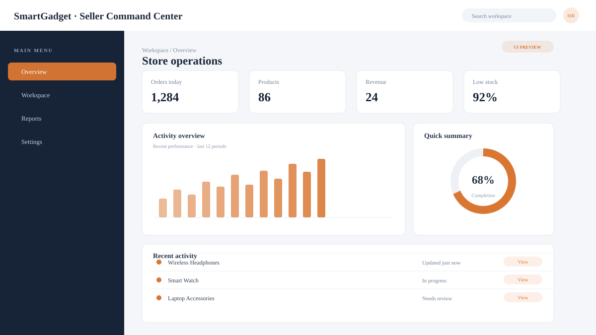
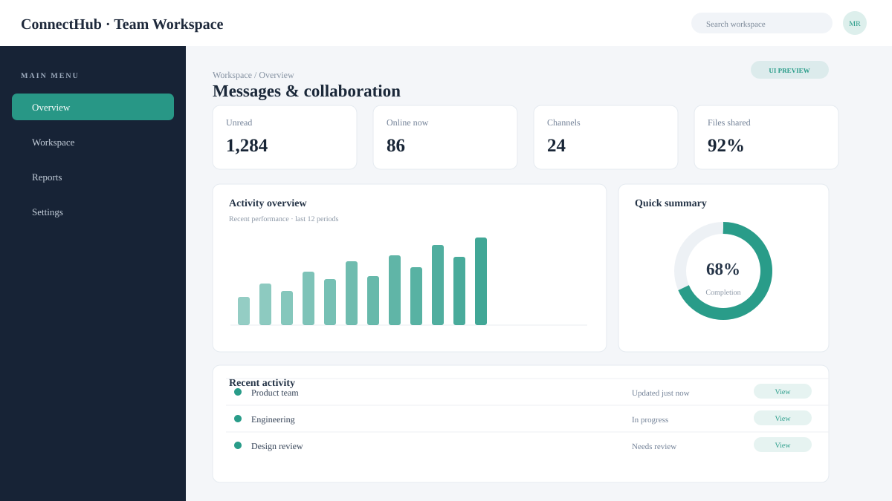
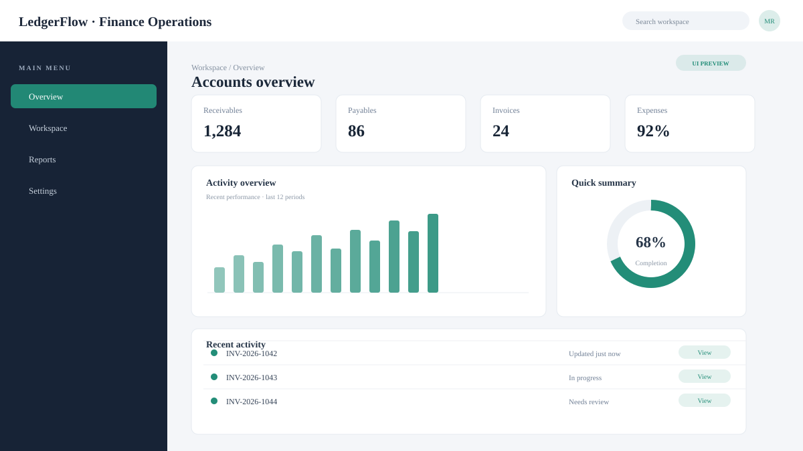
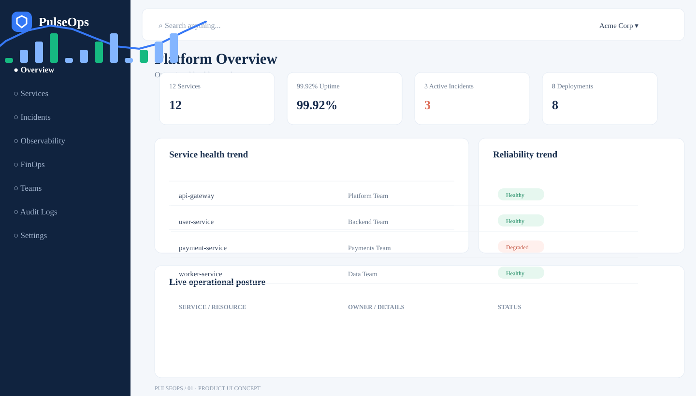
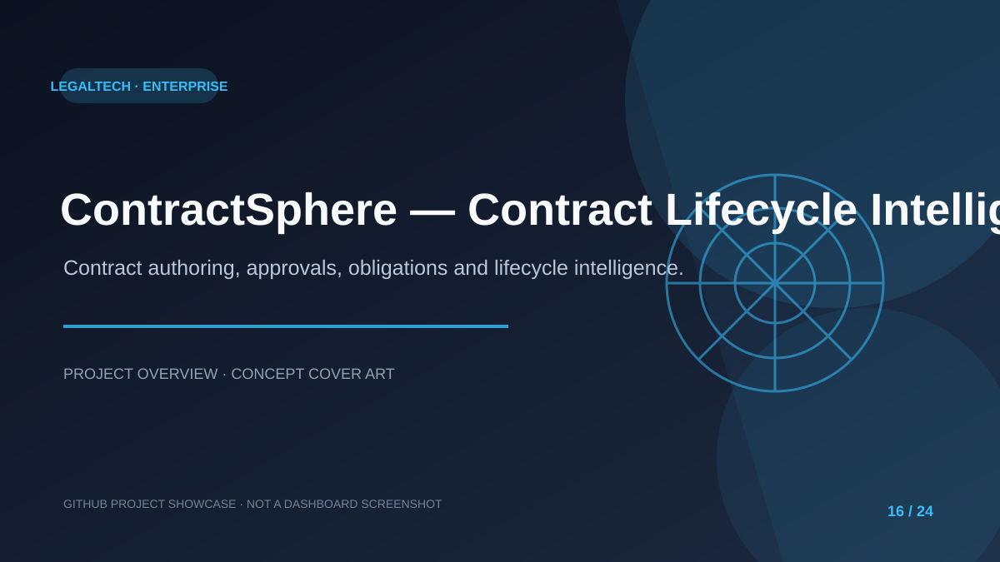
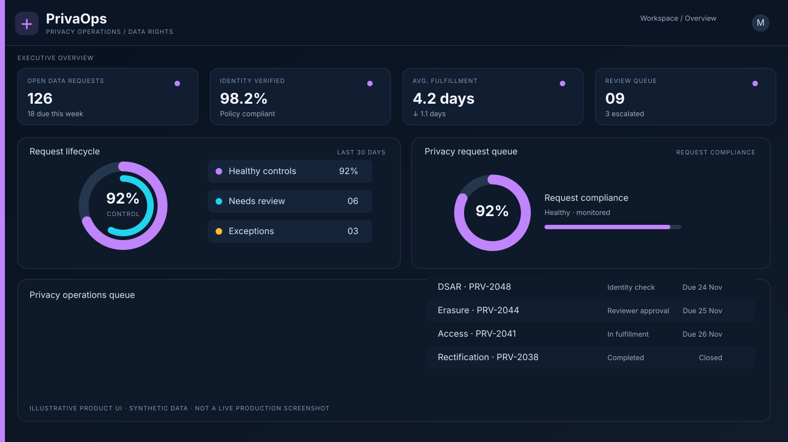
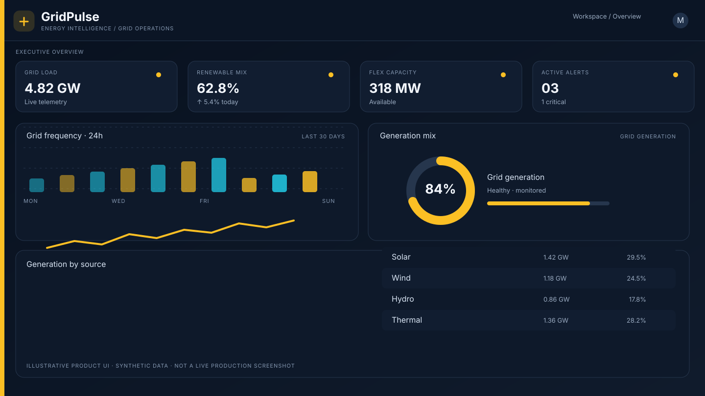
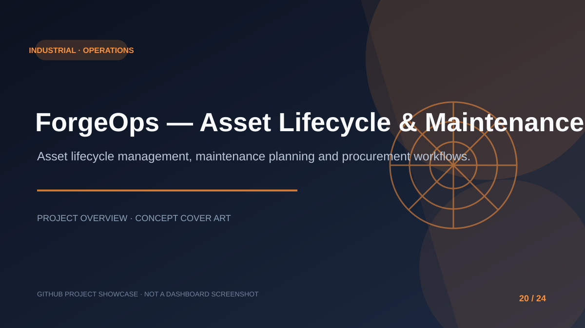
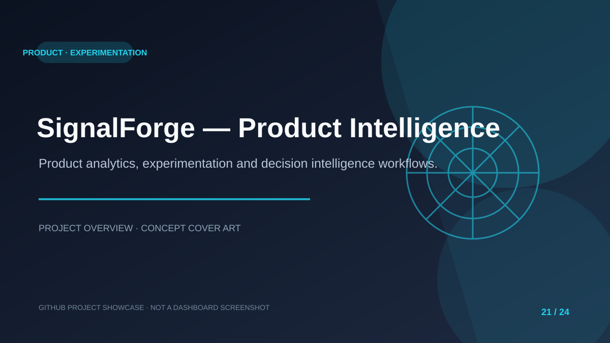

# Matiur Rahaman | Full-Stack Developer

<p align="center">
  <a href="https://github.com/matiur25580/Developer-Portfolio"></a>
  <a href="https://github.com/matiur25580"></a>
  <a href="mailto:rahamanmatiur397@gmail.com"></a>
</p>

<p align="center">
  <strong>Building useful web products, thoughtful user experiences, and full-stack solutions.</strong><br>
  React · TypeScript · Node.js · Express · MongoDB · AI Integrations
</p>

---

## Screenshots

Capture the actual deployed portfolio after the latest production deployment. The [screenshot capture guide](docs/screenshots/README.md) lists the exact sections to capture. Only screenshots of this portfolio belong in this gallery; do not reuse images from the other projects.

## About

I'm **Matiur Rahaman**, a full-stack developer based in West Bengal, India. I enjoy designing and building web applications that bring together clean interfaces, reliable APIs, data-driven workflows, and practical integrations.

This repository contains my personal portfolio website and a curated overview of **24 GitHub projects** across recruitment, AI tools, fintech, logistics, healthcare, e-commerce, collaboration, and business operations.

- **Portfolio source:** [Developer-Portfolio](https://github.com/matiur25580/Developer-Portfolio)
- **GitHub:** [github.com/matiur25580](https://github.com/matiur25580)
- **Email:** [rahamanmatiur397@gmail.com](mailto:rahamanmatiur397@gmail.com)
- **Location:** West Bengal, India

## Portfolio at a Glance

| | |
|---|---|
| **Projects showcased** | 24 public repositories (excluding this portfolio) |
| **Core focus** | Full-stack web development |
| **Frontend** | React, TypeScript, JavaScript, Preact, Vite |
| **Backend** | Node.js, Express.js, REST APIs, PHP |
| **Data** | MongoDB, Mongoose, MySQL |
| **Interests** | AI-assisted products, secure workflows, dashboards, real-time apps |

## Featured Work

A selection of projects from the full catalogue. Open a repository to explore its source code, setup instructions, screenshots, and implementation notes.

| Project | Area | Technology / focus |
|---|---|---|
| [HireFlow — ATS Recruitment System](https://github.com/matiur25580/ats-recruitment-system) | Recruitment · AI | React, TypeScript, Node.js, Express, MongoDB, Gemini |
| [TrustShield — Banking Fraud Detection](https://github.com/matiur25580/Enterprise-AI-Powered-Digital-Banking-Fraud-Detection-DevOps-Command-Center) | FinTech · Security | MERN, JWT, OTP, real-time workflows |
| [FleetCommand — Logistics & Supply Chain](https://github.com/matiur25580/Enterprise-AI-Powered-Logistics-Fleet-Supply-Chain-Command-Center) | Enterprise · Logistics | React, Node.js, Express, MongoDB, Socket.IO |
| [CityCare Hospital Management](https://github.com/matiur25580/hospital-management-system) | Healthcare | MERN, JWT, OTP, hospital workflows |
| [Smart HR & Payroll](https://github.com/matiur25580/enterprise-hr-payroll-system) | HR · Enterprise | TypeScript, Preact, Express, MongoDB |
| [Multi-Vendor Marketplace](https://github.com/matiur25580/Enterprise-AI-Powered-Multi-Vendor-Marketplace-Seller-Ecosystem-Command-Center) | E-commerce | MERN, MongoDB, Brevo OTP |
| [SmartGadget Lifestyle MegaStore](https://github.com/matiur25580/Enterprise-AI-Powered-SmartGadget-Lifestyle-MegaStore-Command-Center) | E-commerce | MERN, JWT, OTP |
| [Draftline AI Writing Studio](https://github.com/matiur25580/ai-saas-generator) | AI · SaaS | React, Vite, Express, MongoDB, Gemini |
| [FinTech Smart Invoice & Expense](https://github.com/matiur25580/FinTech-Smart-Invoice-Expense-Supplier-Payment-System) | FinTech | React, TypeScript, Node.js, Express, MongoDB |
| [Cyber Security Operations Command Center](https://github.com/matiur25580/Enterprise-AI-Powered-Cyber-Security-Operations-Command-Center) | Cybersecurity | React, Vite, TypeScript, Node.js, Express, MongoDB |
| [PulseOps — Enterprise Developer Platform](https://github.com/matiur25580/PulseOps-Enterprise-Developer-Platform) | DevOps · SRE · FinOps | Next.js, React, TypeScript, NestJS, PostgreSQL, Prisma, Docker |

## All 24 Projects

All public projects in this GitHub account are listed below. This personal portfolio repository is intentionally excluded.

### Enterprise platforms & operations

| # | Project | Overview | Repository |
|---:|---|---|---|
| 01 | **ContractSphere — Contract Lifecycle Intelligence** | Contract lifecycle, approvals, obligations and legal operations. | [Source](https://github.com/matiur25580/ContractSphere-Enterprise-Contract-Lifecycle-Intelligence-Platform) |
| 02 | **FinSight — Cloud FinOps Intelligence** | Cloud cost visibility, resource insights and optimization workflows. | [Source](https://github.com/matiur25580/enterprise-cloud-finsight-platform) |
| 03 | **PrivaOps — Privacy & Data Lifecycle** | Privacy request operations, verification and data lifecycle controls. | [Source](https://github.com/matiur25580/PrivaOps-Enterprise-Privacy-Data-Lifecycle-Platform) |
| 04 | **GridPulse — Energy Intelligence** | Energy telemetry, grid flexibility and operational intelligence. | [Source](https://github.com/matiur25580/GridPulse-Enterprise-Energy-Intelligence-Grid-Flexibility-Platform) |
| 05 | **ForgeOps — Asset Lifecycle & Maintenance** | Asset lifecycle, maintenance planning and procurement workflows. | [Source](https://github.com/matiur25580/ForgeOps-Enterprise-Asset-Lifecycle-Predictive-Maintenance-Platform) |
| 06 | **FleetCommand — Logistics & Supply Chain** | Fleet, trips, warehouse and supply-chain operations. | [Source](https://github.com/matiur25580/Enterprise-AI-Powered-Logistics-Fleet-Supply-Chain-Command-Center) |
| 07 | **PulseOps — Enterprise Developer Platform** | Service ownership, observability, incident response, SRE and FinOps. | [Source](https://github.com/matiur25580/PulseOps-Enterprise-Developer-Platform) |
| 08 | **CarbonLedger — ESG & Carbon Accounting** | Carbon accounting, emissions reporting and sustainability operations. | [Source](https://github.com/matiur25580/CarbonLedger-Enterprise-ESG-Carbon-Accounting-Platform) |
| 09 | **SentinelAI — AI Governance & Risk** | AI governance, risk intelligence and model oversight workflows. | [Source](https://github.com/matiur25580/SentinelAI-Enterprise-AI-Governance-Risk-Intelligence-Platform) |
| 10 | **SignalForge — Product Intelligence** | Product analytics, experimentation and decision intelligence. | [Source](https://github.com/matiur25580/SignalForge-Enterprise-Product-Intelligence-Experimentation-Platform) |
| 11 | **NexusID — Identity Security Governance** | Identity lifecycle, access governance and enterprise security. | [Source](https://github.com/matiur25580/NexusID-Enterprise-Identity-Security-Governance-Platform) |
| 12 | **Cyber Security Operations Command Center** | Defensive security operations and monitoring workflows. | [Source](https://github.com/matiur25580/Enterprise-AI-Powered-Cyber-Security-Operations-Command-Center) |

### Finance, commerce & business applications

| # | Project | Overview | Repository |
|---:|---|---|---|
| 13 | **TrustShield — Digital Banking & Fraud Detection** | Banking-style workflows, OTP, KYC and fraud-monitoring concepts. | [Source](https://github.com/matiur25580/Enterprise-AI-Powered-Digital-Banking-Fraud-Detection-DevOps-Command-Center) |
| 14 | **FinTech Smart Invoice & Expense System** | Invoice, expense and supplier-payment management. | [Source](https://github.com/matiur25580/FinTech-Smart-Invoice-Expense-Supplier-Payment-System) |
| 15 | **Multi-Vendor Marketplace Seller Ecosystem** | Buyer, seller, logistics and finance-oriented marketplace workflows. | [Source](https://github.com/matiur25580/Enterprise-AI-Powered-Multi-Vendor-Marketplace-Seller-Ecosystem-Command-Center) |
| 16 | **SmartGadget Lifestyle MegaStore** | E-commerce catalogue, seller workflows and ordering. | [Source](https://github.com/matiur25580/Enterprise-AI-Powered-SmartGadget-Lifestyle-MegaStore-Command-Center) |
| 17 | **Real Estate Management System** | Property, rental and real-estate management workflows. | [Source](https://github.com/matiur25580/realestate-management-system) |
| 18 | **Smart HR & Payroll Management** | Employee, attendance, leave and payroll workflows. | [Source](https://github.com/matiur25580/enterprise-hr-payroll-system) |
| 19 | **CityCare Hospital Management** | Patient registration, appointments and hospital operations. | [Source](https://github.com/matiur25580/hospital-management-system) |

### AI, recruitment & collaboration

| # | Project | Overview | Repository |
|---:|---|---|---|
| 20 | **HireFlow — ATS Recruitment System** | Candidate/recruiter workflows and AI-assisted resume analysis. | [Source](https://github.com/matiur25580/ats-recruitment-system) |
| 21 | **Draftline AI Writing Studio** | AI-assisted content generation and writing workflows. | [Source](https://github.com/matiur25580/ai-saas-generator) |
| 22 | **Real-Time Chat & Collaboration Hub** | Authenticated chat, online presence and realtime messaging. | [Source](https://github.com/matiur25580/Enterprise-Real-Time-Chat-Collaboration-Hub) |
| 23 | **Trello Clone** | Kanban-inspired boards and task organization. | [Source](https://github.com/matiur25580/Trello-Clone) |
| 24 | **Online Food Ordering System** | Restaurant, menu and food-ordering academic team project. | [Source](https://github.com/matiur25580/Online-Food-Ordering-System-main) |

> **Transparency note:** These repositories represent projects at different stages of implementation. The descriptions above summarize their focus; they do not imply that every planned feature or integration is complete or production-deployed. Please refer to each repository's README and source code for its current status. The Online Food Ordering System was an academic team project; my documented contribution was frontend UI work. The Cyber Security Command Center is an evolving project, so its broader SOC/SIEM/SOAR/GRC direction should not be mistaken for a fully implemented feature set.

## Complete Project Visual Gallery

**24 projects · 24 cover illustrations.** The gallery below contains one project-specific cover illustration per repository. These are concept cover artworks, not dashboard screenshots or claims about a live production deployment. The portfolio itself is excluded from this project gallery.

<h3>01 · HireFlow — ATS Recruitment System</h3>

<a href="https://github.com/matiur25580/ats-recruitment-system"><strong>View repository</strong></a>

<a href="https://raw.githubusercontent.com/matiur25580/Developer-Portfolio/main/client/public/projects/preview-hireflow.svg"></a>

<p align="right"><a href="https://developer-portfolio-client.vercel.app/#project-hireflow" title="Open the interactive gallery and swipe through all six images">➡️</a></p>


---

<h3>02 · TrustShield — Banking Fraud Detection</h3>

<a href="https://github.com/matiur25580/Enterprise-AI-Powered-Digital-Banking-Fraud-Detection-DevOps-Command-Center"><strong>View repository</strong></a>

<a href="https://raw.githubusercontent.com/matiur25580/Developer-Portfolio/main/client/public/projects/p5.png"></a>

<p align="right"><a href="https://developer-portfolio-client.vercel.app/#project-trustshield" title="Open the interactive gallery and swipe through all six images">➡️</a></p>


---

<h3>03 · FleetCommand — Logistics & Supply Chain</h3>

<a href="https://github.com/matiur25580/Enterprise-AI-Powered-Logistics-Fleet-Supply-Chain-Command-Center"><strong>View repository</strong></a>

<a href="https://raw.githubusercontent.com/matiur25580/Developer-Portfolio/main/client/public/projects/p4.png"></a>

<p align="right"><a href="https://developer-portfolio-client.vercel.app/#project-fleetcommand" title="Open the interactive gallery and swipe through all six images">➡️</a></p>


---

<h3>04 · SmartGadget Lifestyle MegaStore</h3>

<a href="https://github.com/matiur25580/Enterprise-AI-Powered-SmartGadget-Lifestyle-MegaStore-Command-Center"><strong>View repository</strong></a>

<a href="https://raw.githubusercontent.com/matiur25580/Developer-Portfolio/main/client/public/projects/preview-smartgadget.svg"></a>

<p align="right"><a href="https://developer-portfolio-client.vercel.app/#project-smartgadget" title="Open the interactive gallery and swipe through all six images">➡️</a></p>


---

<h3>05 · CityCare Hospital Management</h3>

<a href="https://github.com/matiur25580/hospital-management-system"><strong>View repository</strong></a>

<a href="https://raw.githubusercontent.com/matiur25580/Developer-Portfolio/main/client/public/projects/p2.png"></a>

<p align="right"><a href="https://developer-portfolio-client.vercel.app/#project-citycare" title="Open the interactive gallery and swipe through all six images">➡️</a></p>


---

<h3>06 · Draftline AI Writing Studio</h3>

<a href="https://github.com/matiur25580/ai-saas-generator"><strong>View repository</strong></a>

<a href="https://raw.githubusercontent.com/matiur25580/Developer-Portfolio/main/client/public/projects/preview-draftline.svg"></a>

<p align="right"><a href="https://developer-portfolio-client.vercel.app/#project-draftline" title="Open the interactive gallery and swipe through all six images">➡️</a></p>


---

<h3>07 · Real Estate Management System</h3>

<a href="https://github.com/matiur25580/realestate-management-system"><strong>View repository</strong></a>

<a href="https://raw.githubusercontent.com/matiur25580/Developer-Portfolio/main/client/public/projects/p3.png"></a>

<p align="right"><a href="https://developer-portfolio-client.vercel.app/#project-realestate" title="Open the interactive gallery and swipe through all six images">➡️</a></p>


---

<h3>08 · Real-Time Chat & Collaboration Hub</h3>

<a href="https://github.com/matiur25580/Enterprise-Real-Time-Chat-Collaboration-Hub"><strong>View repository</strong></a>

<a href="https://raw.githubusercontent.com/matiur25580/Developer-Portfolio/main/client/public/projects/preview-chat.svg"></a>

<p align="right"><a href="https://developer-portfolio-client.vercel.app/#project-chat" title="Open the interactive gallery and swipe through all six images">➡️</a></p>


---

<h3>09 · Trello Clone</h3>

<a href="https://github.com/matiur25580/Trello-Clone"><strong>View repository</strong></a>

<a href="https://raw.githubusercontent.com/matiur25580/Developer-Portfolio/main/client/public/projects/preview-trello.svg"></a>

<p align="right"><a href="https://developer-portfolio-client.vercel.app/#project-trello" title="Open the interactive gallery and swipe through all six images">➡️</a></p>


---

<h3>10 · Online Food Ordering System</h3>

<a href="https://github.com/matiur25580/Online-Food-Ordering-System-main"><strong>View repository</strong></a>

<a href="https://raw.githubusercontent.com/matiur25580/Developer-Portfolio/main/client/public/projects/preview-food-order.svg"></a>

<p align="right"><a href="https://developer-portfolio-client.vercel.app/#project-foodorder" title="Open the interactive gallery and swipe through all six images">➡️</a></p>


---

<h3>11 · Smart HR & Payroll Management</h3>

<a href="https://github.com/matiur25580/enterprise-hr-payroll-system"><strong>View repository</strong></a>

<a href="https://raw.githubusercontent.com/matiur25580/Developer-Portfolio/main/client/public/projects/p1.webp"></a>

<p align="right"><a href="https://developer-portfolio-client.vercel.app/#project-hrpayroll" title="Open the interactive gallery and swipe through all six images">➡️</a></p>


---

<h3>12 · Multi-Vendor Marketplace Seller Ecosystem</h3>

<a href="https://github.com/matiur25580/Enterprise-AI-Powered-Multi-Vendor-Marketplace-Seller-Ecosystem-Command-Center"><strong>View repository</strong></a>

<a href="https://raw.githubusercontent.com/matiur25580/Developer-Portfolio/main/client/public/projects/p6.png"></a>

<p align="right"><a href="https://developer-portfolio-client.vercel.app/#project-marketplace" title="Open the interactive gallery and swipe through all six images">➡️</a></p>


---

<h3>13 · FinTech Smart Invoice & Expense System</h3>

<a href="https://github.com/matiur25580/FinTech-Smart-Invoice-Expense-Supplier-Payment-System"><strong>View repository</strong></a>

<a href="https://raw.githubusercontent.com/matiur25580/Developer-Portfolio/main/client/public/projects/preview-fintech.svg"></a>

<p align="right"><a href="https://developer-portfolio-client.vercel.app/#project-fintech" title="Open the interactive gallery and swipe through all six images">➡️</a></p>


---

<h3>14 · Cyber Security Operations Command Center</h3>

<a href="https://github.com/matiur25580/Enterprise-AI-Powered-Cyber-Security-Operations-Command-Center"><strong>View repository</strong></a>

<a href="https://raw.githubusercontent.com/matiur25580/Developer-Portfolio/main/client/public/projects/preview-cyber.svg"></a>

<p align="right"><a href="https://developer-portfolio-client.vercel.app/#project-cyber" title="Open the interactive gallery and swipe through all six images">➡️</a></p>


---

---

<h3>15 · PulseOps — Enterprise Developer Platform</h3>

<a href="https://github.com/matiur25580/PulseOps-Enterprise-Developer-Platform"><strong>View repository</strong></a>

<a href="https://raw.githubusercontent.com/matiur25580/Developer-Portfolio/main/client/public/projects/pulseops-overview.svg"></a>

<p align="right"><a href="https://developer-portfolio-client.vercel.app/#project-pulseops" title="Open the interactive gallery and swipe through all six images">➡️</a></p>

<sub>Gallery assets: Platform Overview, Service Catalog, Incident Command, SLO &amp; Error Budgets, Observability Explorer, and Alert Management. These are illustrative UI concepts sourced from the PulseOps repository, not screenshots of a live production deployment.</sub>


---

<h3>16 · ContractSphere — Contract Lifecycle Intelligence</h3>

<a href="https://github.com/matiur25580/ContractSphere-Enterprise-Contract-Lifecycle-Intelligence-Platform"><strong>View repository</strong></a>

<a href="https://raw.githubusercontent.com/matiur25580/Developer-Portfolio/main/client/public/projects/gallery-contractsphere.svg"></a>

<p align="right"><a href="https://developer-portfolio-client.vercel.app/#project-contractsphere" title="Open the interactive gallery and browse all six images">➡️</a></p>

<sub>LegalTech · Enterprise · Contract authoring, approvals, obligations and lifecycle intelligence. This is project cover artwork, not a dashboard screenshot.</sub>


---

<h3>17 · FinSight — Cloud FinOps Intelligence</h3>

<a href="https://github.com/matiur25580/enterprise-cloud-finsight-platform"><strong>View repository</strong></a>

<a href="https://raw.githubusercontent.com/matiur25580/Developer-Portfolio/main/client/public/projects/gallery-finsight.svg"></a>

<p align="right"><a href="https://developer-portfolio-client.vercel.app/#project-finsight" title="Open the interactive gallery and browse all six images">➡️</a></p>

<sub>Cloud · FinOps · Cloud cost visibility, resource insights and optimization workflows. This is project cover artwork, not a dashboard screenshot.</sub>


---

<h3>18 · PrivaOps — Privacy & Data Lifecycle</h3>

<a href="https://github.com/matiur25580/PrivaOps-Enterprise-Privacy-Data-Lifecycle-Platform"><strong>View repository</strong></a>

<a href="https://raw.githubusercontent.com/matiur25580/Developer-Portfolio/main/client/public/projects/gallery-privaops.svg"></a>

<p align="right"><a href="https://developer-portfolio-client.vercel.app/#project-privaops" title="Open the interactive gallery and browse all six images">➡️</a></p>

<sub>Privacy · Governance · Privacy request operations, identity verification and data lifecycle controls. This is project cover artwork, not a dashboard screenshot.</sub>


---

<h3>19 · GridPulse — Energy Intelligence</h3>

<a href="https://github.com/matiur25580/GridPulse-Enterprise-Energy-Intelligence-Grid-Flexibility-Platform"><strong>View repository</strong></a>

<a href="https://raw.githubusercontent.com/matiur25580/Developer-Portfolio/main/client/public/projects/gallery-gridpulse.svg"></a>

<p align="right"><a href="https://developer-portfolio-client.vercel.app/#project-gridpulse" title="Open the interactive gallery and browse all six images">➡️</a></p>

<sub>Energy · Sustainability · Energy telemetry, grid flexibility and operational intelligence. This is project cover artwork, not a dashboard screenshot.</sub>


---

<h3>20 · ForgeOps — Asset Lifecycle & Maintenance</h3>

<a href="https://github.com/matiur25580/ForgeOps-Enterprise-Asset-Lifecycle-Predictive-Maintenance-Platform"><strong>View repository</strong></a>

<a href="https://raw.githubusercontent.com/matiur25580/Developer-Portfolio/main/client/public/projects/gallery-forgeops.svg"></a>

<p align="right"><a href="https://developer-portfolio-client.vercel.app/#project-forgeops" title="Open the interactive gallery and browse all six images">➡️</a></p>

<sub>Industrial · Operations · Asset lifecycle management, maintenance planning and procurement workflows. This is project cover artwork, not a dashboard screenshot.</sub>


---

<h3>21 · SignalForge — Product Intelligence</h3>

<a href="https://github.com/matiur25580/SignalForge-Enterprise-Product-Intelligence-Experimentation-Platform"><strong>View repository</strong></a>

<a href="https://raw.githubusercontent.com/matiur25580/Developer-Portfolio/main/client/public/projects/gallery-signalforge.svg"></a>

<p align="right"><a href="https://developer-portfolio-client.vercel.app/#project-signalforge" title="Open the interactive gallery and browse all six images">➡️</a></p>

<sub>Product · Experimentation · Product analytics, experimentation and decision intelligence workflows. This is project cover artwork, not a dashboard screenshot.</sub>


---

<h3>22 · CarbonLedger — ESG & Carbon Accounting</h3>

<a href="https://github.com/matiur25580/CarbonLedger-Enterprise-ESG-Carbon-Accounting-Platform"><strong>View repository</strong></a>

<a href="https://raw.githubusercontent.com/matiur25580/Developer-Portfolio/main/client/public/projects/gallery-carbonledger.svg"></a>

<p align="right"><a href="https://developer-portfolio-client.vercel.app/#project-carbonledger" title="Open the interactive gallery and browse all six images">➡️</a></p>

<sub>ESG · Sustainability · Carbon accounting, emissions reporting and sustainability operations. This is project cover artwork, not a dashboard screenshot.</sub>


---

<h3>23 · NexusID — Identity Security Governance</h3>

<a href="https://github.com/matiur25580/NexusID-Enterprise-Identity-Security-Governance-Platform"><strong>View repository</strong></a>

<a href="https://raw.githubusercontent.com/matiur25580/Developer-Portfolio/main/client/public/projects/gallery-nexusid.svg"></a>

<p align="right"><a href="https://developer-portfolio-client.vercel.app/#project-nexusid" title="Open the interactive gallery and browse all six images">➡️</a></p>

<sub>Identity · Security · Identity lifecycle, access governance and enterprise security workflows. This is project cover artwork, not a dashboard screenshot.</sub>


---

<h3>24 · SentinelAI — AI Governance & Risk</h3>

<a href="https://github.com/matiur25580/SentinelAI-Enterprise-AI-Governance-Risk-Intelligence-Platform"><strong>View repository</strong></a>

<a href="https://raw.githubusercontent.com/matiur25580/Developer-Portfolio/main/client/public/projects/gallery-sentinelai.svg"></a>

<p align="right"><a href="https://developer-portfolio-client.vercel.app/#project-sentinelai" title="Open the interactive gallery and browse all six images">➡️</a></p>

<sub>AI · Governance · AI governance, risk intelligence and model oversight workflows. This is project cover artwork, not a dashboard screenshot.</sub>

## Technology Stack

| Category | Technologies |
|---|---|
| **Frontend** | React, TypeScript, JavaScript, Preact, Vite, Tailwind CSS, HTML, CSS, Bootstrap |
| **Backend** | Node.js, Express.js, REST APIs, PHP |
| **Database** | MongoDB, Mongoose, MySQL |
| **Authentication** | JWT, bcrypt, OTP workflows, role-based access control |
| **Real-time & AI** | Socket.IO, Gemini API, AI-assisted workflows |
| **Tools & delivery** | Git, GitHub, GitHub Actions, Postman, Vercel, Render |

## Education

**B.Tech — Computer Science & Engineering**  
Bengal Institute of Technology, Kolkata · MAKAUT  
2019–2023

## Run This Portfolio Locally

The application source is organized in the `client` directory. To run the frontend locally:

```bash
cd client
npm install
npm run dev
```

To create a production build:

```bash
npm run build
```

Check the `client/package.json` and project configuration for the exact scripts and any environment variables required by your checkout.

## Connect

- **Email:** [rahamanmatiur397@gmail.com](mailto:rahamanmatiur397@gmail.com)
- **GitHub:** [matiur25580](https://github.com/matiur25580)
- **Portfolio source:** [Developer-Portfolio](https://github.com/matiur25580/Developer-Portfolio)

---

## Additional Interactive Project Galleries

The following projects also open their six-image interactive galleries on the portfolio website. These visual previews are illustrative concept artwork, not live application screenshots.

---

<h3>16 · ContractSphere — Contract Lifecycle Intelligence</h3>

<a href="https://github.com/matiur25580/ContractSphere-Enterprise-Contract-Lifecycle-Intelligence-Platform"><strong>View repository</strong></a>

<a href="https://raw.githubusercontent.com/matiur25580/Developer-Portfolio/main/client/public/projects/gallery-contractsphere.svg"></a>

<p align="right"><a href="https://developer-portfolio-client.vercel.app/#project-contractsphere" title="Open the interactive gallery and browse all six images">➡️</a></p>


---

<h3>17 · FinSight — Cloud FinOps Intelligence</h3>

<a href="https://github.com/matiur25580/enterprise-cloud-finsight-platform"><strong>View repository</strong></a>

<a href="https://raw.githubusercontent.com/matiur25580/Developer-Portfolio/main/client/public/projects/gallery-finsight.svg"></a>

<p align="right"><a href="https://developer-portfolio-client.vercel.app/#project-finsight" title="Open the interactive gallery and browse all six images">➡️</a></p>


---

<h3>18 · PrivaOps — Privacy & Data Lifecycle</h3>

<a href="https://github.com/matiur25580/PrivaOps-Enterprise-Privacy-Data-Lifecycle-Platform"><strong>View repository</strong></a>

<a href="https://raw.githubusercontent.com/matiur25580/Developer-Portfolio/main/client/public/projects/gallery-privaops.svg"></a>

<p align="right"><a href="https://developer-portfolio-client.vercel.app/#project-privaops" title="Open the interactive gallery and browse all six images">➡️</a></p>


---

<h3>19 · GridPulse — Energy Intelligence</h3>

<a href="https://github.com/matiur25580/GridPulse-Enterprise-Energy-Intelligence-Grid-Flexibility-Platform"><strong>View repository</strong></a>

<a href="https://raw.githubusercontent.com/matiur25580/Developer-Portfolio/main/client/public/projects/gallery-gridpulse.svg"></a>

<p align="right"><a href="https://developer-portfolio-client.vercel.app/#project-gridpulse" title="Open the interactive gallery and browse all six images">➡️</a></p>


---

<h3>20 · ForgeOps — Asset Lifecycle & Maintenance</h3>

<a href="https://github.com/matiur25580/ForgeOps-Enterprise-Asset-Lifecycle-Predictive-Maintenance-Platform"><strong>View repository</strong></a>

<a href="https://raw.githubusercontent.com/matiur25580/Developer-Portfolio/main/client/public/projects/gallery-forgeops.svg"></a>

<p align="right"><a href="https://developer-portfolio-client.vercel.app/#project-forgeops" title="Open the interactive gallery and browse all six images">➡️</a></p>


---

<h3>21 · CarbonLedger — ESG & Carbon Accounting</h3>

<a href="https://github.com/matiur25580/CarbonLedger-Enterprise-ESG-Carbon-Accounting-Platform"><strong>View repository</strong></a>

<a href="https://raw.githubusercontent.com/matiur25580/Developer-Portfolio/main/client/public/projects/gallery-carbonledger.svg"></a>

<p align="right"><a href="https://developer-portfolio-client.vercel.app/#project-carbonledger" title="Open the interactive gallery and browse all six images">➡️</a></p>


---

<h3>22 · SentinelAI — AI Governance & Risk</h3>

<a href="https://github.com/matiur25580/SentinelAI-Enterprise-AI-Governance-Risk-Intelligence-Platform"><strong>View repository</strong></a>

<a href="https://raw.githubusercontent.com/matiur25580/Developer-Portfolio/main/client/public/projects/gallery-sentinelai.svg"></a>

<p align="right"><a href="https://developer-portfolio-client.vercel.app/#project-sentinelai" title="Open the interactive gallery and browse all six images">➡️</a></p>


---

<h3>23 · SignalForge — Product Intelligence</h3>

<a href="https://github.com/matiur25580/SignalForge-Enterprise-Product-Intelligence-Experimentation-Platform"><strong>View repository</strong></a>

<a href="https://raw.githubusercontent.com/matiur25580/Developer-Portfolio/main/client/public/projects/gallery-signalforge.svg"></a>

<p align="right"><a href="https://developer-portfolio-client.vercel.app/#project-signalforge" title="Open the interactive gallery and browse all six images">➡️</a></p>


---

<h3>24 · NexusID — Identity Security Governance</h3>

<a href="https://github.com/matiur25580/NexusID-Enterprise-Identity-Security-Governance-Platform"><strong>View repository</strong></a>

<a href="https://raw.githubusercontent.com/matiur25580/Developer-Portfolio/main/client/public/projects/gallery-nexusid.svg"></a>

<p align="right"><a href="https://developer-portfolio-client.vercel.app/#project-nexusid" title="Open the interactive gallery and browse all six images">➡️</a></p>

<p align="center">
  <strong>Designed and maintained by Matiur Rahaman</strong><br>
  <sub>Learning, building, improving — one project at a time.</sub>
</p>

